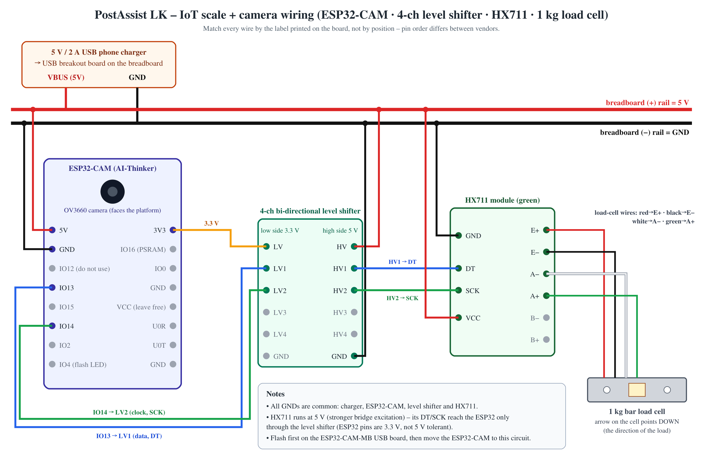

# IoT Scale + Envelope Camera – Step-by-Step Hardware Setup Guide

**Component:** Smart Registered Mail Intake and Tracking (PostAssist LK, J26-IT-372, IT23324138)
**Device:** one ESP32-CAM (OV3660) that **weighs** the letter (HX711 + 1 kg load cell) **and photographs** the envelope lying on the platform, connected to the FastAPI backend over Wi-Fi.
**Firmware:** [`iot/postassist_scale_cam/`](../iot/postassist_scale_cam/) – compiled and verified with ESP32 Arduino core 3.3.12, ArduinoJson 7.4.3 and HX711 Arduino Library 0.7.5 (1.19 MB, 38 % of the "Huge APP" partition).



---

## Contents
1. [What you bought and what each part does](#1-what-you-bought-and-what-each-part-does)
2. [Extra items you still need](#2-extra-items-you-still-need)
3. [Safety rules](#3-safety-rules)
4. [How the device fits into the system](#4-how-the-device-fits-into-the-system)
5. [Step 1 – Build the scale (load cell + wooden bracket)](#step-1--build-the-scale-load-cell--wooden-bracket)
6. [Step 2 – Prepare the modules (headers, load-cell wires)](#step-2--prepare-the-modules)
7. [Step 3 – Install Arduino IDE, the ESP32 board package and libraries](#step-3--install-arduino-ide-the-esp32-board-package-and-libraries)
8. [Step 4 – Configure the firmware](#step-4--configure-the-firmware-configh)
9. [Step 5 – Flash the ESP32-CAM (on the USB programmer board)](#step-5--flash-the-esp32-cam)
10. [Step 6 – Wire the circuit (pin-by-pin table)](#step-6--wire-the-circuit)
11. [Step 7 – Power on and first checks](#step-7--power-on-and-first-checks)
12. [Step 8 – Connect the device to the PostAssist system](#step-8--connect-the-device-to-the-postassist-system)
13. [Step 9 – Tare and calibrate](#step-9--tare-and-calibrate)
14. [Step 10 – Mount and test the camera](#step-10--mount-and-test-the-camera)
15. [Step 11 – Weighing trials and measurement uncertainty](#step-11--weighing-trials-and-measurement-uncertainty)
16. [Step 12 – Use it at the counter](#step-12--use-it-at-the-counter)
17. [Troubleshooting](#troubleshooting)
18. [Device ↔ backend protocol reference](#device--backend-protocol-reference)
19. [Working without the hardware (simulator)](#working-without-the-hardware-simulator)

---

## 1. What you bought and what each part does

| # | Item (from your cart) | Price (LKR) | Role in the system |
|---|---|---:|---|
| 1 | ESP32 CAM Dev Board – OV3660 3 MP camera | 2,750.00 | The "brain": Wi-Fi microcontroller + camera. Reads the HX711, photographs the envelope, talks to the backend. |
| 2 | Load Cell 1 kg | 450.00 | Strain-gauge bar that bends very slightly under the letter's weight. |
| 3 | HX711 24-bit ADC module | 160.00 | Amplifies and digitises the tiny load-cell signal (millivolts) for the ESP32. |
| 4 | Optimus Load Cell Bracket – Wood | 600.00 | Base and top plate that hold the bar load cell correctly (one end fixed, one end loaded). |
| 5 | 4-ch bi-directional logic level shifter (3.3 V ↔ 5 V) | 100.00 | Lets the 5 V-powered HX711 talk safely to the 3.3 V ESP32 pins. |
| 6 | Jumper wires female–female (1×40) | 160.00 | Connections between modules. |
| | Sub-total / shipping / **grand total** | 4,220.00 / 580.00 / **4,800.00** | Proposal allowance for hardware: Rs. 10,500 (items 1–3 of Table 13) – you are within budget. |

**Programming board:** the Tronic.lk OV3660 board ships **without** the USB programming base. Buy the **ESP32 CAM Adapter Board (MD0699)** – an ESP32-CAM-MB with a micro-USB socket and an *IO0* button – to upload the firmware (see §2). A USB-TTL module also works: [Flashing without the MB board](#flashing-without-the-esp32-cam-mb-board).

**Why one board for both jobs?** The weight and the photo of the *same* envelope are captured by the *same* device at the *same* place – the envelope is photographed while it lies on the scale. This keeps the hardware cost low and makes it impossible to pair the photo of one letter with the weight of another.

## 2. Extra items you still need

The Tronic.lk "ESP32 CAM Dev Board OV3660" is the camera board **only** – its listing says programming needs a
USB-TTL adapter – so the USB programming board is the first missing item. Codes and prices are Tronic.lk's
(checked 2 Oct 2026; confirm before ordering).

**Must buy (≈ Rs 1,050 + delivery):**

| # | Item | Tronic.lk code | Price (LKR) | Why it is needed |
|---|---|---|---:|---|
| 1 | ESP32 CAM Adapter Board (ESP32-CAM-MB, CH340, micro-USB, IO0 button) | MD0699 | 400 | Uploads the firmware and shows the serial log. Without it (or a USB-TTL module) you cannot program the ESP32-CAM. |
| 2 | 400-point breadboard | TA0164 | 160 | Shared 5 V and GND rails for the ESP32-CAM, level shifter and HX711. |
| 3 | Jumper wires male-to-female 20 cm (1×40) | TA0027 | 190 | ESP32-CAM pins are male, breadboard holes need male plugs. The long 30 cm version (TA0117) is better for the camera on its stand. |
| 4 | Jumper wires male-to-male (1×40) | TA0026 | ~160–190 | Breadboard links (rails, short hops). |
| 5 | Micro-USB to DIP adapter 5-pin | MD0469 | 50 | Brings the charger's 5 V and GND onto the breadboard (use VCC and GND pins). Do **not** use MD0231 – it is limited to 500 mA, too little for Wi-Fi + camera. |
| 6 | 1000 µF 16 V electrolytic capacitor | CA0124 | 15 | Across 5 V/GND next to the ESP32-CAM; absorbs Wi-Fi/camera current spikes that cause "brownout" resets. Long leg (+) to 5 V. |
| 7 | 40-pin male header strip (×2) | HE0002 | 15 each | For the HX711 and level-shifter modules if their pins are not soldered. |

**Must have, but probably already available:**

| Item | Approx. LKR | Why |
|---|---:|---|
| 5 V / 2 A phone charger + micro-USB **data** cable | existing | Powers the circuit; the same cable connects the MD0699 to the laptop. Charge-only cables do not work for uploading. |
| Soldering iron, solder (and flux) | lab | Header pins on the modules; the load-cell wires to the HX711 pads. |
| **Reference masses** – e.g. a calibration weight set with 10, 20, 50, 100, 200, 500 g (class M1 or better), *or* access to the post office's approved scale | 2,000–4,000 (proposal budget Rs 4,000) | Calibration and the 10×10 trials (SO2). Coins and kitchen scales are not reliable references. A 0.01 g pocket scale can be a secondary check, not the reference. |
| Camera stand – a gooseneck phone/lamp holder or a simple wooden L-arm | 300–800 | Holds the ESP32-CAM 28–32 cm above the platform, lens down. |
| Desk lamp with diffuse light | existing | Even light, no glare on glossy envelopes. |
| M4/M5 screws and spacers (check whether the wooden bracket includes them) | ~100 | Mounting the 1 kg bar load cell. |

**Optional (only if you need them):** USB barcode reader for label verification at the counter (the phone app or
typing the ID also works); digital multimeter for checking 5 V / 3.3 V; a second ESP32-CAM as a spare.

**Not needed:** microSD card (the firmware deliberately leaves the SD slot unused so GPIO13/14 are free), an external
antenna, a separate FTDI/CP2102 USB-TTL module (MD0699 replaces it), a relay or display.

## 3. Safety rules

1. **Unplug power while wiring.** Re-check every connection before powering on.
2. **Never connect 5 V to the ESP32-CAM 3V3 pin** and never connect HX711 DT/SCK (5 V logic) directly to the ESP32 – always through the level shifter (or use Option B in Step 6).
3. Do **not** press, bend or overload the middle (white, glued strain-gauge area) of the load cell. 1 kg is its *maximum*; the prototype range is 5–500 g.
4. Touch a grounded metal object before handling the boards (static).
5. The ESP32-CAM gets warm – that is normal. A *hot* regulator means a wiring fault: unplug immediately.
6. This DIY scale is a **research demonstrator**, not a legal-for-trade instrument (OIML R 76-1). Real charging must use the post office's approved scale (the system supports an audited manual weight for this).

## 4. How the device fits into the system

```
   envelope on the platform
            │ weight                         photo
   ┌────────▼────────┐  DT/SCK  ┌──────────┐     ┌─────────────┐
   │ load cell + HX711│────────►│ level    │────►│ ESP32-CAM    │  Wi-Fi (HTTP/HTTPS)
   └─────────────────┘  5 V     │ shifter  │3.3 V│ + OV3660     │────────────────────┐
                                 └──────────┘     └─────────────┘                    │
                                                                                     ▼
 React counter screen  ◄──── FastAPI backend (laptop, port 8000) ◄──── MongoDB
 (live weight, "Use this weight",    • POST /api/iot/readings  every 0.5 s  (net g, spread, stable,
  "Capture from scale camera")         loaded, placement #, calibration id)  → reply = queued commands
                                     • commands: tare | calibrate | capture | identify | reboot
                                     • POST /api/iot/captures/<id>  JPEG of the envelope
```

* The device **pushes** readings; the server answers with any queued commands. Nothing has to connect *to* the ESP32, so it also works behind routers and through HTTPS.
* Each reading carries a **placement number**. It only increases after the platform has been empty, so the server can refuse to reuse the previous letter's weight for a new letter (proposal test T03).
* The counter officer always presses **"Use this weight"**; a reading is accepted only if it is fresh (< 3 s), stable (spread ≤ 1 g over 1 s), within 5–500 g and from a calibrated scale.

---

## Step 1 – Build the scale (load cell + wooden bracket)

1. Look at the load cell: there is an **arrow** on one side and two threaded holes at **each** end (often one pair is M4, the other M5). The wires come out of one end.
2. Put the **base plate** of the bracket on the table. Fix the **wire end** of the load cell to the base with its spacer/riser so that the cell is lifted off the base (the cell must be able to bend).
3. Fix the **other end** to the **top plate** (the platform) with its spacer. The two plates must touch the cell only at the screw blocks.
4. Turn the cell so that the **arrow points down** – the direction in which the letter pushes.
5. Check: the middle of the cell (white glue area) touches **nothing**; there is a gap of a few millimetres between the plates; the platform moves slightly when pressed and springs back.
6. Tape the load-cell cable to the base plate (strain relief) so pulling the cable does not change the reading.
7. Place the scale on a **level, firm** table away from fans and air-conditioner outlets (air flow and vibration make readings unstable).

## Step 2 – Prepare the modules

1. **Solder header pins** onto the HX711 (`GND DT SCK VCC` side) and onto the level shifter (both sides) if they are not already soldered. Short side of the pins into the board, solder on the top.
2. **Connect the load cell to the HX711** – solder (best) or use the screw terminals if your HX711 has them:

| Load-cell wire | HX711 pad | Meaning |
|---|---|---|
| **Red** | **E+** | excitation + |
| **Black** | **E−** | excitation − |
| **White** | **A−** | signal − (channel A) |
| **Green** | **A+** | signal + (channel A) |

   *B−/B+ stay empty.* Some cells use other colours; check the seller's sheet. If the weight later reads **negative** when you press the platform, swap **white and green** (A−/A+).
3. Optional check with a multimeter (power off): red↔black ≈ 1 kΩ and white↔green ≈ 1 kΩ means the bridge is intact.

## Step 3 – Install Arduino IDE, the ESP32 board package and libraries

1. Install **Arduino IDE 2.x** from <https://www.arduino.cc/en/software>.
2. *File → Preferences → Additional boards manager URLs*, add:
   `https://espressif.github.io/arduino-esp32/package_esp32_index.json`
3. *Tools → Board → Boards Manager*, search **esp32**, install **"esp32 by Espressif Systems"** (version 3.x).
4. *Tools → Manage Libraries*, install:
   * **HX711 Arduino Library** by *Bogdan Necula* (not the library called just "HX711"),
   * **ArduinoJson** by *Benoit Blanchon* (version 7).
5. Open `iot/postassist_scale_cam/postassist_scale_cam.ino`.
6. Board settings (*Tools* menu):

| Setting | Value |
|---|---|
| Board | **AI Thinker ESP32-CAM** |
| Partition Scheme | **Huge APP (3MB No OTA/1MB SPIFFS)** |
| PSRAM | Enabled (default for this board) |
| Upload Speed | 460800 (use 115200 if uploads fail) |
| Port | the COM port that appears when the MB board is plugged in |

*Command-line alternative (what was used to verify the build):*
```bash
arduino-cli compile -b "esp32:esp32:esp32cam:PartitionScheme=huge_app" iot/postassist_scale_cam
```

## Step 4 – Configure the firmware (`config.h`)

1. In `iot/postassist_scale_cam/`, copy `config.example.h` to **`config.h`** (it is git-ignored, so your Wi-Fi password is never committed).
2. Edit `config.h`:

| Setting | What to put |
|---|---|
| `WIFI_SSID` / `WIFI_PASSWORD` | Your **2.4 GHz** Wi-Fi (the ESP32 cannot join 5 GHz networks). A phone hotspot works. |
| `API_BASE_URL` | `http://<laptop-IP>:8000` – find the laptop IP with `ipconfig` (look for *IPv4 Address* of the Wi-Fi adapter, e.g. `192.168.1.10`). No trailing slash. **Not** `localhost` – that would be the ESP32 itself. |
| `DEVICE_ID` | Same as `SEED_DEVICE_ID` in `backend/.env` (default `SCALECAM-01`). |
| `DEVICE_KEY` | Same as `SEED_DEVICE_KEY` in `backend/.env`. If you left it empty, the backend wrote a generated key to `backend/storage/seed_device_key.txt`. Admins can also register a new device (`POST /api/devices`), which returns a key once. |
| `ROOT_CA_PEM` | Only for an `https://` server: its root certificate. Leave empty for the lab (http). |
| Pins | Leave the defaults: `HX711_DOUT_PIN 13`, `HX711_SCK_PIN 14`. |

3. On the laptop, make sure the backend is reachable from the network:
   * start it with `--host 0.0.0.0` (see the run guide), and
   * allow inbound TCP **port 8000** in Windows Defender Firewall for *Private* networks (Windows usually asks the first time Python listens – choose *Allow* for private networks). Your Wi-Fi network profile must be *Private*, not *Public*.

## Step 5 – Flash the ESP32-CAM

1. Make sure the **camera ribbon** is firmly locked in the connector (lift the black latch, insert the ribbon with contacts facing the board, press the latch down).
2. Plug the **ESP32-CAM onto the ESP32-CAM-MB** adapter board (Tronic.lk **MD0699**) (the camera faces up, the MB's micro-USB socket is under the antenna end). Nothing else connected.
3. Connect the MB to the laptop with a **data** USB cable. A new COM port should appear (CH340 driver; Windows installs it automatically – otherwise install the WCH CH340 driver).
4. Press **Upload** in Arduino IDE. The MB board resets the ESP32 into download mode automatically.
   *If you see "Failed to connect to ESP32": hold the **IO0** button, press and release **RST**, release **IO0**, and press Upload again.*
5. When upload finishes, press **RST** on the MB board. Open *Serial Monitor* at **115200 baud**. You should see:
   ```
   PostAssist scale+camera pa-scalecam-1.0.0 (SCALECAM-01)
   [cam] sensor PID 0x3660
   [wifi] connected, IP 192.168.1.37
   [scale] calibration NONE, factor 2000.000, offset 0
   ```
   Write down the **IP address**. (Without the HX711 connected yet, the scale will report `sensor_ok=false` – that is expected.)
6. Open `http://<device-IP>/` in a browser on the same Wi-Fi and press **Test photo** – you should see a picture from the camera.

### Flashing without the ESP32-CAM-MB board
Use a USB-to-TTL adapter (FTDI/CP2102/CH340) set to **5 V** supply: adapter 5V→ESP32 **5V**, GND→**GND**, adapter **TX→U0R**, adapter **RX→U0T**, and connect **IO0 to GND** with a jumper during upload. Press the ESP32's RST button (underneath), upload, then remove the IO0–GND jumper and press RST again.

## Step 6 – Wire the circuit

Unplug power. Take the ESP32-CAM **off** the MB board (the MB is only needed for programming). Plug the HX711 and the level shifter into the breadboard so that each pin is in its own row.

### Option A (recommended – uses your level shifter): HX711 at 5 V

| # | From | To | Wire colour (suggested) | Notes |
|---|---|---|---|---|
| 1 | Micro-USB adapter (MD0469) **VCC** | breadboard **(+) rail** | red | 5 V supply for everything (charger → micro-USB cable → adapter) |
| 2 | Micro-USB adapter **GND** | breadboard **(−) rail** | black | common ground |
| 3 | ESP32-CAM **5V** | (+) rail | red | powers the ESP32-CAM |
| 4 | ESP32-CAM **GND** (the one next to 5V) | (−) rail | black | |
| 5 | ESP32-CAM **3V3** | level shifter **LV** | orange | 3.3 V reference for the low side |
| 6 | level shifter **HV** | (+) rail | red | 5 V reference for the high side |
| 7 | level shifter **GND** | (−) rail | black | either GND pin (they are connected on the board) |
| 8 | HX711 **VCC** | (+) rail | red | HX711 powered at 5 V |
| 9 | HX711 **GND** | (−) rail | black | |
| 10 | HX711 **DT** (or DOUT) | level shifter **HV1** | blue | data, 5 V side |
| 11 | level shifter **LV1** | ESP32-CAM **IO13** | blue | data, 3.3 V side |
| 12 | HX711 **SCK** (or CLK / PD_SCK) | level shifter **HV2** | green | clock, 5 V side |
| 13 | level shifter **LV2** | ESP32-CAM **IO14** | green | clock, 3.3 V side |
| 14 | load cell red / black / white / green | HX711 **E+ / E− / A− / A+** | – | done in Step 2 |
| 15 | 1000 µF capacitor: **long leg (+)** | (+) rail, close to the ESP32-CAM 5V wire | – | **short leg / stripe (−) to the (−) rail.** Stops brown-out resets. Reversed polarity damages the capacitor. |

Leave **free**: ESP32-CAM **VCC** (it is an *output* selectable 3.3/5 V – never feed power into it), **IO12** (boot strapping pin – using it can stop the board from booting), **IO16** (PSRAM), **IO0**, **U0R/U0T**, **IO2/IO15** (not needed), **IO4** (flash LED, used by the firmware).

> **Why IO13 and IO14?** The ESP32-CAM uses almost all GPIOs for the camera and PSRAM. IO13 and IO14 are free because the firmware does not use the SD-card slot.

### Option B (no level shifter): HX711 at 3.3 V
Connect HX711 **VCC → ESP32-CAM 3V3**, HX711 **GND → GND**, **DT → IO13** and **SCK → IO14** directly. This is electrically safe (everything is 3.3 V) but the bridge excitation is lower, so readings are a little noisier. Use it only if the level shifter is faulty.

### Before you power on – checklist
- [ ] No wire goes from the (+) rail to ESP32 **3V3** or **VCC**.
- [ ] DT and SCK reach the ESP32 **only** through LV1/LV2 (Option A).
- [ ] Every module's GND is on the (−) rail.
- [ ] The capacitor's stripe (−) side is on the (−) rail.
- [ ] The load-cell middle touches nothing; the platform moves freely.

## Step 7 – Power on and first checks

1. Plug the 5 V / 2 A charger into the USB breakout. The small red LED on the back of the ESP32-CAM lights while the backend accepts readings.
2. Open `http://<device-IP>/`. You should see a live weight and `"sensor_ok": true`. Press the platform gently – the number must change.
   * Number goes **down** when you press → swap A+/A− (white/green).
   * `sensor_ok: false` → check DT/SCK/VCC/GND and the level-shifter LV/HV supplies.
3. The weight will be wrong until you calibrate (Step 9).

## Step 8 – Connect the device to the PostAssist system

1. Start MongoDB, the backend and the web app (see [Setup_and_Run_Guide.md](Setup_and_Run_Guide.md)). Start the backend with `--host 0.0.0.0`.
2. Sign in to the web app as **`counter2`** (office *SLIIT Malabe demo counter* – the seeded device `SCALECAM-01` belongs to this office) or as `pm2` / `admin`.
3. Open **IoT scale**. Within a second the card should show **online**, the IP, firmware version, Wi-Fi signal (RSSI), `HX711 ok` and `camera ok`.
4. If it stays **offline**: check `API_BASE_URL`, the firewall rule and that the phone/laptop/ESP32 are on the same Wi-Fi. If the ESP32 serial log shows `readings -> 401`, the device key does not match.

### Board running a pull sketch (bridge)

A board flashed with a simpler sketch that only *answers* requests (`GET /weight`, `POST /tare`,
`POST /calibrate?g=`, `GET /capture` on `http://<device-IP>/`) never contacts the backend. Connect it with the bridge
on the laptop instead of re-flashing:

1. In `backend/.env` set `BRIDGE_DEVICE_URL=http://<device-IP>` (`SEED_DEVICE_ID` / `SEED_DEVICE_KEY` as before).
2. `cd backend` → `.venv/Scripts/python tools/device_bridge.py --check` – five `PASS` lines.
3. `.venv/Scripts/python tools/device_bridge.py` (or `backend/tools/start_all.ps1`, which starts everything).

The bridge polls the board about three times per second, derives *stable*, *loaded* and the placement number, and
executes tare / calibrate / capture commands from the web app on the board. Tare and calibrate from the
**IoT scale** page, not from the board's own page: the calibration id is issued by the bridge, and a calibration is
accepted only if the board reads the reference mass back within 3 % (at least 2 g). A board that answers
`409` on `/weight` was restarted: the page shows **needs tare**, and the calibration is dropped unless
`BRIDGE_CALIBRATION_SURVIVES_RESTART=true`. Step-by-step checks: [IoT_Integration_Test_Flow.md](IoT_Integration_Test_Flow.md).

## Step 9 – Tare and calibrate

Calibration converts raw HX711 counts into grams. It is stored in the ESP32's flash and survives restarts. Every new calibration gets a **calibration id** that is recorded with every paired weight.

1. Empty the platform, wait until **stable**, press **Tare (platform empty)**.
2. Place a known **reference mass** (100 g or 200 g is ideal) in the **centre** of the platform. Wait until **stable**.
3. Enter its mass in *Reference mass (g)* and press **Calibrate**. The card shows the new calibration id.
4. Check with other masses (e.g. 20 g, 50 g, 500 g). Readings should be within about ±1 g.
5. Re-tare at the start of each counter session (temperature changes cause drift; the firmware also slowly tracks zero while the platform is empty).

*(Without the web app: on `http://<device-IP>/` use **Tare** and **Calibrate**, or type `t` and `c 100` in the Serial Monitor while the board is on the MB.)*

## Step 10 – Mount and test the camera

1. Fix the ESP32-CAM on the stand **28–32 cm above the centre of the platform**, lens pointing **straight down**. Run the 4 signal/power wires (5V, GND, 3V3, IO13, IO14) to the breadboard with 20 cm male-to-female jumpers.
2. On the IoT page press **Take test photo**. A C5/DL envelope should fill most of the picture with its edges just inside.
3. Adjust:
   * picture upside down / mirrored → change `CAMERA_VFLIP` / `CAMERA_HMIRROR` in `config.h` and re-flash;
   * blurry → move the camera up/down a little (the OV3660 lens has a fixed focus);
   * glare spots → move the lamp to the side; keep `flash` off for glossy envelopes;
   * slow uploads / timeouts → set `CAMERA_FRAME_SIZE` to `FRAMESIZE_UXGA`.
4. The photo also gets an automatic **quality check** (sharpness, brightness, contrast, glare); warnings appear in the intake screen.

## Step 11 – Weighing trials and measurement uncertainty

The proposal's SO2 target is a mean absolute error ≤ 1 g over 5–500 g (10 reference points × 10 repeats).

1. On the IoT page, for each reference mass (5, 10, 20, 30, 50, 100, 200, 300, 400, 500 g – template: `Datasets/templates/weighing_trials_template.csv`): place the mass, wait for **stable**, choose the *condition* (centre, off-centre, re-placed, after restart, near band boundary) and press **Record current stable reading**. Lift the mass off between repeats.
2. Press **Download trials CSV**, then run:
   ```bash
   ml/.venv/Scripts/python ml/evaluation/weighing_analysis.py SCALECAM-01_trials.csv
   ```
3. The report gives MAE, bias and repeatability per mass, a linear fit and the **expanded uncertainty U (k = 2)**. A postmaster enters U on the IoT page. From then on, the tariff engine asks for a **reweigh** whenever *weight ± U* crosses a postage-band boundary (e.g. 30 g), instead of silently choosing a band (proposal test T04).
4. Report the class/tolerance of your reference masses – the accuracy claim cannot be better than the reference.

## Step 12 – Use it at the counter

1. *Counter intake → New registered letter.*
2. Place the envelope **address-side up** on the platform.
3. **Capture from scale camera** → the photo appears → drag a box around the address → **Read address**.
4. Check and correct the fields → **confirm fields**.
5. In *4 · Weight* the live reading shows **stable – ready** → **Use this weight**.
6. **Calculate charge** → take payment → **accept & print label**. Stick the label on the envelope and **scan it back** to verify before the dispatch tray.
7. Lift the letter off the platform before the next one (this starts a new placement).

---

## Troubleshooting

| Symptom | Likely cause | Fix |
|---|---|---|
| Serial: `Brownout detector was triggered`, endless resets | Weak 5 V supply or thin/long cable | Use a 5 V **2 A** charger, short thick USB cable; don't power from a laptop port with the flash on. |
| `[cam] init failed 0x105` or `0x20001` | Camera ribbon not seated | Re-seat the ribbon (latch fully closed); power-cycle. |
| `[cam] no PSRAM` | Wrong board or PSRAM disabled | Board *AI Thinker ESP32-CAM*; do not use GPIO16. |
| Board does not boot after wiring | Something connected to **IO12** or **IO0** | Use IO13/IO14 only. |
| `sensor_ok: false`, weight missing | HX711 not answering | Check DT→HV1/LV1→IO13, SCK→HV2/LV2→IO14, LV=3.3 V, HV=5 V, HX711 VCC/GND. |
| Weight negative when loaded | A+/A− swapped | Swap white and green, re-calibrate. |
| Reading never becomes stable | Vibration, fan, platform touching something, loose screws | Firm table, no air flow, check the gap and screws. Increase `STABLE_SPREAD_G` only with evidence. |
| Weight drifts slowly | Warm-up, temperature | Wait 5 min after power-on, tare again. |
| Wi-Fi never connects | 5 GHz network, wrong password, SSID with special characters | Use a 2.4 GHz network or phone hotspot. |
| Serial: `readings -> -1 connection refused` | Wrong `API_BASE_URL`, backend on 127.0.0.1, firewall | Use the laptop's LAN IP, start uvicorn with `--host 0.0.0.0`, allow port 8000. |
| Serial: `readings -> 401` | Device id/key mismatch | Copy the exact key from `backend/.env` / `seed_device_key.txt`. |
| IoT page: capture **expired** | Camera off or upload too slow | Check `camera ok`; use `FRAMESIZE_UXGA`; move closer to the router. |
| "Use this weight" refused: `PLACEMENT_ALREADY_USED` | Same letter still on the platform from the last item | Lift it off, wait for 0 g, place the new letter. |
| "Use this weight" refused: `UNCALIBRATED` | No calibration yet | Do Step 9. |

## Device ↔ backend protocol reference

All requests carry `X-Device-Id` and `X-Device-Key` headers.

**Reading** – `POST /api/iot/readings` (every 0.5 s):
```json
{"seq": 812, "boot_id": "3f9a01c2", "uptime_ms": 405233, "captured_at": "2026-10-01T09:15:02Z",
 "net_g": 23.47, "raw": 8642210, "spread_g": 0.38, "stable": true, "loaded": true, "placement_id": 57,
 "calibration_id": "CAL-1A2B-1759310000", "sensor_ok": true, "sample_count": 10, "rssi": -58,
 "fw": "pa-scalecam-1.0.0", "ip": "192.168.1.37", "camera_ok": true}
```
Response: `{"server_time": "...", "commands": [{"id": "CMD-…", "type": "capture", "params": {"capture_id": "CAP-…", "flash": false}}]}`

**Photo** – `POST /api/iot/captures/<capture_id>` with `Content-Type: image/jpeg` and the JPEG as the body.
**Command result** – `POST /api/iot/commands/<cmd_id>/result` with `{"status": "done"|"failed", "result": {...}}` (calibrate returns `calibration_id` and `factor`).

## Working without the hardware (simulator)

`backend/tools/device_simulator.py` speaks exactly the same protocol, so you can demonstrate and test the counter workflow before the circuit is built:
```bash
cd backend
.venv/Scripts/python tools/device_simulator.py --key <device key> --image ../Datasets/processed/synthetic_envelopes/images/SYN-SI-001.jpg
```
Type `w 23.5` to "place" a 23.5 g letter, `r` to remove it.
