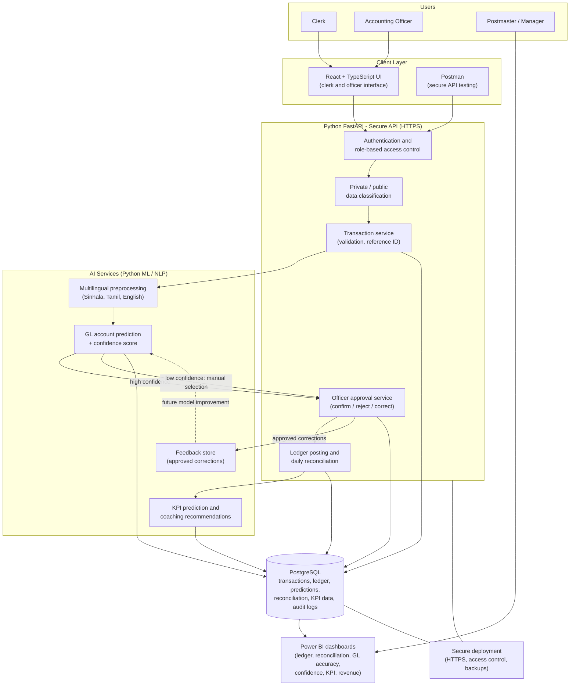
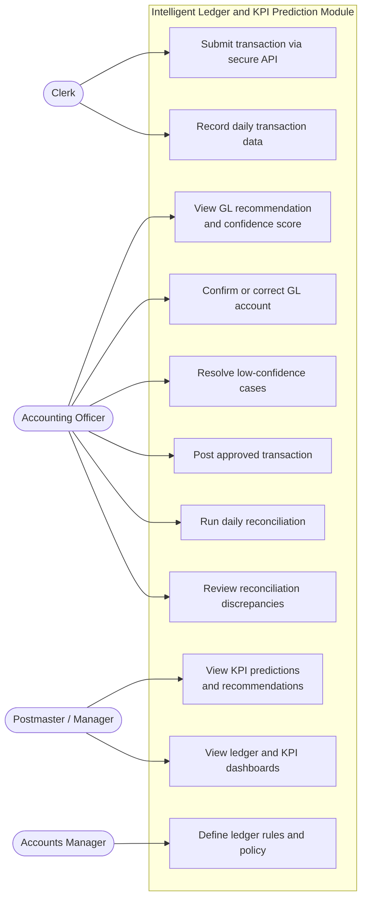
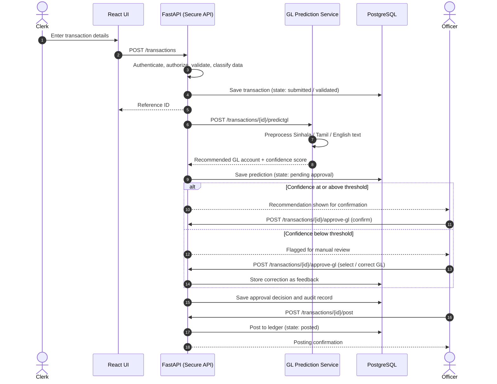
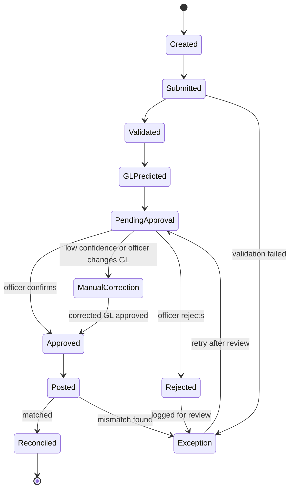
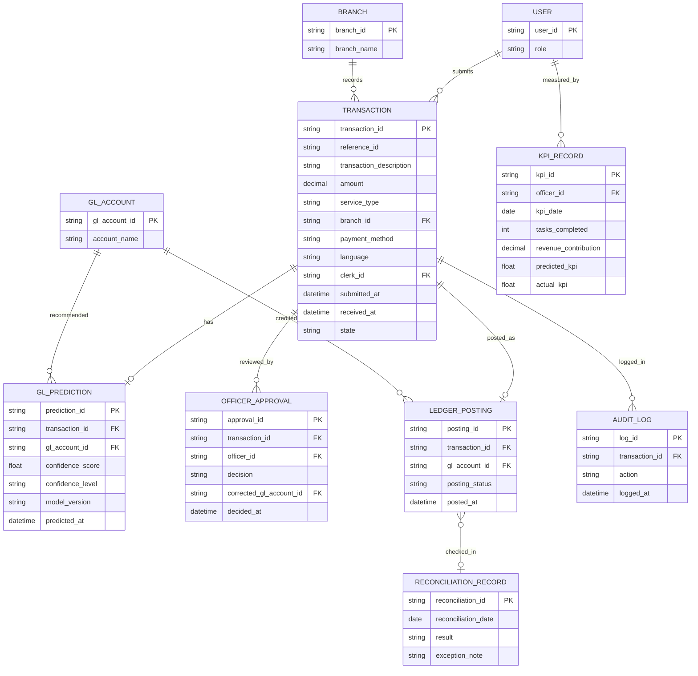
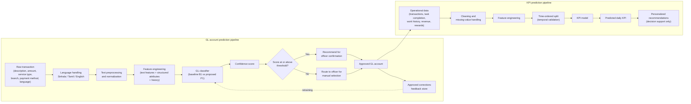
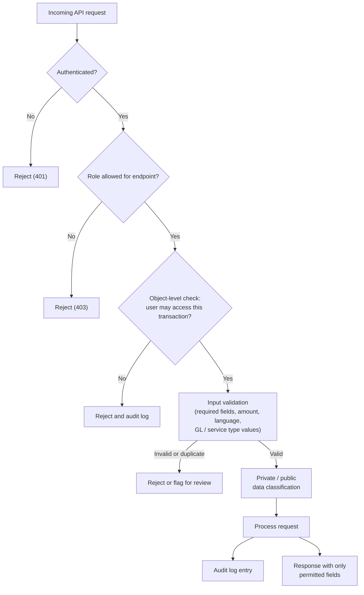
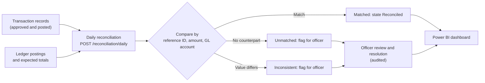
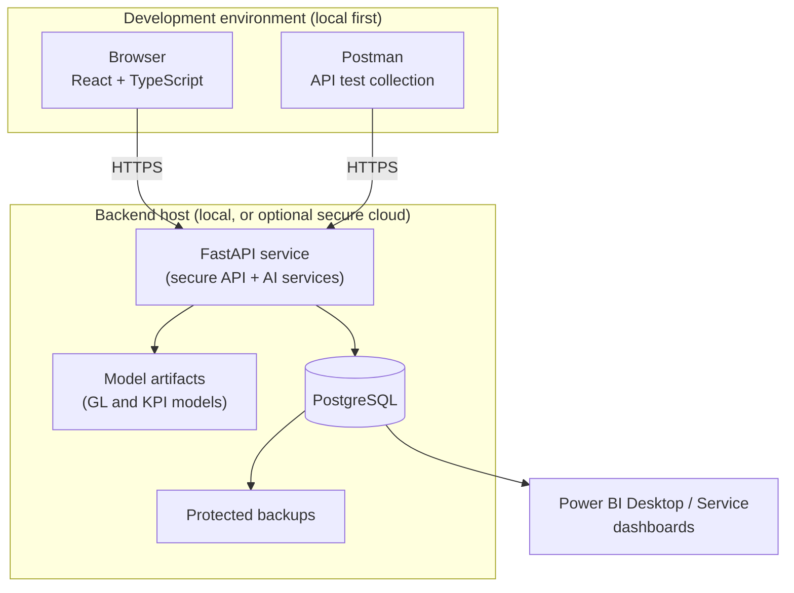
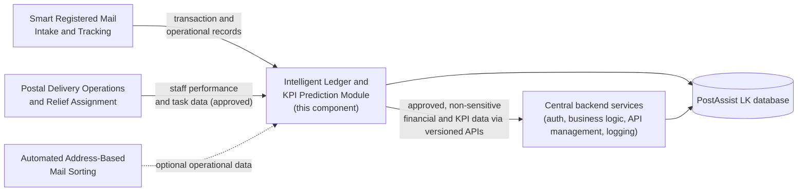

# Intelligent Ledger and KPI Prediction Module

**Component of PostAssist LK – Intelligent Backbone for Local Postal Services**
Project ID: J26-IT-372 · B.Sc. (Hons) in Information Technology, SLIIT

| | |
|---|---|
| **Student** | Gunawardena N C A (IT23323216) |
| **Supervisors** | Dr. Junius Anjana, Mrs. Poorna Panduwawala |
| **Status** | Research prototype (proposal stage → implementation) |

---

## 1. Overview

Postal branch staff must classify every daily transaction into the correct **General Ledger (GL) account**, reconcile records, and track performance. Transaction descriptions are written in **Sinhala, Tamil, and English**, so manual interpretation is slow and inconsistent.

This module applies **multilingual NLP and machine learning** to:

1. **Recommend a GL account** for each transaction, with a **confidence score**.
2. Route **low-confidence predictions to an authorized officer** (human-in-the-loop) for review or manual selection.
3. Store approved corrections as **feedback** for future model improvement.
4. Run **daily reconciliation** between transactions and ledger postings.
5. **Predict each officer's daily KPI achievement** and generate coaching recommendations.
6. Present everything in **Power BI dashboards**.

> **Design principle:** AI is a decision-support tool. Final accounting decisions always remain with authorized officers. KPI predictions are never used for disciplinary, promotion, or employment decisions.

## 2. Research Background

### 2.1 Problem statement

Postal branch transactions must be assigned to the correct GL account, reconciled daily, and monitored against performance targets. Clerks and officers interpret descriptions written in Sinhala, Tamil, or English by hand, which causes processing delays, inconsistent classification, and human error. KPI reporting is usually based on completed activity, so shortfalls are noticed late. Established platforms (SAP S/4HANA, Oracle Fusion Cloud Financials, QuickBooks Online, Xero) offer mature GL and reporting features, but none of them is documented as combining multilingual postal transaction classification, confidence-based officer verification, and daily KPI prediction in one workflow.

### 2.2 Research questions

| ID | Question |
|---|---|
| RQ1 | Can a multilingual ML model recommend the correct GL account from postal transaction descriptions and structured attributes more accurately than a conventional baseline? |
| RQ2 | Does model performance differ between Sinhala, Tamil, and English descriptions? |
| RQ3 | Can confidence scores reliably separate predictions that are safe to confirm from those that need manual officer review? |
| RQ4 | Does reusing approved officer corrections as feedback reduce the correction rate over time? |
| RQ5 | Can daily KPI achievement be predicted from transaction, task, revenue, and performance data well enough to support officer coaching? |
| RQ6 | Does an integrated workflow (secure API → GL prediction → approval → reconciliation → KPI → dashboard) work correctly end to end? |

### 2.3 Working hypotheses

These are hypotheses to be tested, not findings.

- **H1:** Combining description text with amount, service type, branch, payment method, language, and history improves macro-F1 over a description-only baseline.
- **H2:** Prediction quality varies by language, so per-language reporting is required.
- **H3:** High-confidence predictions are correct more often than low-confidence ones, but confidence will be tested rather than assumed to equal correctness.
- **H4:** Approved corrections lower the officer correction rate in later iterations.
- **H5:** Temporal validation gives a more honest KPI estimate than random splitting.

### 2.4 Literature themes

| Theme | What existing work shows | What it does not establish |
|---|---|---|
| Accounting classification / GL prediction [34], [35], [36] | ML can classify financial transactions and predict accounting data | Performance on Sri Lankan postal transactions, chart of accounts, or multilingual text |
| Multilingual NLP for Sinhala and Tamil [10], [11] | Sinhala, Tamil, and English text can be processed computationally; resources are uneven | That all three languages perform equally for GL classification |
| Human-in-the-loop decision support [13] | Human review and feedback matter when predictions are uncertain | Optimal thresholds, or that every correction is itself correct |
| Employee performance prediction [15], [16] | Historical work data can model future performance | Suitability for postal officers; bias and opportunity effects remain risks |
| Commercial accounting platforms | Established GL and reporting functions | Postal-specific multilingual GL prediction with confidence routing and KPI support |

The review is a focused critical review, not a registered systematic review.

### 2.5 Research gap and contribution

| Gap | Contribution | Evidence required |
|---|---|---|
| Limited GL prediction for postal transactions | AI-based GL account prediction | Prediction accuracy vs. baseline |
| Limited Sinhala/Tamil/English transaction processing | Multilingual transaction understanding | Per-language accuracy |
| Limited human verification of uncertain predictions | Confidence-based human-in-the-loop approval | Correct vs. corrected prediction rates |
| Limited daily KPI prediction | KPI prediction module with recommendations | Predicted vs. actual KPI |
| Financial and KPI functions handled separately | Integrated financial management workflow | Accuracy, processing time, usability |

### 2.6 Methodology: Design Science Research

1. **Problem and evidence:** literature review, system analysis, stakeholder interviews
2. **Measurable objectives:** baselines, evaluation metrics, validation plan
3. **Design and build:** API pipeline, GL prediction, multilingual processing, KPI model, dashboards
4. **Demonstrate:** run the prototype on sample data and test each module
5. **Evaluate and analyse:** compare against targets and document limitations
6. **Report and communicate:** findings, recommendations, shared results

Each iteration stays independently demonstrable, and decisions, results, and limitations are logged for reproducibility.

### 2.7 Experimental design

- **Splits:** 60% development, 20% validation, 20% held-out test; related or duplicate transactions never cross partitions
- **Threshold selection:** confidence threshold chosen on validation data and frozen before the final test
- **Baselines:** manual officer selection (B0) and a conventional ML classifier on description plus basic attributes (B1) against the proposed model (P1)
- **Reporting:** results broken down by major GL account and by language
- **Feedback study:** performance measured before and after adding approved corrections
- **Success rule:** a speed gain does not count if it comes with more incorrect GL assignments
- **KPI evaluation:** predefined regression or classification metrics with time-ordered validation

### 2.8 Stakeholder requirements gathering (planned)

| Group | Planned sample |
|---|---|
| Postal clerks | 3–5 |
| Accounting officers | 2–4 |
| Postmasters / branch managers | 1–2 |
| Adult postal service users | 4–6 |

These are planning ranges, subject to institutional and postal permission. Interviews cover GL selection, correction patterns, reconciliation, KPI monitoring, and dashboard needs. If postal access is unavailable, role-based university participants and synthetic or secondary data are used and the findings are labelled as simulated.

### 2.9 Threats to validity

| Threat | Response |
|---|---|
| Data may not represent all postal branches | State the limitation; use approved real or anonymized data where possible |
| Synthetic data may be unrealistically clean | Combine with secondary and historical samples; report separately |
| Inconsistent or wrong GL labels | Controlled GL mapping, rule-based and officer label validation |
| Class imbalance across GL accounts | Class balancing, macro-F1, per-account reporting |
| Data leakage in KPI or GL models | Time-ordered splits, duplicate-safe partitions |
| Overconfident predictions | Calibration checks on a separate test set |
| Biased performance data | KPI used for decision support only, never for disciplinary or promotion decisions |

### 2.10 Ethics and responsible use

- Participation is voluntary and focuses on workflows and usability, not employee monitoring
- Real postal financial and employee records are avoided; synthetic, anonymized, or approved secondary data are preferred
- No participant recruitment, interview findings, or operational approvals are claimed until they actually occur
- AI predictions never authorize financial decisions; officers approve or correct them
- Ethical clearance and data-access permission are to be confirmed through SLIIT and the postal organization

### 2.11 Key references

- [34] Z. Yang et al., "A deep learning framework for automated transaction classification and budget prediction in personal financial management," *Discover Artificial Intelligence*, vol. 6, Art. 885, 2026.
- [35] Y. Li, "Accounting Data Classification and Prediction Based on Machine Learning Algorithms," *Procedia Computer Science*, vol. 285, pp. 46–55, 2026.
- [36] A. Booker, V. Chiu, N. Groff, and V. J. Richardson, "AIS research opportunities utilizing machine learning: From a meta-theory of accounting literature," *Int. J. Accounting Information Systems*, vol. 52, Art. 100661, 2024.
- [10] "Si-Ta: Machine Translation of Sinhala and Tamil Official Documents," *Proc. NITC*, Colombo, 2018.
- [11] "A Multi-way Parallel Named Entity Annotated Corpus for English, Tamil and Sinhala," *Natural Language Processing Journal*, vol. 11, Art. 100160, 2025.
- [13] "Human-in-the-loop: Explainable or Accurate Artificial Intelligence by Exploiting Human Bias?" *Proc. IEEE Conference*, 2022.
- [15] "Analysis and Prediction of Employee Promotions Using Machine Learning," *Proc. DSIT*, 2022.
- [16] "Predicting Employee Performance Using Machine Learning to Enhance Workforce Efficiency," *Proc. IEEE Conference*, 2024.

The full reference list is in the project proposal.

## 3. Architecture and Workflow

```
Clerk entry (secure API) → GL prediction + confidence → Confidence threshold check
        ↓ (low confidence)                                    ↓ (high confidence)
 Officer review / manual correction  ←──────────────  Officer confirmation
        ↓
 Ledger posting + feedback logged → Daily reconciliation → KPI prediction → Power BI dashboard
```

### Transaction states
`created → submitted → validated → GL predicted → pending approval → approved / rejected → posted → reconciled` (or `exception`).

GL prediction confidence (`high`, `low`, `corrected`, `manually selected`) is tracked **separately** from the transaction state.

### System architecture



**Layer summary**

| Layer | Responsibility |
|---|---|
| Client | React UI for clerks and officers; Postman collection for API and security testing |
| Secure API (FastAPI) | Authentication, RBAC, data classification, validation, approval, posting, reconciliation, audit logging |
| AI services | Multilingual preprocessing, GL prediction with confidence, KPI prediction, feedback capture |
| Data | PostgreSQL for all transaction, ledger, prediction, reconciliation, KPI, and audit records |
| Analytics | Power BI reads validated, role-restricted data only |

### Use-case diagram



### Sequence diagram: GL prediction and officer approval



### Transaction state diagram



GL prediction confidence (`high`, `low`, `corrected`, `manually selected`) is stored separately from these states.

### Data model (ER diagram)



### ML pipeline: GL prediction and KPI prediction



### Data classification and security flow



### Reconciliation flow



### Deployment diagram



### Integration with other PostAssist LK components



## 4. Key Features

- **Secure clerk-to-officer API** with authentication, role-based and object-level authorization, private/public data classification, validation, and audit logging
- **GL account prediction** using description, amount, service type, branch, payment method, language, and historical records
- **Multilingual processing** (Sinhala, Tamil, English) with per-language evaluation
- **Confidence-based routing** with a threshold selected on validation data and fixed before final testing
- **Human-in-the-loop approval**: confirm, reject, or modify predictions; corrections stored for audit and learning
- **Daily reconciliation** that flags matched, unmatched, and inconsistent records
- **KPI prediction and personalized recommendations**
- **Power BI dashboards**: ledger postings, reconciliation status, GL accuracy, confidence levels, KPI achievement, revenue

## 5. Tech Stack

| Layer | Technology |
|---|---|
| Frontend (clerk/officer UI) | React + TypeScript |
| Backend / AI services | Python, FastAPI |
| ML / NLP | Python ML and NLP libraries (scikit-learn-style baselines, multilingual text models) |
| Database | PostgreSQL |
| API testing | Postman |
| Dashboards | Power BI |
| Deployment | Local first; optional secure cloud (HTTPS, access control, backups) |

## 6. API Summary

| Endpoint | Actor | Purpose |
|---|---|---|
| `POST /transactions` | Clerk | Submit a transaction; returns a unique reference ID |
| `POST /transactions/{id}/predictgl` | Officer / system | Generate GL recommendation + confidence score |
| `POST /transactions/{id}/approve-gl` | Finance officer | Confirm prediction or manually select an account |
| `POST /transactions/{id}/post` | Finance officer | Post approved transaction to the ledger (audited) |
| `POST /reconciliation/daily` | Finance officer | Compare transactions vs. ledger postings |
| `GET /dashboards/financialsummary` | Manager | Validated data for Power BI |

### Transaction payload (request)
`transaction_id`, `reference_id`, `transaction_description`, `amount`, `service_type`, `branch_id`, `payment_method`, `language`, `clerk_id`, `client_version`, `submitted_at`.
The clerk identity comes from authentication, not from the request body. The server adds `received_at`, `validation_status`, `GL_prediction`, `confidence_score`, `approval_status`, `policy_version`, and `transaction_revision`.

## 7. Proposed Repository Structure

```
.
├── api/                 # FastAPI app: auth, transactions, approvals, reconciliation
├── ml/
│   ├── gl_prediction/   # baseline + proposed GL models, confidence scoring
│   ├── multilingual/    # Sinhala / Tamil / English preprocessing
│   └── kpi/             # KPI prediction and recommendations
├── frontend/            # React + TypeScript clerk/officer UI
├── data/                # synthetic / anonymized datasets (not real records)
├── dashboards/          # Power BI files and data model notes
├── postman/             # API collection and test environments
├── tests/               # functional, security, and scenario tests (T01–T18)
├── docs/                # proposal, architecture, decision log
└── README.md
```

## 8. Getting Started (planned)

> Commands below are a starting template; adjust to the final project layout.

**Prerequisites:** Python 3.10+, Node.js 18+, PostgreSQL 14+, Postman, Power BI Desktop.

```bash
# 1. Backend
python -m venv .venv
source .venv/bin/activate          # Windows: .venv\Scripts\activate
pip install -r requirements.txt

# 2. Configuration – copy and edit; never commit secrets
cp .env.example .env               # DB URL, JWT secret, confidence threshold

# 3. Database
createdb postassist_ledger
alembic upgrade head               # or run the SQL schema scripts

# 4. Run the API
uvicorn api.main:app --reload

# 5. Frontend
cd frontend && npm install && npm run dev
```

Import the collection from `postman/` to exercise the secure clerk-to-officer workflow.

## 9. Datasets

| Dataset | Size | Notes |
|---|---|---|
| Postal transaction dataset | 1,000–1,500 records | Primary or approved anonymized/synthetic; split 60/20/20 (dev/validation/test), duplicates never cross partitions |
| Multilingual secondary dataset | Sinhala, Tamil, English text | Used for NLP evaluation |
| KPI dataset | 500–1,000 records | Operational or synthetic |
| API/security tests | 100+ valid/invalid requests | Prototype-level only |

**No real postal financial or employee records are committed to this repository.**

## 10. Evaluation and Acceptance Targets

These are *proposed targets*, not achieved results; final values are to be approved by the supervisors.

| ID | Objective | Target |
|---|---|---|
| SO1 | Secure API | ≥ 95% API tests pass; 100% of unauthorized-access tests rejected |
| SO2 | GL prediction | ≥ 85% macro-F1, compared with a baseline |
| SO3 | Multilingual + confidence review | Per-language reporting; ≥ 90% of high-confidence recommendations correct at the chosen threshold; low-confidence cases routed to officers |
| SO4 | Reconciliation + KPI | ≥ 90% reconciliation test-case accuracy; KPI performance reported with suitable metrics |

**Experiment configurations**
- API: B0 manual flow · B1 basic authenticated API · P1 full secure pipeline
- GL: B0 manual officer selection · B1 conventional ML on description + basic attributes · P1 proposed multi-feature model with confidence

Metrics: accuracy, precision, recall, macro-F1, top-k accuracy, confidence analysis, officer correction rate, response time, reconciliation accuracy, and KPI regression/classification metrics (with temporal validation).

## 11. Security and Privacy

- HTTPS, authentication, role-based and object-level authorization
- Secure password handling, session management, rate limiting, audit logging
- Financial and employee data treated as private; only approved, non-sensitive data reaches shared APIs and dashboards
- Secrets kept outside source code; protected backups
- If the API, database, or prediction service is down, the approved manual accounting procedure is used and entries are later recorded as explicitly marked reconciliation records

## 12. Timeline (24 weeks, ~600 hours)

| Weeks | Focus |
|---|---|
| 1–4 | Literature review, ethics, data and security design |
| 3–11 | Dataset preparation, secure API, GL mapping, baseline model |
| 9–18 | AI GL prediction, multilingual processing, human-in-the-loop |
| 18–24 | KPI model, reconciliation, Power BI, integration, evaluation, final report |

Milestones: **M1** week 4 · **M2** week 8 · **M3–M5** weeks 12–21.

## 13. Limitations

- Results depend on data quality; synthetic or limited data may not represent all Sri Lankan postal branches
- Prototype-level security testing only, not a formal security certification
- KPI predictions are decision-support information, not judgments of employee value
- Not a replacement for approved Sri Lanka Post accounting procedures, and no nationwide validation is claimed

## 14. Related PostAssist LK Components

This module sits alongside the Smart Registered Mail Intake & Tracking, Postal Delivery Operations & Relief Assignment, and Automated Address-Based Mail Sorting components. It can later expose approved APIs without sharing the complete financial database.

## 15. Acknowledgements

Department of Posts Sri Lanka, the researchers cited in the project proposal, and the academic guidance and ethical-review framework of the Sri Lanka Institute of Information Technology.
