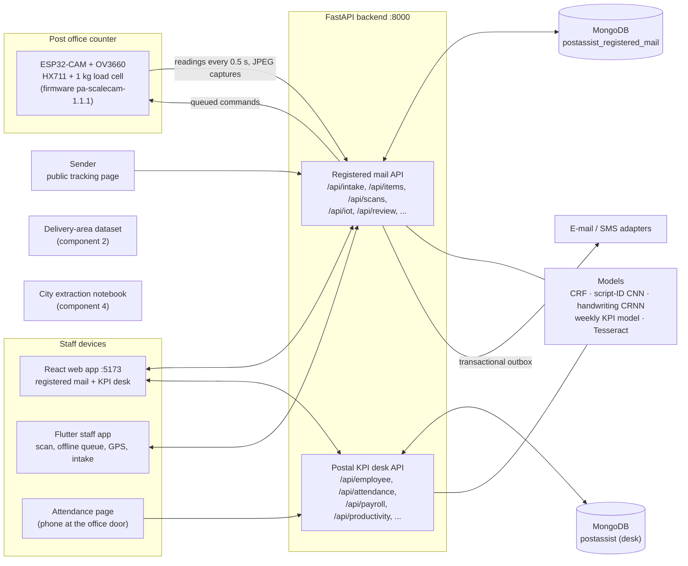

# PostAssist LK – Intelligent Backbone for Local Postal Services

**SLIIT final-year research project · J26-IT-372**

PostAssist LK digitises the daily work of a Sri Lankan post office: accepting and tracking registered mail,
organising delivery areas and postmen, managing staff attendance, KPIs, entitlements and pay, reconciling the
office's daily accounts, and reading addresses from mail images. This repository holds the whole system – the
shared FastAPI backend, the React web app, the Flutter staff mobile app, the IoT scale and camera firmware, the
machine-learning pipelines, the datasets and the documentation of every component.

**Stack:** Python (FastAPI) · MongoDB · React (Vite, Tailwind, MUI) · Flutter (Android/iOS) · ESP32-CAM (Arduino) ·
scikit-learn and PyTorch → ONNX models · Tesseract OCR · Power BI (optional reporting).

---

## Contents

1. [Components of the system](#1-components-of-the-system)
2. [Architecture](#2-architecture)
3. [Smart Registered Mail Intake and Tracking](#3-smart-registered-mail-intake-and-tracking)
4. [IoT scale + envelope camera (hardware and firmware)](#4-iot-scale--envelope-camera-hardware-and-firmware)
5. [Flutter staff mobile app](#5-flutter-staff-mobile-app)
6. [Postal Delivery Operations and Relief Assignment](#6-postal-delivery-operations-and-relief-assignment)
7. [Daily Accounts Reconciliation, Ledger Prediction and Postal KPI Desk](#7-daily-accounts-reconciliation-ledger-prediction-and-postal-kpi-desk)
8. [Postal Address City Extraction](#8-postal-address-city-extraction)
9. [Web app (React)](#9-web-app-react)
10. [Backend API (FastAPI)](#10-backend-api-fastapi)
11. [Machine-learning models and results](#11-machine-learning-models-and-results)
12. [Datasets](#12-datasets)
13. [Repository layout](#13-repository-layout)
14. [Getting started](#14-getting-started)
15. [Configuration](#15-configuration)
16. [Testing](#16-testing)
17. [Branches and integration status](#17-branches-and-integration-status)
18. [Documentation](#18-documentation)
19. [Limitations and honest notes](#19-limitations-and-honest-notes)

---

## 1. Components of the system

| # | Component | What it does | Main code |
|---|---|---|---|
| 1 | **Smart Registered Mail Intake and Tracking** – Senarathna W.L.S.K (IT23324138) | counter acceptance of registered letters with trilingual assisted address reading and an IoT scale and camera, versioned tariff, barcode/QR labels, location-aware tracking scans with offline sync, review, sender notifications, public tracking | `backend/app/`, `frontend/src/pages/`, `frontend/src/components/`, `mobile_app/flutter_app/`, `iot/`, `ml/` |
| 2 | **Postal Delivery Operations and Relief Assignment** | helps postmen with delivery assignments, delivery locations, routes and delivery progress; starts from a labelled delivery-area dataset for the Kaduwela area | `Datasets/kaduwela_postal_dataset_Final.xlsx` |
| 3 | **Daily Accounts Reconciliation, Ledger Prediction and Postal KPI Desk** | employee records, daily KPI log, attendance with location and door codes, productivity and next-week KPI forecasts, entitlements and payroll (EPF/ETF), daily-accounts import, cash reconciliation and GL-code suggestions, Power BI reporting | `backend/main.py`, `backend/routes.py`, `backend/attendance.py`, `backend/payroll.py`, `backend/productivity.py`, `frontend/src/admin/`, `frontend/src/attendance/`, `frontend/src/entitlements/` |
| 4 | **Postal Address City Extraction** | crops the recipient label from a mail photo, reads it with Tesseract in four orientations and picks the most likely city by pattern and fuzzy matching | `firmware/address_extraction.ipynb` |

How they fit together in a post office:

* A letter is **accepted at the counter** and tracked to delivery (component 1); its delivery scans come from the
  postmen assigned to each area.
* **Delivery areas and postman assignments** (component 2) decide which postman delivers which address and who
  covers a route when someone is absent.
* The **KPI desk** (component 3) records each employee's daily work, attendance and leave, forecasts next week's KPI,
  and computes entitlements and pay; its **daily accounts** module reconciles the office's daily cash and ledger
  entries.
* **City extraction** (component 4) reads the destination town from a photo of the mail item for sorting.

Components 1 and 3 already share one backend process (port 8000) and one web app (port 5173). Components 2 and 4
are currently a dataset and a notebook; see [§17](#17-branches-and-integration-status).

---

## 2. Architecture



The desk's routes are registered after every registered-mail route so that they can never shadow them
(`backend/tests/test_combined_api.py`). The registered-mail API and the desk keep separate MongoDB databases.

---

## 3. Smart Registered Mail Intake and Tracking

*Component 1 · Senarathna W.L.S.K (IT23324138) · branch `feature/smart_registered_mail_intake_&_tracking`*

### 3.1 A letter's journey

1. **Counter intake.** The counter officer starts a draft. The envelope is photographed by the scale's camera
   (or a webcam, or a file upload). The officer crops the address block and the system suggests the address fields
   in Sinhala, Tamil or English. The officer confirms every field, places the letter on the IoT scale and presses
   *Use this weight*, the charge is calculated from the tariff in force, the payment is recorded, and a label and
   a receipt are printed. The printed label is scanned back to verify it.
2. **Dispatch and transit.** Hub officers scan the label (web or phone) to record *dispatched*, *in transit* and
   *at destination office*. Every scan carries the phone's location evidence.
3. **Location check.** Each scan is compared with the approved reference zone of the office or delivery area.
   Clear mismatches, missing locations on arrival, mock locations and delivery exceptions are **held for review**;
   held scans do not change the status and do not message the sender.
4. **Review.** A postmaster reads the reasons and approves or rejects the held scan, giving a reason that is
   audited.
5. **Delivery.** The postman scans *out for delivery* and then *delivered*, with a signature, the recipient's name
   or a delivery-sheet reference. This works offline: the scan is queued on the phone and uploaded later with the
   same event id, so it is never duplicated.
6. **Sender updates.** Each accepted event creates the sender's message (e-mail or SMS, in English, Sinhala or
   Tamil) atomically with the event. The sender follows the letter on a public tracking page that shows office
   names and times only, with no coordinates and no staff names.

### 3.2 Functions

| Area | Functions |
|---|---|
| **Sign-in and roles** | username + password (salted PBKDF2-SHA256), signed expiring JWTs, user re-read on every request; roles *admin, postmaster, counter officer, hub officer, postman*; object-level rules (office, assignment); worker identity always taken from the token; append-only audit log |
| **Intake drafts** | auto-saved drafts that can be resumed after a restart, progress per step, cancel or delete (releases the scale reading), configuration B0 (manual) / B1 (baseline OCR) / P1 (pipeline) per draft for the comparison experiment |
| **Envelope image** | capture from the ESP32-CAM on the scale, webcam or upload; crop and rotate; image-quality check (resolution, sharpness, brightness, contrast, glare) with recapture advice |
| **Address reading** | P1 pipeline: deskew → line segmentation → trained **script-ID CNN** → matching Tesseract language pack; **handwriting reader** (CRNN-CTC) for handwritten blocks with *Auto / Handwritten / Printed*; B1 baseline for comparison; typed or pasted text always possible |
| **Address fields** | trained **CRF tagger** splits text into name, house number, street, locality, town, district, postcode, country with per-field confidence; low-confidence fields highlighted; suggestions shown beside the officer's values and never merged silently |
| **Address checks** | town ↔ postcode check against the gazetteer (consistent / mismatch / unknown); Colombo zone postcodes suggested, never inserted; destination office suggestion; optional LLM normalisation (Gemma 3 4B via Ollama) behind an *unsupported-change guard* that rejects invented digits, names or script changes |
| **Confirmation** | sender, recipient and notification blocks must be confirmed before acceptance; editing after confirmation needs reconfirmation; corrections (suggested vs final) recorded for evaluation |
| **Weighing (IoT)** | live reading on the counter screen (≤ 1 s); pairing only if the reading is fresh (≤ 3 s), stable (spread ≤ 1 g over 1 s), 5–500 g, from a calibrated healthy scale of the officer's office; one placement → one letter (`PLACEMENT_ALREADY_USED`); audited manual weight from an approved instrument |
| **Tariff and charge** | versioned tariff transcribed from the Department of Posts notice of 9 Feb 2026 (letter band + Rs 60 registration; e.g. 20 g → Rs 70 + 60 = **Rs 130.00**); optional advice of delivery (Rs 100) and insurance (Rs 100 per Rs 1,000, max Rs 25,000); if *weight ± U* crosses a band boundary the quote is **reweigh required**; itemised quotes expire after 10 min; missing or overlapping tariffs block quoting |
| **Acceptance and labels** | exactly one item per draft (idempotent retry returns the same item); payment must equal the quote; opaque tracking IDs `PA-DEMO-` + 10 Crockford base-32 characters + a check character; label with Code 128 + QR + readable ID; receipt with itemised charge and tracking QR; audited reprints with a reason; label verification by scanning (`LABEL_MISMATCH`) |
| **Tracking scans** | valid transitions only (`INVALID_TRANSITION`); each role sees only the statuses it may record; late offline scans of an earlier stage kept in history without moving the status back; explicit return workflow; *delivered* needs an acknowledgement, *attempted* and *return started* need a reason |
| **Location policies** | L0 status-only (baseline), L1 fixed radius, **L2 uncertainty-aware** (probability of being inside the zone from the reported accuracy, fix age and a Gaussian error model); every event stores its policy version; admin can switch policies |
| **Review queue** | held and flagged scans with reasons; approve or reject with an audited reason |
| **Offline sync** | phone queue in SQLite written *before* upload with a client-generated `event_id`; server is idempotent (1,000 replays → one event, one message); automatic upload in capture order when the network returns |
| **Sender notifications** | transactional outbox inside the item document; de-duplication key (event + recipient + channel + template version); bounded exponential back-off; *ambiguous* and permanent failures shown for retry or manual resolution; templates in EN/SI/TA; adapters: e-mail to file (default), SMTP, Resend, SMS stub; fault injection for experiments |
| **Public tracking** | `/track/<ID>#t=<token>` from the receipt; redacted timeline; postmaster can rotate the tracking link |
| **Recipient location** | a postmaster can set a confirmed recipient location (with mandatory provenance) as the delivery reference point; town or postcode centres are never used |
| **Offices and zones** | reference points with provenance (OpenStreetMap or measured on site), facility and delivery-area radii, "use my location" |
| **Reports and experiments** | CSV exports `intake_tasks.csv`, `scan_events.csv`, `notifications.csv`, dashboard summary, weighing trials CSV |
| **Dashboard** | items needing attention (held scans, failed messages, offline or uncalibrated scale, unfinished drafts) |

### 3.3 Mail states

```
accepted → dispatched → in_transit → at_destination_office → out_for_delivery → delivered
                                            │                     │
                                            │                     └→ delivery_attempted → out_for_delivery / at_destination_office
                                            └→ return_started → in_transit → returned_to_sender
```

| Role | Statuses it may record |
|---|---|
| Counter officer | `dispatched` (plus *accepted* through intake) |
| Hub officer | `dispatched`, `in_transit`, `at_destination_office` |
| Postman | `out_for_delivery`, `delivery_attempted`, `delivered` |
| Postmaster, admin | every status except `accepted` |

Senders who opted in always receive the key updates (accepted, out for delivery, attempted, delivered, return
started, returned); transit scans are sent only to senders who asked for *all* updates.

### 3.4 Demo accounts

Created on the first start when `DEMO_SEED=true`. The password of every account is `DEMO_PASSWORD` from `backend/.env`.

| Username | Role | Office |
|---|---|---|
| `counter2` | counter officer | Malabe Post Office `MLB-PO` (owns the scale `SCALECAM-01`) |
| `hub2` | hub officer | Malabe Post Office |
| `postman2` | postman | Malabe Post Office |
| `pm2` | postmaster | Malabe Post Office |
| `counter1`, `hub1`, `hubjaf`, `postman1`, `pm1` | – | Kaduwela, Central Mail Exchange, Jaffna (Kaduwela → Colombo → Jaffna journey) |
| `admin` | administrator | devices, users, tariff approval, location-policy switch |

### 3.5 Key design decisions

* **Atomic event + status + notification without multi-document transactions.** An item document embeds its
  events and outbox, and every change is one `update_one` guarded by a `revision` field (optimistic concurrency).
* **Idempotency everywhere:** unique `draft_id` (repeated acceptance), unique `weight.placement_key` (no reused
  scale reading), client-generated `event_id` (offline replays), notification de-duplication key.
* **Explainable decisions:** quotes list their lines and tariff version; scan decisions list their reasons and the
  location-policy version.
* **Suggestions, not decisions:** every OCR or model output is a suggestion that the officer confirms field by field;
  manual entry is always possible when OCR is unavailable.
* **Location is evidence, not proof:** a missing fix is stored as missing, never invented; uncertain evidence is
  flagged instead of producing a false accusation or a false confirmation.

---

## 4. IoT scale + envelope camera (hardware and firmware)

*Part of component 1.* One **ESP32-CAM** both **weighs** the letter and **photographs** the envelope lying on the
platform. The weight and the photo of the same letter therefore come from the same device at the same moment, and
the hardware stays cheap.


### 4.1 Hardware

| Part | Role |
|---|---|
| AI-Thinker **ESP32-CAM** with **OV3660** 3 MP camera | Wi-Fi microcontroller: reads the HX711, takes the photo, talks to the backend |
| **1 kg bar load cell** on a wooden bracket | measures the letter's weight |
| **HX711** 24-bit ADC (powered at 5 V) | amplifies and digitises the load-cell signal |
| 4-channel bi-directional **level shifter** (3.3 V ↔ 5 V) | connects the 5 V HX711 safely to the 3.3 V ESP32 pins |
| ESP32-CAM-MB USB programmer | flashing and serial log |
| breadboard, jumpers, 1000 µF capacitor, 5 V / 2 A supply, camera stand 28–32 cm above the platform | power, wiring, brown-out protection, mounting |

Hardware bought for Rs 4,800 (within the proposal's allowance). Full parts list, prices and extra items:
[IoT hardware setup guide §1–2](Documents/IoT_Hardware_Setup_Guide.md#1-what-you-bought-and-what-each-part-does).

### 4.2 Wiring (HX711 at 5 V through the level shifter)

| From | To |
|---|---|
| 5 V supply VCC / GND | breadboard (+) / (−) rails |
| ESP32-CAM **5V** / **GND** | (+) / (−) rails |
| ESP32-CAM **3V3** | level shifter **LV** |
| level shifter **HV** / **GND** | (+) / (−) rails |
| HX711 **VCC** / **GND** | (+) / (−) rails |
| HX711 **DT** → shifter **HV1**, shifter **LV1** → | ESP32-CAM **IO13** |
| HX711 **SCK** → shifter **HV2**, shifter **LV2** → | ESP32-CAM **IO14** |
| load cell red / black / white / green | HX711 **E+ / E− / A− / A+** |
| 1000 µF capacitor (+ to 5 V) | across the rails next to the ESP32-CAM |

IO13 and IO14 are free because the SD-card slot is not used. Leave **IO12** (boot strapping), **IO16** (PSRAM),
**IO0** and **IO4** (flash LED) alone, and never feed power into the ESP32-CAM **VCC** pin. Without a level
shifter the HX711 can run at 3.3 V directly (slightly noisier).

### 4.3 Firmware `iot/postassist_scale_cam/` (version `pa-scalecam-1.1.1`)

| Feature | Details |
|---|---|
| **Weighing** | reads the HX711 itself (no library) at 10 samples/s with slow clock pulses, sampled at the end of each pulse, so slow edges through the level shifter no longer flip bits; 1-second window → net grams, spread, *stable* (spread ≤ 1 g) and *loaded* flags; isolated spikes > 25 g ignored unless confirmed; slow zero tracking while empty |
| **Placement numbering** | the platform must return to empty before the next stable load gets a new number, so the server can refuse to reuse the previous letter's weight |
| **Push protocol** | `POST /api/iot/readings` every 500 ms with `X-Device-Id` / `X-Device-Key`; the reply carries queued commands (tare, calibrate, capture, identify, reboot); results go to `POST /api/iot/commands/<id>/result` |
| **Envelope photo** | on *capture* the camera warms up (exposure and white balance settle), takes a short burst and uploads the frame with the most detail (largest JPEG) to `POST /api/iot/captures/<id>`; QXGA 2048×1536, lens and pixel correction, edge enhancement, vertical flip for the usual mounting |
| **Calibration** | offset, factor and calibration id stored in flash (NVS); every paired weight records the calibration id; since 1.1.1 a stored factor below 100 counts/g is discarded at start-up and refused by calibrate, so a bad calibration can no longer lock the scale |
| **Device web page** `http://<device-IP>/` | live weight, tare, calibrate, test photo, **focus helper** (turn the lens until the detail score peaks), Wi-Fi and backend address settings without re-flashing |
| **Set-up network** | if the configured Wi-Fi cannot be joined within 20 s the board opens `PostAssist-Scale` on `http://192.168.4.1/` |
| **HTTPS** | optional root CA in `config.h` for an `https://` backend |

**Local endpoints of the board**

| Endpoint | Purpose |
|---|---|
| `GET /` | device page |
| `GET /status` | firmware version, Wi-Fi, backend address, backend reachability, calibration, spike count |
| `GET /weight` | current reading |
| `POST /tare` (`?force=1` while not stable) | zero the platform |
| `POST /calibrate` | calibrate with a known reference mass |
| `POST /calibrate/reset` | back to the default factor without a stable reading |
| `GET /capture`, `GET /capture.jpg` | take a photo |
| `GET /focus` | one fast frame with its detail score |
| `POST /settings` | change Wi-Fi and backend address |

**Serial console (115200 baud):** `t` tare · `tf` tare now (not stable) · `r` reset calibration ·
`c <grams>` calibrate · `i` info.

### 4.4 Build and flash

1. Copy `iot/postassist_scale_cam/config.example.h` to `config.h` (git-ignored) and set the Wi-Fi (2.4 GHz),
   `API_BASE_URL` (`http://<laptop-LAN-IP>:8000`), `DEVICE_ID` and `DEVICE_KEY` – the same values as
   `SEED_DEVICE_ID` / `SEED_DEVICE_KEY` in `backend/.env`.
2. Board **AI Thinker ESP32-CAM** (esp32 core 3.x), PSRAM enabled, partition **Huge APP (3 MB No OTA)**,
   library **ArduinoJson 7**.
3. Compile and upload with the ESP32-CAM-MB:
   ```bash
   arduino-cli compile -b "esp32:esp32:esp32cam:PartitionScheme=huge_app" iot/postassist_scale_cam
   ```
   The 1.1.0 build with ESP32 core 3.3.12 and ArduinoJson 7.4.3 is 1.20 MB (38 % of the partition).
4. Wire the circuit, power on, open the device page and focus the lens for the 30 cm working distance.
5. In the web app (`counter2`) open **IoT scale**: the card shows *online*, IP, firmware, RSSI, `HX711 ok` and
   `camera ok`.

### 4.5 Calibration and measurement uncertainty

1. Empty platform, wait for *stable*, **Tare**. Place a reference mass (100–200 g) in the centre, **Calibrate**.
2. Weighing trials: 10 reference masses from 5 to 500 g × 10 repeats under different conditions, recorded on the
   IoT page, exported as CSV and analysed:
   ```bash
   ml/.venv/Scripts/python ml/evaluation/weighing_analysis.py SCALECAM-01_trials.csv
   ```
   The report gives MAE, bias, repeatability, a linear fit and the expanded uncertainty **U (k = 2)**. A postmaster
   enters U on the IoT page; from then on the tariff engine asks for a reweigh whenever *weight ± U* crosses a band
   boundary. Target (SO2): MAE ≤ 1 g over 5–500 g.

### 4.6 Working without the board, and older boards

* **Simulator:** `backend/tools/device_simulator.py` speaks the same protocol (type `w 23.5` to place a 23.5 g
  letter, `r` to remove it) and can upload an envelope image.
* **Bridge:** `backend/tools/device_bridge.py` connects a board that runs a pull-only sketch (`/weight`, `/tare`,
  `/calibrate`, `/capture`) to the backend (`BRIDGE_DEVICE_URL`). Do not run it while firmware 1.1 reports to the
  backend itself; `device_bridge.py --check` remains useful as a diagnostic.

Troubleshooting (brown-outs, camera init errors, unstable or jumping readings, `401` device key, connection refused)
and the full protocol reference: [IoT hardware setup guide](Documents/IoT_Hardware_Setup_Guide.md#troubleshooting)
and [IoT integration test flow](Documents/IoT_Integration_Test_Flow.md).

---

## 5. Flutter staff mobile app

*Part of component 1.* `mobile_app/flutter_app/` (package `postassist_mobile`) – Android and iOS app that talks to
the same backend and covers every registered-mail staff role.

| Role | What the app does |
|---|---|
| Counter officer | registers a letter in 5 steps (envelope photo → address reading → confirm → IoT scale weight → charge and accept), shows the label and receipt with Code 128 + QR, verifies the printed label by scanning it, saved drafts, sender messages, scale and camera |
| Hub officer | scans labels to record *dispatched / in transit / at destination office* |
| Postman | scans labels to record *out for delivery / delivery attempted / delivered* with signature, name or delivery-sheet acknowledgement – works **offline** |
| Postmaster | everything above plus the review queue, summary, audit log, offices and reference zones (set from the phone's GPS) |
| Sender (no sign-in) | tracks a letter by scanning the receipt QR or typing the tracking ID and access code |

* **Offline first:** each scan is written to SQLite with a once-generated `event_id` before any upload and re-sent
  with the same id until the server gives a durable answer (accepted, duplicate, held, rejected). Each queued scan
  remembers who captured it and is uploaded only with that person's sign-in.
* **Location evidence:** read once when *Save* is pressed, with accuracy, fix age, permission state and Android's
  mock-location flag.
* **Tracking-ID check:** the check character is validated on the phone, so a mistyped ID is caught before upload.
* **Languages:** Sinhala, Tamil and English (ARB files in `lib/l10n/`).
* **UI:** follows the principles of the Sri Lanka Digital Design System draft and WCAG 2.2 AA (48 dp targets,
  labels above fields, status shown with words and icons, text scaling); it is not formally approved by any
  government body and uses no national emblem or Sri Lanka Post logo.
* **Libraries:** provider, http, sqflite, mobile_scanner, geolocator, connectivity_plus, barcode_widget,
  image_picker, shared_preferences, intl.

```bash
cd mobile_app/flutter_app
flutter pub get
flutter run                      # phone over USB or a running emulator
flutter build apk --release      # build/app/outputs/flutter-apk/app-release.apk
```

Server address at sign-in: `http://<laptop-IP>:8000` on the same Wi-Fi, `http://10.0.2.2:8000` on the Android
emulator, or `http://127.0.0.1:8000` on a USB-connected phone after `adb reverse tcp:8000 tcp:8000`.
Full guide: [Documents/Flutter_Mobile_App_Guide.md](Documents/Flutter_Mobile_App_Guide.md).

---

## 6. Postal Delivery Operations and Relief Assignment

*Component 2 · branch `feature/Postal-Delivery-Operations-and-Relief-Assignment`*

**Goal:** help postmen manage their delivery assignments, identify delivery locations, organise delivery routes and
track delivery progress, and assign a relief postman when a delivery area is uncovered.

**In the repository so far – the delivery-area dataset** `Datasets/kaduwela_postal_dataset_Final.xlsx`:

| Sheet | Contents |
|---|---|
| `All_Addresses` | 902 address records `KDW0001`–`KDW0902` |
| `Ihala_Bomiriya`, `Pahala_Bomiriya`, `Hewagama` | the same records per delivery area (300 / 300 / 302) |
| `Data_Dictionary` | meaning of every column |

| Column | Meaning |
|---|---|
| `address_text` | model input: the address as written |
| `target_delivery_area` | class label: `IHALA_BOMIRIYA`, `PAHALA_BOMIRIYA` or `HEWAGAMA` |
| `locality_name`, `road_name`, `house_number` | fields extracted and normalised from the address where identifiable |
| `postcode`, `latitude`, `longitude` | blank – no verified values were supplied |
| `verification_status` | to be verified against official postal records before real use |
| `split_group` | train / validation / test group, so related addresses stay in one split (630 / 135 / 135, 2 unassigned) |

The dataset supports a model that maps a written address to its delivery area in the Kaduwela delivery office,
which is the first step for assigning letters to postmen and for relief assignment. The addresses are synthetic
(see the data dictionary).

**Links to the rest of the system:** registered-mail items already carry an assigned postman
(`POST /api/items/{id}/assign`) and postmen scan *out for delivery / delivered* in the Flutter app (component 1);
the KPI desk's work-allocation page (component 3, feature branch) plans daily work and cover routes.

---

## 7. Daily Accounts Reconciliation, Ledger Prediction and Postal KPI Desk

*Component 3 · branch `feature/daily-accounts-reconciliation-ledger-prediction`*

A desk for the postmaster that covers staff, performance, pay and the office's daily accounts. Its backend is
`backend/main.py` + `backend/routes.py` (database `KPI_MONGODB_DB`, default `postassist`); its pages live under
`frontend/src/admin/`, `frontend/src/attendance/` and `frontend/src/entitlements/`.

### 7.1 Functions on `main`

| Area | Functions |
|---|---|
| **Employee records** | employee list and form, field options (drop-down values) managed in the desk, Excel import and export of employees and daily KPI logs |
| **Daily KPI log** | per employee and day: task type, route and distance, assigned, completed, correct, on-time and late work, approvals processed, accounts verified, revenue collected; completion, accuracy and timeliness rates, KPI score and performance category |
| **Attendance** | phone page at the office door (`/attendance-qr/token`): the phone's location must be within the office radius; time-in / time-out classified as *on time*, *late* or *half day* by the configured time windows; one check-in and one check-out per day; closed days refused; attendance log list and form |
| **Attendance and pay settings** | office location and radius, opening days, on-time, late, half-day and check-out windows, late deduction, overtime rate, EPF (employee and employer) and ETF percentages |
| **Productivity** | next-week KPI estimate per employee from the trained weekly KPI model (`backend/models/weekly_kpi_model.joblib`) with a plain-language summary of the measured rates |
| **Entitlements** | dashboard and pages for leave, holiday pay, overtime, gratuity (5-year minimum), promotions, transfers, family benefits, retirement and loans |
| **Payroll** | monthly pay from basic salary, late attendance, overtime and contribution rates; EPF and ETF views |

### 7.2 Functions on the feature branch (not yet merged into `main`)

| Area | Functions |
|---|---|
| **Daily accounts** | import of `.xlsx`, `.xls` and `.csv` daily-account sheets with multiple worksheets, header detection, automatic and custom column mapping, summary-row exclusion and staged batches; validation issues with corrections; categories such as money orders, postal services, stamp stock, utility collections, pension/welfare and expenses/imprest; daily, weekly and monthly aggregations, trends and revenue breakdown |
| **Cash reconciliation and ledger** | cash reconciliation by the accounting rules; **GL-code suggestion** for every transaction from the postal chart of accounts with a confidence, approved or corrected by the postmaster; clerk transaction entry and status workflow; consolidated and category Excel reports; audit history |
| **Postmaster sign-in** | scrypt password hashes, HttpOnly session cookie (8 h), CSRF token, lockout after five failed attempts, postmaster and clerk roles |
| **Attendance security** | short-lived door code from the postmaster's settings screen, employee attendance credentials, duplicate-scan window, daily attendance, roster, calendar and export |
| **KPI forecasts** | next-week KPI from a **gradient-boosting** model (26 features: work counts and rates, route length, leave, overtime, KPI history, office, designation, work category, employment type); weekly KPI = completion 0.40 + accuracy 0.30 + timeliness 0.30 (provisional weights); forecast monitoring against the recorded weeks; read-only random-forest preview |
| **KPI simulator** | what-if scenarios (e.g. workload +20 %, productivity +5 % or +10 %, extra working hours) evaluated with the same model, with saved simulation history |
| **AI productivity coach** | evidence-based coaching notes on timeliness, accuracy and completion, and a chat that answers supported questions in English and Sinhala |
| **Performance review and work allocation** | 24-month promotion review (example rules: mean KPI ≥ 85, attendance ≥ 90 %), daily work allocation with cover routes, approved by a person |
| **Leave** | leave requests with postmaster approval, rejection and cancellation, shown on leave calendars and in the daily attendance summary; gratuity from the service period; overtime from the day's records |
| **Reporting** | Postal KPI dashboard; six related reporting datasets and an Excel workbook for Power BI; optional Power BI embedding through a service principal (tokens stay on the server) |

Forecasts, coaching and reviews are **monitoring aids only** – they never change pay, warnings or promotions
without a person's decision. Details: the component's own README on its branch.

---

## 8. Postal Address City Extraction

*Component 4 · branch `feature/firmware`*

`firmware/address_extraction.ipynb` reads the destination city from a photo of a mail item, with no LLM, CSV or
database:

1. **Pre-processing** – grey scale, bilateral filter, CLAHE contrast enhancement.
2. **Label crop** – the recipient label is cropped from the photo, enlarged 3× and detail-enhanced for OCR.
3. **OCR in four orientations** – Tesseract (`eng+sin` when the Sinhala pack is installed, otherwise `eng`) reads the
   crop at 0°, 90°, 180° and 270°.
4. **City matching** – the text is normalised (common OCR confusions such as 0→O, 1→I, 5→S) and compared with a list
   of 29 Western Province cities (Colombo, Moratuwa, Panadura, Kelaniya, Gampaha, …) by exact word match and fuzzy
   similarity; the best-scoring city is the result.
5. **Output** – the notebook shows the text read in each orientation and the matched city; a saved sample result
   (image, rotation, recipient-label text) is in `firmware/recipient_address_result.csv`.

Sample photos: `firmware/test/1.jpeg`–`8.jpeg`.

```bash
python -m pip install opencv-python pillow matplotlib pytesseract pandas numpy notebook
cd firmware
python -m notebook address_extraction.ipynb
```

Component 1 reads full addresses in Sinhala, Tamil and English with its own trained models (§3.2); this notebook
targets the city only, for sorting.

---

## 9. Web app (React)

`frontend/` – one Vite app (React 19) for both user interfaces, served on `https://localhost:5173` (also
`https://<laptop-IP>:5173` on the LAN). Vite forwards `/api` to the backend. Registered mail uses Tailwind CSS 4,
the KPI desk uses MUI.

**Registered mail (component 1)**

| Page | Route | Used by |
|---|---|---|
| Sign in | `/login` | all staff |
| Dashboard – what needs attention | `/` | all staff |
| Counter intake – drafts | `/counter` | counter officer, postmaster |
| Intake wizard (image, recipient, sender, destination, weight, charge) | `/counter/:draftId` | counter officer |
| Label and receipt print + verify | `/items/:id/print` | counter officer |
| Registered items and item detail (timeline, journey progress) | `/items`, `/items/:id` | all staff |
| Record a scan | `/scan` | counter, hub, postmaster |
| Review queue | `/review` | postmaster |
| Sender messages (outbox) | `/notifications` | postmaster, counter officer |
| IoT scale (live status, tare, calibrate, test photo, trials, uncertainty) | `/devices` | counter officer, postmaster |
| Offices and reference zones | `/offices` | postmaster |
| Reports (CSV exports, location policy, tariff versions) | `/reports` | postmaster, admin |
| Audit log | `/audit` | postmaster |
| Public tracking | `/track/:id` | senders (no sign-in) |

**Postal KPI desk (component 3)**

| Page | Route |
|---|---|
| Employees | `/employee`, `/employee/:id` |
| Daily KPI log | `/daily-kpi-log`, `/daily-kpi-log/:id` |
| Attendance log | `/attendance-log`, `/attendance-log/:id` |
| Door attendance page | `/attendance-qr/token` |
| Productivity | `/productivity` |
| Entitlements and payroll | `/entitlements`, `/entitlements/payroll`, `/entitlements/epf`, `/entitlements/etf`, `/entitlements/leave`, `/entitlements/holiday-pay`, `/entitlements/overtime`, `/entitlements/gratuity`, `/entitlements/promotions`, `/entitlements/transfers`, `/entitlements/family-benefits`, `/entitlements/retirement`, `/entitlements/loans` |
| Settings | `/settings` |
| Feature branch only | `/kpi-forecasts`, `/forecast-monitoring`, `/kpi-simulator`, `/work-allocation`, `/daily-accounts`, `/postal-kpi-dashboard`, sign-in |

Webcam capture and the door attendance page need `localhost` or HTTPS. Set `VITE_HTTPS=false` in `frontend/.env`
for plain HTTP.

---

## 10. Backend API (FastAPI)

One process: `uvicorn app.main:app` in `backend/` serves the registered-mail API and, when its packages are
installed, the KPI desk API. Interactive documentation at <http://localhost:8000/docs>.

**Registered mail (component 1)** – `backend/app/`, health at `/api/health`

| Router | Prefix | Main endpoints |
|---|---|---|
| auth | `/api/auth` | `login`, `me` |
| intake | `/api/intake` | drafts (create, list, get, patch, cancel), image upload, scale-camera capture, OCR, parse, normalise, address check, confirm fields, weight pair / manual / live, quote, accept, office suggestions, capabilities |
| items | `/api/items` | search, detail, label, label printed (reprint), label verify, assign postman, recipient location, rotate tracking link |
| scans | `/api/scans` | record one scan, batch upload (offline), lookup with allowed statuses, status list |
| review | `/api/review` | held, flagged, decide, audit |
| notifications | `/api/notifications` | outbox list, preview, retry, resolve |
| devices | `/api/devices` | list, register, rotate key, live reading, readings, commands, weighing trials (+ CSV), uncertainty |
| iot (device auth) | `/api/iot` | readings, captures, command results |
| public | `/api/public` | redacted tracking |
| admin | `/api/admin` | offices, tariffs + approval, location policy mode, users |
| reports | `/api/reports` | `intake.csv`, `events.csv`, `notifications.csv`, summary |

| Service (`app/services/`) | Responsibility |
|---|---|
| `address/` | tokenizer, trilingual lexicon, CRF features and parser, normaliser + unsupported-change guard |
| `ocr/` | image-quality gate, script-ID (ONNX), B1/P1 Tesseract pipelines, handwriting reader `htr.py` (ONNX) |
| `notifications/` | EN/SI/TA templates, adapters (file, SMTP, Resend, SMS stub), outbox worker |
| `tariff.py` | versioned tariff engine with the boundary-uncertainty rule |
| `weighing.py` | pairing rules for IoT readings |
| `state_machine.py` | mail states, transitions, role permissions, notification rules |
| `location.py` | L0/L1/L2 location policies |
| `scan_events.py` | scan decision pipeline and review |
| `labels.py`, `tracking_id.py` | Code 128 / QR SVG, opaque IDs with check character |
| `item_views.py` | staff view vs redacted public timeline |

On start-up the API starts a local MongoDB if none is running (`MONGODB_AUTOSTART`), creates the indexes that enforce
the integrity rules, seeds the demo data and starts the outbox worker.

**Postal KPI desk (component 3)** – `backend/routes.py`, health at `/health`

| Endpoints | Purpose |
|---|---|
| `GET/POST/PUT/DELETE /api/{doctype}[/{name}]` | generic records: `employee`, `daily_kpi_log`, `attendance_log` |
| `POST /api/import/excel`, `GET /api/export/employee`, `GET /api/export/daily_kpi_log` | Excel import and export |
| `GET/POST /api/field-options` | drop-down values |
| `GET/PUT /api/settings/attendance`, `POST /api/attendance/location`, `POST /api/attendance/scan` | attendance settings, location check, time-in / time-out |
| `GET /api/payroll` | monthly payroll |
| `GET/POST/DELETE /api/entitlements/{module}[/{id}]` | entitlement records |
| `GET /api/productivity/{employee_id}` | next-week KPI estimate |

The feature branch adds `/api/auth/*`, `/api/daily-accounts/*`, `/api/kpi/forecasts*`, `/api/kpi/simulations*`,
`/api/forecast-monitoring`, `/api/productivity/{id}/coach`, `/api/promotion-review`, `/api/allocation`,
`/api/leave`, `/api/gratuity`, `/api/postal-kpi/dashboard`, `/api/reporting/*` and `/api/powerbi/*`.

---

## 11. Machine-learning models and results

| Component | Model | Task | Result (held-out data) |
|---|---|---|---|
| 1 | **Address-field tagger** (linear-chain CRF) | label tokens as name, house, street, locality, city, region, postcode, country | unseen postal towns: token accuracy 99.7 %, required-field exact match 99.4 % (rule baseline 57.5 %); real-address (Deepparse LK) subset 97.6 % |
| 1 | **Script identification** (CNN, 0.46 M parameters, ONNX) | Sinhala / Tamil / Latin per text line, chooses the Tesseract language pack | 98.6 % on fonts never seen in training (3 seeds: 97.5 ± 1.4 %); handwriting-style lines 94.1 %; 6.8 ms per line on CPU |
| 1 | **Handwriting recogniser** (CRNN + CTC, 4.5 M parameters, ONNX) | reads handwritten Sinhala, English and Tamil lines | real Sinhala (SinOCR test) CER **18.1 %** vs Tesseract 91 %; real English (IAM test) CER **9.2 %** vs Tesseract 55 % |
| 1 | **Location policy simulation** | false acceptance vs unnecessary review for L0/L1/L2 | clearly-outside scans accepted: L0 100 %, L1 0 %, L2 0 %; stale fixes reported consistent: L1 90 %, L2 0 % |
| 2 | delivery-area classifier (planned) | address text → Ihala Bomiriya / Pahala Bomiriya / Hewagama | dataset ready with grouped train / validation / test splits |
| 3 | **Weekly KPI model** (`backend/models/weekly_kpi_model.joblib`) | next week's KPI from this week's rates and counts | later weeks of 16 employees (60 test rows): MAE **3.41** vs 3.81 for "same as this week" and 7.93 for the simple baseline; RMSE 4.55 |
| 3 | Gradient-boosting next-week KPI model (feature branch) | next-week KPI from 26 workload, history and employee features | see the branch's `backend/evaluation/evaluate_next_week_kpi.py` |
| 3 | GL-code suggestion (feature branch) | GL account for each daily-account transaction | category mapping to the postal chart of accounts with a confidence; low-confidence codes wait for approval |
| 4 | Tesseract + fuzzy city matching | city of the recipient address | demonstrated on 8 sample photos |

Training and evaluation for component 1:

```bash
python -m venv ml/.venv
ml/.venv/Scripts/python -m pip install torch --index-url https://download.pytorch.org/whl/cu128   # or .../whl/cpu
ml/.venv/Scripts/python -m pip install -r ml/requirements.txt
bash ml/run_all.sh                                 # datasets → CRF → script-ID → synthetic envelopes → simulation
ml/.venv/Scripts/python ml/htr/build_cache.py      # handwriting model (datasets outside the repo)
ml/.venv/Scripts/python ml/htr/train.py
ml/.venv/Scripts/python ml/htr/evaluate.py
```

Evaluation scripts: `ml/evaluation/ocr_benchmark.py` (SO1), `weighing_analysis.py` (SO2),
`location_policy_simulation.py` (SO3); offline sync and messaging (SO4) are covered by `backend/tests/test_workflow.py`.
Details: [ml/README.md](ml/README.md) and the reports in `ml/reports/`.

---

## 12. Datasets

| Component | Dataset | Used for |
|---|---|---|
| 1 | Sri Lanka provinces-districts-cities gazetteer (2,155 towns in EN/SI/TA, MIT) | gazetteer features, town ↔ postcode check, synthetic addresses, office suggestions |
| 1 | Deepparse worldwide addresses – `lk` split (CC BY 4.0) | real-address part of the CRF corpus |
| 1 | OpenStreetMap (ODbL) | post-office reference points with provenance, street vocabulary |
| 1 | Wikidata (CC0) | recipient-name vocabulary |
| 1 | Google Fonts (SIL OFL) | rendered training lines and synthetic envelopes |
| 1 | Department of Posts tariff notice, 9 Feb 2026 | versioned tariff |
| 1 | SinOCR handwritten, IAM lines, 454-class Sinhala characters (kept outside the repository) | handwriting recogniser |
| 1 | templates `envelope_annotation`, `weighing_trials`, `location_trials`, `usability_task_log` | field data collection |
| 2 | `Datasets/kaduwela_postal_dataset_Final.xlsx` – 902 synthetic Kaduwela addresses in 3 delivery areas | delivery-area classification |
| 3 | research workbook behind the weekly KPI model; synthetic employee-weeks file (30 employees × 52 weeks, feature branch) | KPI models and development data |
| 4 | `firmware/test/*.jpeg` – 8 mail photos | city extraction demonstration |

Sources, licences and rebuild steps for component 1: [Datasets/README.md](Datasets/README.md).

---

## 13. Repository layout

```
J26-IT-372/
├── backend/
│   ├── app/                  [1] registered-mail API: routers, services, security, audit, seed, reference data
│   ├── models/               [1] CRF, script-ID and handwriting models · [3] weekly KPI model
│   ├── tests/                [1] unit and end-to-end acceptance tests (T03–T17), combined-API test
│   ├── tools/                [1] device_simulator.py, device_bridge.py, start_all.ps1, rename_demo_office.py
│   ├── main.py, routes.py    [3] Postal KPI desk API
│   ├── attendance.py, payroll.py, productivity.py, excel_io.py, db.py   [3] desk modules
│   ├── test_productivity.py  [3] desk test
│   └── requirements.txt, .env.example
├── frontend/
│   └── src/
│       ├── pages/, components/            [1] registered-mail pages and components
│       ├── admin/, attendance/, entitlements/   [3] KPI desk
│       └── App.jsx                        routes of both
├── mobile_app/
│   └── flutter_app/          [1] Flutter staff app (lib/, test/, android/, ios/)
├── iot/
│   └── postassist_scale_cam/ [1] ESP32-CAM firmware: .ino, device_page.h, camera_pins.h, config.example.h
├── ml/                       [1] dataset builders, training, evaluation, reports
├── Datasets/                 [1] public data, processed corpora, templates · [2] Kaduwela delivery-area dataset
├── firmware/                 [4] address city extraction notebook and sample photos
└── Documents/                requirements, setup, IoT, mobile and technical guides (MD + PDF)
```

---

## 14. Getting started

### 14.1 Prerequisites

| Tool | Version tested | Needed for |
|---|---|---|
| Python | 3.14 (3.11+ works) | backend, ML, notebook |
| Node.js | 22 LTS | web app |
| MongoDB Community Server | 8.2 | database (local service, portable `mongod` or Atlas via `MONGODB_URI`) |
| Tesseract OCR 5 + Sinhala and Tamil data | 5.x | address reading (components 1 and 4; component 1 also works by typing) |
| Flutter SDK | 3.47 (Dart 3.13) | mobile app; install it in a path without spaces, e.g. `C:\src\flutter` |
| Android phone (Android 7.0 / API 24+) or emulator | – | mobile app, door attendance page |
| Arduino IDE 2 or arduino-cli + ESP32 core 3.x | 3.3.12 | firmware |
| Ollama + `gemma3:4b` | – | optional LLM normalisation experiment |
| Power BI workspace + service principal | – | optional desk reporting (feature branch) |

### 14.2 Backend (both APIs)

```bash
cd backend
python -m venv .venv
.venv/Scripts/python -m pip install -r requirements.txt
cp .env.example .env            # set JWT_SECRET, SEED_DEVICE_KEY, DEMO_PASSWORD, PUBLIC_BASE_URL
.venv/Scripts/python -m uvicorn app.main:app --host 0.0.0.0 --port 8000 --reload
```

Start with `--host 0.0.0.0` so that phones and the ESP32 can reach it, and allow port 8000 through the Windows
firewall on private networks. The KPI desk API can also run on its own with `.venv/Scripts/python main.py`.

### 14.3 Web app (both UIs)

```bash
cd frontend
npm install
npm run dev                     # https://localhost:5173
```

### 14.4 Everything at once (Windows)

```powershell
powershell -ExecutionPolicy Bypass -File backend\tools\start_all.ps1
```

Starts MongoDB, the API, the device bridge (only when `BRIDGE_DEVICE_URL` is set) and the web app, each in its own
window.

### 14.5 Component-specific steps

| Component | Steps |
|---|---|
| 1 – mobile app | [§5](#5-flutter-staff-mobile-app) |
| 1 – IoT device | [§4.4](#44-build-and-flash); without hardware: `backend/.venv/Scripts/python backend/tools/device_simulator.py --key "<SEED_DEVICE_KEY>"` |
| 2 – delivery dataset | open `Datasets/kaduwela_postal_dataset_Final.xlsx`; use `split_group` for train / validation / test |
| 3 – KPI desk | open `/employee` in the web app; on the feature branch also set `POSTMASTER_USERNAME`, `POSTMASTER_PASSWORD` and `ATTENDANCE_DOOR_SECRET` in `backend/.env` |
| 4 – city extraction | [§8](#8-postal-address-city-extraction) |

### 14.6 Ten-minute registered-mail demonstration

1. `counter2` (web): *Counter intake* → *Register a new letter* → capture or upload the envelope → crop the
   recipient block → *Read address* → check the fields → destination *Malabe Post Office* → e-mail updates →
   confirm → place the letter on the scale (simulator `w 20`) → *Use this weight* → *Calculate charge*
   (Rs 130.00) → accept and print → verify the label.
2. `hub2`: *Record a scan* → *Dispatched*; then *At destination office* from far away → **held for review**.
3. `pm2`: *Review queue* → approve with a reason.
4. `postman2` (Flutter app): scan the label → *Out for delivery* → *Delivered* with a signature; try it in
   airplane mode and watch the scan upload later.
5. Open the tracking link from the receipt: office names and times only.
6. `pm2`: *Messages* and *Reports* → download the CSV files for the evaluation.

E-mails from the default file adapter are written to `backend/storage/outbox_mail/` as `.eml` files.

---

## 15. Configuration

`backend/.env` (copy of `backend/.env.example`):

| Variable | Default | Component | Meaning |
|---|---|---|---|
| `MONGODB_URI`, `MONGODB_DB` | `mongodb://127.0.0.1:27017`, `postassist_registered_mail` | 1 | database |
| `MONGODB_AUTOSTART` | `true` | 1 | start a local `mongod` when none is running |
| `JWT_SECRET`, `JWT_EXPIRE_MINUTES` | – , `720` | 1 | sign-in tokens (set a fixed secret) |
| `CORS_ORIGINS`, `PUBLIC_BASE_URL` | localhost:5173 | 1 | web origins, base of tracking links |
| `TRACKING_PREFIX` | `PA-DEMO` | 1 | tracking-ID prefix until an official range exists |
| `DEMO_SEED`, `DEMO_PASSWORD` | `true`, `PostAssist#2026` | 1 | demo data and its password |
| `SEED_DEVICE_ID`, `SEED_DEVICE_KEY` | `SCALECAM-01` | 1 | the IoT scale; same values in the firmware's `config.h` |
| `BRIDGE_DEVICE_URL` | empty | 1 | only for a board running a pull sketch |
| `WEIGHT_MIN_G`, `WEIGHT_MAX_G`, `READING_MAX_AGE_S`, `DEFAULT_WEIGHT_UNCERTAINTY_G`, `DEVICE_OFFLINE_AFTER_S` | 5, 500, 3, 2.0, 10 | 1 | weighing rules |
| `TESSERACT_CMD` | auto | 1 | path to `tesseract.exe` |
| `LLM_PROVIDER`, `OLLAMA_URL`, `OLLAMA_MODEL` | `none`, local, `gemma3:4b` | 1 | optional LLM normalisation |
| `NOTIFY_EMAIL_ADAPTER` | `file` | 1 | `file`, `smtp` or `resend` (+ `SMTP_*`, `RESEND_*`) |
| `OUTBOX_WORKER_ENABLED`, `OUTBOX_POLL_SECONDS`, `OUTBOX_MAX_ATTEMPTS` | `true`, 2, 6 | 1 | message delivery worker |
| `OUTBOX_FAULT_MODE` | `none` | 1 | `fail_first`, `timeout_once`, `permanent` for failure-injection experiments |
| `KPI_MONGODB_URI`, `KPI_MONGODB_DB` | – , `postassist` | 3 | KPI desk database |
| `POSTMASTER_USERNAME`, `POSTMASTER_PASSWORD`, `AUTH_COOKIE_SECURE` | – | 3 (branch) | first postmaster account and cookie security |
| `ATTENDANCE_DOOR_SECRET`, `ATTENDANCE_TOKEN_SECONDS`, `ATTENDANCE_DUPLICATE_SECONDS` | – , 120, 90 | 3 (branch) | door code for attendance |
| `POWERBI_TENANT_ID`, `POWERBI_CLIENT_ID`, `POWERBI_CLIENT_SECRET`, `POWERBI_WORKSPACE_ID`, `POWERBI_REPORT_*` | empty | 3 (branch) | optional Power BI embedding |

`frontend/.env`: `VITE_API_PROXY` (default `http://127.0.0.1:8000`), `VITE_HTTPS`.
Firmware: `iot/postassist_scale_cam/config.h` (Wi-Fi, `API_BASE_URL`, device id/key, pins, weighing and camera
settings).

---

## 16. Testing

| Component | Command | What is tested |
|---|---|---|
| 1 – backend | `cd backend && .venv/Scripts/python -m pytest -q tests` | 71 tests: tariff (incl. the official cross-check), location probability, state machine, tracking-ID check characters, address guard, end-to-end acceptance scenarios T03–T17 (including 1,000 replays of one scan), scale bridge, handwriting pipeline, combined-API route order; end-to-end tests need MongoDB and use a temporary database |
| 1 – mobile app | `cd mobile_app/flutter_app && flutter analyze && flutter test` | tracking IDs, intake logic, API client, widgets, backend contract tests against an isolated API on port 8001 (launch configuration `backend-mobile-test`) |
| 1 – firmware | `arduino-cli compile …` ([§4.4](#44-build-and-flash)) and the [IoT integration test flow](Documents/IoT_Integration_Test_Flow.md) | build, device ↔ backend chain on the bench |
| 3 – KPI desk | `cd backend && .venv/Scripts/python -m pytest -q test_productivity.py` | 4 tests of the weekly KPI forecast; the feature branch adds tests for daily accounts, attendance security, sign-in, entitlements, leave, forecasts, simulator, coach, reporting and Power BI |
| 4 – city extraction | run the notebook on `firmware/test/` | recipient-label text and city per sample photo |

---

## 17. Branches and integration status

| Component | Branch | In `main` |
|---|---|---|
| 1 – Smart Registered Mail Intake and Tracking | `feature/smart_registered_mail_intake_&_tracking` | merged ([PR #5](https://github.com/GUNAWARADANANCA/J26-IT-372/pull/5)) |
| 2 – Postal Delivery Operations and Relief Assignment | `feature/Postal-Delivery-Operations-and-Relief-Assignment` | dataset merged ([PR #4](https://github.com/GUNAWARADANANCA/J26-IT-372/pull/4)) |
| 3 – Daily Accounts Reconciliation, Ledger Prediction and Postal KPI Desk | `feature/daily-accounts-reconciliation-ledger-prediction` | KPI desk core merged ([PR #2](https://github.com/GUNAWARADANANCA/J26-IT-372/pull/2)); daily accounts, sign-in, forecasts, simulator, coach, work allocation and reporting still on the branch |
| 4 – Postal Address City Extraction | `feature/firmware` | merged ([PR #3](https://github.com/GUNAWARADANANCA/J26-IT-372/pull/3)) |

---

## 18. Documentation

| Document | Component | Contents |
|---|---|---|
| [Requirements specification](Documents/Requirements_Specification.md) | 1 | functional (FR01–FR15), non-functional, hardware and business rules with traceability to code and tests |
| [Setup and run guide](Documents/Setup_and_Run_Guide.md) | 1 | installation, demo script, experiments, troubleshooting |
| [IoT hardware setup guide](Documents/IoT_Hardware_Setup_Guide.md) | 1 | parts, wiring, flashing, calibration, camera mounting, protocol, troubleshooting |
| [IoT integration test flow](Documents/IoT_Integration_Test_Flow.md) | 1 | checking the whole device → backend → web chain |
| [Flutter mobile app guide](Documents/Flutter_Mobile_App_Guide.md) | 1 | installing Flutter, running on a phone or emulator, APK, troubleshooting |
| [Flutter app README](mobile_app/flutter_app/README.md) · [Backend README](backend/README.md) · [IoT README](iot/README.md) · [ML README](ml/README.md) · [Datasets README](Datasets/README.md) | 1 | per-folder details |
| `Documents/*.pdf` | 1 | component guides (EN, SI), IoT scale guide, models and datasets, technical reference, research work record, folder structure |
| `Data_Dictionary` sheet in the Kaduwela dataset | 2 | meaning of every column |
| README on the component's branch | 3 | postmaster sign-in, next-week KPI model, Power BI reporting and embedding |
| notebook markdown cells | 4 | pipeline steps |

---

## 19. Limitations and honest notes

* **Component 1:** most Sinhala and Tamil address text used for the CRF and script-ID models is synthetic; quote the
  real-address rows and validate on the consented envelope set before making claims. Tamil handwriting is
  untested (fonts only) and handwritten digits must always be checked by the officer. The tariff was transcribed
  from the official notice and must be approved by an authorised postal officer. Office reference points are trial
  points (the Malabe point is on the SLIIT campus). App translations need review by native speakers.
* **Component 2:** the addresses are synthetic and have no verified postcodes or coordinates; verify them against
  official postal records before real use.
* **Component 3:** forecasts, coaching notes, promotion reviews and work allocations are monitoring aids that a
  person must approve; the KPI weights and review rules are provisional, not official Sri Lanka Post standards.
  Do not expose the desk API publicly until HTTPS and secure cookies are configured.
* **Component 4:** the city list covers 29 Western Province cities and the label crop assumes a typical label
  position; results depend on photo quality and on the installed Tesseract language packs.
* Research prototype: use synthetic mail and synthetic staff data unless operational and ethics approval has been
  obtained.
