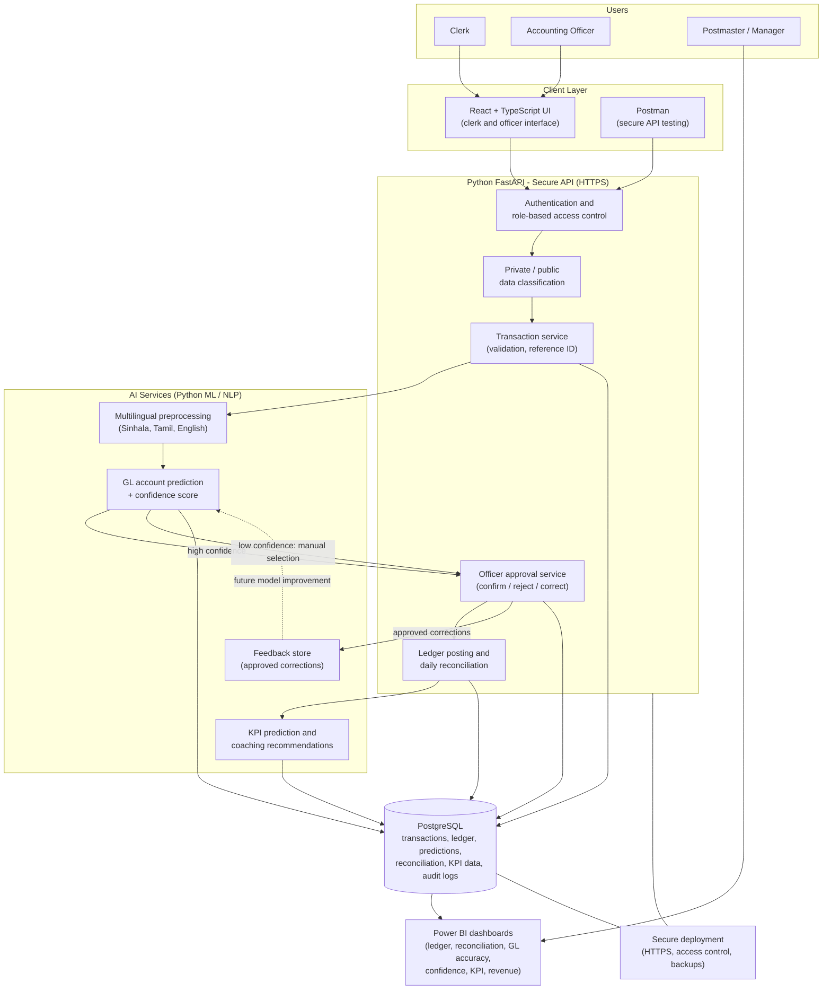

# Intelligent Ledger and KPI Prediction Module

**Component of PostAssist LK – Intelligent Backbone for Local Postal Services**
Project ID: J26-IT-372 · B.Sc. (Hons) in Information Technology, SLIIT

| | |
|---|---|
| **Student** | Gunawardena N C A (IT23323216) |
| **Supervisors** | Dr. Junius Anjana, Mrs. Poorna Panduwawala |
| **Status** | Research prototype (proposal stage → implementation) |

---

## 1. Overview

Postal branch staff must classify every daily transaction into the correct **General Ledger (GL) account**, reconcile records, and track performance. Transaction descriptions are written in **Sinhala, Tamil, and English**, so manual interpretation is slow and inconsistent.

This module applies **multilingual NLP and machine learning** to:

1. **Recommend a GL account** for each transaction, with a **confidence score**.
2. Route **low-confidence predictions to an authorized officer** (human-in-the-loop) for review or manual selection.
3. Store approved corrections as **feedback** for future model improvement.
4. Run **daily reconciliation** between transactions and ledger postings.
5. **Predict each officer's daily KPI achievement** and generate coaching recommendations.
6. Present everything in **Power BI dashboards**.

> **Design principle:** AI is a decision-support tool. Final accounting decisions always remain with authorized officers. KPI predictions are never used for disciplinary, promotion, or employment decisions.

## 2. Architecture and Workflow

```
Clerk entry (secure API) → GL prediction + confidence → Confidence threshold check
        ↓ (low confidence)                                    ↓ (high confidence)
 Officer review / manual correction  ←──────────────  Officer confirmation
        ↓
 Ledger posting + feedback logged → Daily reconciliation → KPI prediction → Power BI dashboard
```

### Transaction states
`created → submitted → validated → GL predicted → pending approval → approved / rejected → posted → reconciled` (or `exception`).

GL prediction confidence (`high`, `low`, `corrected`, `manually selected`) is tracked **separately** from the transaction state.

### System architecture



**Layer summary**

| Layer | Responsibility |
|---|---|
| Client | React UI for clerks and officers; Postman collection for API and security testing |
| Secure API (FastAPI) | Authentication, RBAC, data classification, validation, approval, posting, reconciliation, audit logging |
| AI services | Multilingual preprocessing, GL prediction with confidence, KPI prediction, feedback capture |
| Data | PostgreSQL for all transaction, ledger, prediction, reconciliation, KPI, and audit records |
| Analytics | Power BI reads validated, role-restricted data only |

## 3. Key Features

- **Secure clerk-to-officer API** with authentication, role-based and object-level authorization, private/public data classification, validation, and audit logging
- **GL account prediction** using description, amount, service type, branch, payment method, language, and historical records
- **Multilingual processing** (Sinhala, Tamil, English) with per-language evaluation
- **Confidence-based routing** with a threshold selected on validation data and fixed before final testing
- **Human-in-the-loop approval**: confirm, reject, or modify predictions; corrections stored for audit and learning
- **Daily reconciliation** that flags matched, unmatched, and inconsistent records
- **KPI prediction and personalized recommendations**
- **Power BI dashboards**: ledger postings, reconciliation status, GL accuracy, confidence levels, KPI achievement, revenue

## 4. Tech Stack

| Layer | Technology |
|---|---|
| Frontend (clerk/officer UI) | React + TypeScript |
| Backend / AI services | Python, FastAPI |
| ML / NLP | Python ML and NLP libraries (scikit-learn-style baselines, multilingual text models) |
| Database | PostgreSQL |
| API testing | Postman |
| Dashboards | Power BI |
| Deployment | Local first; optional secure cloud (HTTPS, access control, backups) |

## 5. API Summary

| Endpoint | Actor | Purpose |
|---|---|---|
| `POST /transactions` | Clerk | Submit a transaction; returns a unique reference ID |
| `POST /transactions/{id}/predictgl` | Officer / system | Generate GL recommendation + confidence score |
| `POST /transactions/{id}/approve-gl` | Finance officer | Confirm prediction or manually select an account |
| `POST /transactions/{id}/post` | Finance officer | Post approved transaction to the ledger (audited) |
| `POST /reconciliation/daily` | Finance officer | Compare transactions vs. ledger postings |
| `GET /dashboards/financialsummary` | Manager | Validated data for Power BI |

### Transaction payload (request)
`transaction_id`, `reference_id`, `transaction_description`, `amount`, `service_type`, `branch_id`, `payment_method`, `language`, `clerk_id`, `client_version`, `submitted_at`.
The clerk identity comes from authentication, not from the request body. The server adds `received_at`, `validation_status`, `GL_prediction`, `confidence_score`, `approval_status`, `policy_version`, and `transaction_revision`.

## 6. Proposed Repository Structure

```
.
├── api/                 # FastAPI app: auth, transactions, approvals, reconciliation
├── ml/
│   ├── gl_prediction/   # baseline + proposed GL models, confidence scoring
│   ├── multilingual/    # Sinhala / Tamil / English preprocessing
│   └── kpi/             # KPI prediction and recommendations
├── frontend/            # React + TypeScript clerk/officer UI
├── data/                # synthetic / anonymized datasets (not real records)
├── dashboards/          # Power BI files and data model notes
├── postman/             # API collection and test environments
├── tests/               # functional, security, and scenario tests (T01–T18)
├── docs/                # proposal, architecture, decision log
└── README.md
```

## 7. Getting Started (planned)

> Commands below are a starting template; adjust to the final project layout.

**Prerequisites:** Python 3.10+, Node.js 18+, PostgreSQL 14+, Postman, Power BI Desktop.

```bash
# 1. Backend
python -m venv .venv
source .venv/bin/activate          # Windows: .venv\Scripts\activate
pip install -r requirements.txt

# 2. Configuration – copy and edit; never commit secrets
cp .env.example .env               # DB URL, JWT secret, confidence threshold

# 3. Database
createdb postassist_ledger
alembic upgrade head               # or run the SQL schema scripts

# 4. Run the API
uvicorn api.main:app --reload

# 5. Frontend
cd frontend && npm install && npm run dev
```

Import the collection from `postman/` to exercise the secure clerk-to-officer workflow.

## 8. Datasets

| Dataset | Size | Notes |
|---|---|---|
| Postal transaction dataset | 1,000–1,500 records | Primary or approved anonymized/synthetic; split 60/20/20 (dev/validation/test), duplicates never cross partitions |
| Multilingual secondary dataset | Sinhala, Tamil, English text | Used for NLP evaluation |
| KPI dataset | 500–1,000 records | Operational or synthetic |
| API/security tests | 100+ valid/invalid requests | Prototype-level only |

**No real postal financial or employee records are committed to this repository.**

## 9. Evaluation and Acceptance Targets

These are *proposed targets*, not achieved results; final values are to be approved by the supervisors.

| ID | Objective | Target |
|---|---|---|
| SO1 | Secure API | ≥ 95% API tests pass; 100% of unauthorized-access tests rejected |
| SO2 | GL prediction | ≥ 85% macro-F1, compared with a baseline |
| SO3 | Multilingual + confidence review | Per-language reporting; ≥ 90% of high-confidence recommendations correct at the chosen threshold; low-confidence cases routed to officers |
| SO4 | Reconciliation + KPI | ≥ 90% reconciliation test-case accuracy; KPI performance reported with suitable metrics |

**Experiment configurations**
- API: B0 manual flow · B1 basic authenticated API · P1 full secure pipeline
- GL: B0 manual officer selection · B1 conventional ML on description + basic attributes · P1 proposed multi-feature model with confidence

Metrics: accuracy, precision, recall, macro-F1, top-k accuracy, confidence analysis, officer correction rate, response time, reconciliation accuracy, and KPI regression/classification metrics (with temporal validation).

## 10. Security and Privacy

- HTTPS, authentication, role-based and object-level authorization
- Secure password handling, session management, rate limiting, audit logging
- Financial and employee data treated as private; only approved, non-sensitive data reaches shared APIs and dashboards
- Secrets kept outside source code; protected backups
- If the API, database, or prediction service is down, the approved manual accounting procedure is used and entries are later recorded as explicitly marked reconciliation records

## 11. Timeline (24 weeks, ~600 hours)

| Weeks | Focus |
|---|---|
| 1–4 | Literature review, ethics, data and security design |
| 3–11 | Dataset preparation, secure API, GL mapping, baseline model |
| 9–18 | AI GL prediction, multilingual processing, human-in-the-loop |
| 18–24 | KPI model, reconciliation, Power BI, integration, evaluation, final report |

Milestones: **M1** week 4 · **M2** week 8 · **M3–M5** weeks 12–21.

## 12. Limitations

- Results depend on data quality; synthetic or limited data may not represent all Sri Lankan postal branches
- Prototype-level security testing only, not a formal security certification
- KPI predictions are decision-support information, not judgments of employee value
- Not a replacement for approved Sri Lanka Post accounting procedures, and no nationwide validation is claimed

## 13. Related PostAssist LK Components

This module sits alongside the Smart Registered Mail Intake & Tracking, Postal Delivery Operations & Relief Assignment, and Automated Address-Based Mail Sorting components. It can later expose approved APIs without sharing the complete financial database.

## 14. Acknowledgements

Department of Posts Sri Lanka, the researchers cited in the project proposal, and the academic guidance and ethical-review framework of the Sri Lanka Institute of Information Technology.

## 15. License

To be confirmed under SLIIT intellectual-property rules. Third-party libraries retain their own licenses.
