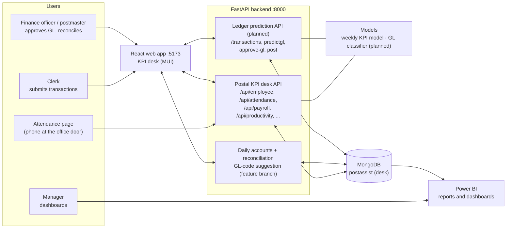

# PostAssist LK – Intelligent Backbone for Local Postal Services

**SLIIT final-year research project · J26-IT-372**

PostAssist LK digitises the daily work of a Sri Lankan post office: accepting and tracking registered mail,
organising delivery areas and postmen, managing staff attendance, KPIs, entitlements and pay, reconciling the
office's daily accounts, and reading addresses from mail images. This repository holds the whole system – the
shared FastAPI backend, the React web app, the Flutter staff mobile app, the IoT scale and camera firmware, the
machine-learning pipelines, the datasets and the documentation of every component.

**Stack:** Python (FastAPI) · MongoDB · React (Vite, Tailwind, MUI) · Flutter (Android/iOS) · ESP32-CAM (Arduino) ·
scikit-learn and PyTorch → ONNX models · Tesseract OCR · Power BI (optional reporting).

> **Status.** The KPI desk (§7) and, on the feature branch, daily accounts, reconciliation and GL-code suggestion
> (§6) are implemented. The multilingual GL classifier, confidence routing, feedback learning, the ledger API (§4)
> and the research evaluation are **planned research scope** (24-week provisional plan). Every number marked
> *proposed* or *target* below is **not an achieved result.**

---

## Contents

1. [Component overview and objectives](#1-component-overview-and-objectives)
2. [Architecture](#2-architecture)
3. [Ledger prediction workflow](#3-ledger-prediction-workflow)
4. [Secure ledger API (planned)](#4-secure-ledger-api-planned)
5. [Multilingual GL prediction and confidence routing](#5-multilingual-gl-prediction-and-confidence-routing)
6. [Daily accounts, reconciliation and officer approval](#6-daily-accounts-reconciliation-and-officer-approval)
7. [Postal KPI desk](#7-postal-kpi-desk)
8. [KPI prediction and coaching](#8-kpi-prediction-and-coaching)
9. [Web app (React)](#9-web-app-react)
10. [Backend API (FastAPI)](#10-backend-api-fastapi)
11. [Machine-learning models and results](#11-machine-learning-models-and-results)
12. [Datasets](#12-datasets)
13. [Repository layout](#13-repository-layout)
14. [Getting started](#14-getting-started)
15. [Configuration](#15-configuration)
16. [Testing](#16-testing)
17. [Branches, integration status and work plan](#17-branches-integration-status-and-work-plan)
18. [Documentation](#18-documentation)
19. [Limitations and honest notes](#19-limitations-and-honest-notes)

---

## 1. Component overview and objectives

PostAssist LK has four components. This README covers component 3.

**Intelligent Ledger and KPI Prediction Module** · Gunawardena N C A (IT23323216) · supervisors Dr. Junius Anjana
and Mrs. Poorna Panduwawala. It is the accounts and performance part of PostAssist LK. It covers the postmaster's
desk (staff, daily KPI, attendance, entitlements and pay), the office's daily accounts and cash reconciliation, and a
research extension that recommends the General Ledger (GL) account for each transaction from a Sinhala, Tamil or
English description, shows a confidence score, sends uncertain cases to an authorised officer, and predicts each
officer's daily KPI achievement with coaching suggestions. Everything is decision support: the officer approves every
ledger decision and a person decides on every pay, warning or promotion matter.

| # | Component | Owner |
|---|---|---|
| 1 | Smart Registered Mail Intake and Tracking | Senarathna W.L.S.K (IT23324138) |
| 2 | Postal Delivery Operations and Relief Assignment | team member |
| **3** | **Daily Accounts Reconciliation, Ledger Prediction and Postal KPI Desk** (research title: *Intelligent Ledger and KPI Prediction Module*) | **Gunawardena N C A (IT23323216)** |
| 4 | Postal Address City Extraction | team member |

What this component does in a post office:

* The **KPI desk** records each employee's daily work, attendance and leave, forecasts next week's KPI, and computes
  entitlements and pay (EPF/ETF).
* The **daily accounts** module imports the office's daily-account sheets and reconciles cash and ledger entries.
* **Ledger prediction** recommends the GL account for each transaction with a confidence score. An officer confirms,
  rejects or corrects it, and only approved decisions are posted.
* **KPI prediction** estimates daily KPI achievement per officer and suggests improvements.
* **Power BI dashboards** show ledger postings, reconciliation status, revenue, GL accuracy, confidence levels and
  KPI results to managers and postmasters.

Components 1 and 3 already share one backend process (port 8000) and one web app (port 5173). Other components may
later consume approved, versioned APIs from this module without access to the complete financial database.

### Specific objectives and proposed acceptance targets

The supervisor approves the final values after an initial feasibility check and before the held-out evaluation.

| ID | Objective | Proposed target (not yet achieved) |
|---|---|---|
| SO1 | secure clerk-to-officer API with authentication and data protection | ≥ 95 % of API tests succeed; all unauthorised-access tests rejected |
| SO2 | AI model predicts the correct GL account | ≥ 85 % macro-F1, compared with a baseline model |
| SO3 | Sinhala, Tamil and English support with confidence-based officer review | per-language results; ≥ 90 % of high-confidence recommendations correct at the chosen threshold; low-confidence cases routed to an officer, never auto-finalised |
| SO4 | KPI prediction, reconciliation and management dashboards | ≥ 90 % accuracy on reconciliation test cases; KPI prediction reported with suitable measures |

Non-functional targets include a 95th-percentile API response under 2 s at 10 concurrent pilot users, no duplicate
ledger records in idempotency tests, 100 % of low-confidence test cases offering manual selection, and no private
data in ordinary logs.

### Responsibility allocation

| Activity / deliverable | My responsibility | Shared | Other members |
|---|---|---|---|
| Secure API and transaction processing | clerk-to-officer API tested with Postman, data classification | agree common API and data formats | support integration |
| AI-based GL account prediction | develop and evaluate the GL model | define GL requirements and evaluation criteria | feedback on integration |
| Multilingual transaction processing | Sinhala, Tamil and English processing, per-language evaluation | agree multilingual data and testing requirements | support data preparation |
| Human-in-the-loop approval | confidence-based approval, officer verification, manual correction, feedback collection | define approval rules and user workflow | UI integration |
| Reconciliation and KPI prediction | reconciliation and KPI model linked to approved GL accounts | define reconciliation rules and validation scenarios | integration and testing |
| Power BI dashboard and analytics | dashboards for GL, reconciliation, KPI, confidence, revenue | agree dashboard requirements and data standards | system integration |
| Dataset preparation and evaluation | synthetic/secondary data, preprocessing, training, evaluation | review results | provide datasets |
| Documentation and final evaluation | methodology, experiments, results, limitations | final system testing | overall documentation |

---

## 2. Architecture



The desk's routes are registered after every registered-mail route so that they can never shadow them
(`backend/tests/test_combined_api.py`). The desk keeps its own MongoDB database (`KPI_MONGODB_DB`).

---

## 3. Ledger prediction workflow

*Research scope · Gunawardena N C A (IT23323216)*

```
Clerk entry (secure API) → GL prediction + confidence → threshold check → officer review / correction
      → ledger finalised, feedback logged → reconciliation → KPI prediction → dashboard and coaching output
```

### 3.1 A transaction's journey

1. **Entry.** The clerk submits description, amount, service type, branch, payment method and language through the
   secure API. The clerk's identity comes from the sign-in token, never from an editable field.
2. **Validation and classification.** Required fields and approved values are checked, the amount must be valid and
   non-negative, fields are classified as private or permitted public data, and a unique `reference_id` is returned.
3. **GL prediction.** The model recommends a GL account with a confidence score from the description, amount,
   service type, branch, payment method, language and historical records.
4. **Threshold check.** Above the predefined threshold the officer confirms the recommendation. Below it the
   officer must select or correct the account manually.
5. **Approval and posting.** The officer confirms, rejects or modifies the account. The original prediction, the
   decision, any correction and the timestamp are stored, then the transaction is posted with an audit trail.
6. **Daily reconciliation.** Transactions are compared with ledger postings and expected totals and marked
   *matched*, *unmatched* or *exception*. Discrepancies are highlighted for an officer, never ignored.
7. **KPI analytics and dashboards.** Approved records feed the KPI model and the Power BI dashboards.

### 3.2 States

Transaction state and prediction result are **stored separately**, so the progress of a transaction is never mixed
up with the confidence of the AI.

```
created → submitted → validated → gl_predicted → pending_approval → approved → posted → reconciled
                                                        │                │
                                                        │                └→ rejected → exception
                                                        └→ manual correction (officer selected) → approved
```

| Stored separately | Values |
|---|---|
| Transaction state | `created`, `submitted`, `validated`, `GL predicted`, `pending approval`, `approved`, `rejected`, `posted`, `reconciled`, `exception` |
| GL prediction result | `high confidence`, `low confidence`, `corrected`, `manually selected` |

Rejected transactions and missing approvals are logged as exceptions.

### 3.3 Roles

| Role | What it does |
|---|---|
| Clerk | enters and submits daily transactions through the secure API |
| Finance officer | confirms, rejects or corrects GL accounts, resolves low-confidence cases and reconciliation discrepancies, posts transactions |
| Manager / postmaster | views ledger, reconciliation, revenue, prediction-accuracy and KPI dashboards |
| Finance / accounts manager | operational decision-maker for ledger rules, reconciliation procedures and exception handling |

### 3.4 Key design decisions

* **Suggestions, not decisions.** No transaction is posted on an AI prediction alone.
* **Confidence is tested, not trusted.** High confidence is not assumed to mean correct; calibration is checked on a
  separate held-out set.
* **Only approved corrections feed learning.** An officer's correction is not assumed to be right until approved.
* **Private data stays private.** Financial and employee data is classified as private; only approved, aggregated
  data reaches shared APIs and dashboards, and logs avoid account details, personal data and tokens.
* **Failure falls back to the manual procedure.** If the API, database or prediction service is down, the approved
  manual accounting procedure is followed and the entry is made later as an explicitly marked reconciliation record,
  not as a false system record.

---

## 4. Secure ledger API (planned)

FastAPI REST API designed and tested with Postman. Interactive documentation at <http://localhost:8000/docs>.

| Endpoint | Actor | Behaviour |
|---|---|---|
| `POST /transactions` | clerk | create and submit a transaction; returns a unique reference ID |
| `POST /transactions/{id}/predictgl` | authorised officer / system | recommended GL account and confidence score from the transaction details and historical records |
| `POST /transactions/{id}/approve-gl` | finance officer | confirm the prediction or select an alternative, especially when confidence is below the threshold |
| `POST /transactions/{id}/post` | authorised finance officer | post the approved transaction to the selected GL account with an audit trail |
| `POST /reconciliation/daily` | finance officer | compare transactions with ledger postings and return mismatches for review |
| `GET /dashboards/financialsummary` | authorised manager | validated financial, reconciliation, GL-prediction and KPI indicators for Power BI, with data-access rules enforced |

**Request fields:** `transaction_id`, `reference_id`, `transaction_description`, `amount`, `service_type`,
`branch_id`, `payment_method`, `language`, `clerk_id` (from the token), `client_version`, `submitted_at`.

**Added by the server:** `received_at`, `validation_status`, `GL_prediction`, `confidence_score`, `approval_status`,
`policy_version`, `transaction_revision`. Submission time and receipt time are kept apart so a delayed request is not
wrongly rejected.

**Security:** authentication and role-based authorisation on every endpoint, object-level authorisation (changing an
ID gives no access to another transaction), HTTPS, secure password handling, session management, rate limiting,
audit logging, protected backups, secrets kept outside the source code, and no sensitive data in responses or logs.

**Configurations compared (SO1):**

| Config | Meaning |
|---|---|
| B0 | existing manual transaction flow |
| B1 | basic API workflow with authentication and structured exchange |
| P1 | B1 + private/public data classification, validation, secure exchange and audit logging |

Test material: 100+ valid and invalid requests (missing fields, wrong credentials, unauthorised roles, duplicate
reference IDs, invalid amounts) and 1,000 replay requests. Prototype-level only, not a security certification.

---

## 5. Multilingual GL prediction and confidence routing

*Research scope (WP4–WP5).*

**Inputs:** transaction description (Sinhala, Tamil or English), amount, service type, branch, payment method,
language and historical records. **Outputs:** recommended GL account, confidence score, model version, language,
prediction time.

| Configuration | Meaning |
|---|---|
| B0 | manual GL selection by the officer |
| B1 | conventional ML classifier on the description and basic attributes (baseline) |
| P1 | proposed model using description, amount, service type, branch, payment method, language and history |

* **Languages:** Sinhala, Tamil and English descriptions are normalised and evaluated **separately**, because English
  performance cannot be assumed for the other two. Open-source processing is preferred; an external translation API
  is optional and may have limits or cost.
* **Features:** the study checks that each added feature really improves prediction instead of assuming that more
  features are better.
* **Confidence:** every recommendation carries a score. The threshold is chosen on validation data and fixed before
  the final test. High-confidence predictions go to the officer for confirmation, low-confidence ones need manual
  selection.
* **Split:** development / validation / held-out test (60 / 20 / 20), with related or duplicate transactions kept
  inside one partition.
* **Feedback:** performance is compared before and after adding approved corrections as learning feedback.
* **Metrics:** accuracy, precision, recall, macro-F1, top-k accuracy, per-account and per-language results,
  confidence analysis, officer correction rate.
* **Success rule:** a prediction that is faster but increases wrong GL assignments does not count as success.

---

## 6. Daily accounts, reconciliation and officer approval

### 6.1 Implemented on the feature branch

| Area | Functions |
|---|---|
| **Daily accounts** | import of `.xlsx`, `.xls` and `.csv` daily-account sheets with multiple worksheets, header detection, automatic and custom column mapping, summary-row exclusion and staged batches; validation issues with corrections; categories such as money orders, postal services, stamp stock, utility collections, pension/welfare and expenses/imprest; daily, weekly and monthly aggregations, trends and revenue breakdown |
| **Cash reconciliation and ledger** | cash reconciliation by the accounting rules; **GL-code suggestion** for every transaction from the postal chart of accounts with a confidence, approved or corrected by the postmaster; clerk transaction entry and status workflow; consolidated and category Excel reports; audit history |
| **Postmaster sign-in** | scrypt password hashes, HttpOnly session cookie (8 h), CSRF token, lockout after five failed attempts, postmaster and clerk roles |
| **Reporting** | Postal KPI dashboard; six related reporting datasets and an Excel workbook for Power BI; optional Power BI embedding through a service principal (tokens stay on the server) |

### 6.2 Research extension (planned)

* **Officer approval:** confirm, reject or modify any prediction before posting; 100 % of low-confidence test cases
  offer manual selection; the original prediction, decision, correction and timestamp are stored.
* **Reconciliation test:** controlled records with known expected totals, ledger balances and references check the
  *matched / unmatched / exception* logic. Results must stay consistent after repeated processing and a restart.
* **Notifications** (reference ID only, no unnecessary details): clerk – submitted and waiting for approval;
  officer – recommended account with confidence, or please review a low-confidence case; approval confirmation; daily
  matched / unmatched counts; KPI message with areas for improvement.

---

## 7. Postal KPI desk

*Branch `feature/daily-accounts-reconciliation-ledger-prediction`.* A desk for the postmaster that covers staff,
performance and pay. Its backend is `backend/main.py` + `backend/routes.py` (database `KPI_MONGODB_DB`, default
`postassist`); its pages live under `frontend/src/admin/`, `frontend/src/attendance/` and
`frontend/src/entitlements/`.

### 7.1 Functions on `main`

| Area | Functions |
|---|---|
| **Employee records** | employee list and form, field options (drop-down values) managed in the desk, Excel import and export of employees and daily KPI logs |
| **Daily KPI log** | per employee and day: task type, route and distance, assigned, completed, correct, on-time and late work, approvals processed, accounts verified, revenue collected; completion, accuracy and timeliness rates, KPI score and performance category |
| **Attendance** | phone page at the office door (`/attendance-qr/token`): the phone's location must be within the office radius; time-in / time-out classified as *on time*, *late* or *half day* by the configured time windows; one check-in and one check-out per day; closed days refused; attendance log list and form |
| **Attendance and pay settings** | office location and radius, opening days, on-time, late, half-day and check-out windows, late deduction, overtime rate, EPF (employee and employer) and ETF percentages |
| **Productivity** | next-week KPI estimate per employee from the trained weekly KPI model (`backend/models/weekly_kpi_model.joblib`) with a plain-language summary of the measured rates |
| **Entitlements** | dashboard and pages for leave, holiday pay, overtime, gratuity (5-year minimum), promotions, transfers, family benefits, retirement and loans |
| **Payroll** | monthly pay from basic salary, late attendance, overtime and contribution rates; EPF and ETF views |

### 7.2 Functions on the feature branch (not yet merged into `main`)

| Area | Functions |
|---|---|
| **Attendance security** | short-lived door code from the postmaster's settings screen, employee attendance credentials, duplicate-scan window, daily attendance, roster, calendar and export |
| **KPI forecasts** | next-week KPI from a **gradient-boosting** model (26 features: work counts and rates, route length, leave, overtime, KPI history, office, designation, work category, employment type); weekly KPI = completion 0.40 + accuracy 0.30 + timeliness 0.30 (provisional weights); forecast monitoring against the recorded weeks; read-only random-forest preview |
| **KPI simulator** | what-if scenarios (e.g. workload +20 %, productivity +5 % or +10 %, extra working hours) evaluated with the same model, with saved simulation history |
| **AI productivity coach** | evidence-based coaching notes on timeliness, accuracy and completion, and a chat that answers supported questions in English and Sinhala |
| **Performance review and work allocation** | 24-month promotion review (example rules: mean KPI ≥ 85, attendance ≥ 90 %), daily work allocation with cover routes, approved by a person |
| **Leave** | leave requests with postmaster approval, rejection and cancellation, shown on leave calendars and in the daily attendance summary; gratuity from the service period; overtime from the day's records |

Forecasts, coaching and reviews are **monitoring aids only** – they never change pay, warnings or promotions
without a person's decision.

---

## 8. KPI prediction and coaching

**Goal (research scope):** predict an officer's **daily KPI achievement** and give personalised suggestions.

| Item | Detail |
|---|---|
| Inputs | operational transaction records, daily task completion, work history, revenue contribution, rewards and other approved performance indicators |
| Output | predicted daily KPI achievement, with personalised KPI and coaching recommendations that show the prediction or confidence behind them |
| Evaluation | predefined regression or classification measures against actual KPI values and a simple baseline |
| Validation | temporal validation (train on earlier days, test on later days) so future information does not leak into training |

KPI predictions are decision support only. They never decide discipline, promotion or employment, because
historical performance data can carry organisational bias, be incomplete, or reflect opportunity rather than
ability. The existing next-week model (§7) is the starting point for this work.

**Dashboards (Power BI)** show ledger postings and approved entries, reconciliation status, revenue indicators, GL
prediction accuracy and confidence levels, KPI achievement and recommendations. Figures are checked against known
test values and must not show unauthorised private data.

---

## 9. Web app (React)

`frontend/` – one Vite app (React 19) served on `https://localhost:5173` (also `https://<laptop-IP>:5173` on the
LAN). Vite forwards `/api` to the backend. The KPI desk uses MUI.

**Postal KPI desk (component 3)**

| Page | Route |
|---|---|
| Employees | `/employee`, `/employee/:id` |
| Daily KPI log | `/daily-kpi-log`, `/daily-kpi-log/:id` |
| Attendance log | `/attendance-log`, `/attendance-log/:id` |
| Door attendance page | `/attendance-qr/token` |
| Productivity | `/productivity` |
| Entitlements and payroll | `/entitlements`, `/entitlements/payroll`, `/entitlements/epf`, `/entitlements/etf`, `/entitlements/leave`, `/entitlements/holiday-pay`, `/entitlements/overtime`, `/entitlements/gratuity`, `/entitlements/promotions`, `/entitlements/transfers`, `/entitlements/family-benefits`, `/entitlements/retirement`, `/entitlements/loans` |
| Settings | `/settings` |
| Feature branch only | `/kpi-forecasts`, `/forecast-monitoring`, `/kpi-simulator`, `/work-allocation`, `/daily-accounts`, `/postal-kpi-dashboard`, sign-in |

**Planned ledger screens:** transaction entry (clerk), GL prediction review with confidence and confirm / reject /
modify / manual selection (finance officer), posting and audit history, daily reconciliation with exceptions, and
KPI prediction with recommendations. The wireframes are functional drafts; labels and multilingual content will be
refined through user feedback and local-language review.

Webcam capture and the door attendance page need `localhost` or HTTPS. Set `VITE_HTTPS=false` in `frontend/.env`
for plain HTTP.

---

## 10. Backend API (FastAPI)

One process: `uvicorn app.main:app` in `backend/` serves the registered-mail API and, when its packages are
installed, the KPI desk API. Interactive documentation at <http://localhost:8000/docs>.

**Postal KPI desk (component 3)** – `backend/routes.py`, health at `/health`

| Endpoints | Purpose |
|---|---|
| `GET/POST/PUT/DELETE /api/{doctype}[/{name}]` | generic records: `employee`, `daily_kpi_log`, `attendance_log` |
| `POST /api/import/excel`, `GET /api/export/employee`, `GET /api/export/daily_kpi_log` | Excel import and export |
| `GET/POST /api/field-options` | drop-down values |
| `GET/PUT /api/settings/attendance`, `POST /api/attendance/location`, `POST /api/attendance/scan` | attendance settings, location check, time-in / time-out |
| `GET /api/payroll` | monthly payroll |
| `GET/POST/DELETE /api/entitlements/{module}[/{id}]` | entitlement records |
| `GET /api/productivity/{employee_id}` | next-week KPI estimate |

The feature branch adds `/api/auth/*`, `/api/daily-accounts/*`, `/api/kpi/forecasts*`, `/api/kpi/simulations*`,
`/api/forecast-monitoring`, `/api/productivity/{id}/coach`, `/api/promotion-review`, `/api/allocation`,
`/api/leave`, `/api/gratuity`, `/api/postal-kpi/dashboard`, `/api/reporting/*` and `/api/powerbi/*`.

The planned research ledger API is described in [§4](#4-secure-ledger-api-planned).

---

## 11. Machine-learning models and results

| Model | Task | Result (held-out data) |
|---|---|---|
| **Weekly KPI model** (`backend/models/weekly_kpi_model.joblib`) | next week's KPI from this week's rates and counts | later weeks of 16 employees (60 test rows): MAE **3.41** vs 3.81 for "same as this week" and 7.93 for the simple baseline; RMSE 4.55 |
| Gradient-boosting next-week KPI model (feature branch) | next-week KPI from 26 workload, history and employee features | see the branch's `backend/evaluation/evaluate_next_week_kpi.py` |
| GL-code suggestion (feature branch) | GL account for each daily-account transaction | category mapping to the postal chart of accounts with a confidence; low-confidence codes wait for approval |
| **Multilingual GL account classifier** (research, planned) | GL account from Sinhala / Tamil / English description, amount, service type, branch, payment method and history, with confidence | proposed target ≥ 85 % macro-F1 vs a baseline classifier; per-language and confidence reliability to be reported; **not yet measured** |
| **Daily KPI predictor** (research, planned) | daily KPI achievement per officer | evaluated with temporal validation against a simple baseline; **not yet measured** |
| **Reconciliation rules** (research, planned) | matched / unmatched / exception | proposed target ≥ 90 % accuracy on controlled test cases; **not yet measured** |

Experiments (planned): (1) secure API B0 / B1 / P1; (2) GL prediction B0 / B1 / P1; (3) multilingual, reconciliation
and KPI prediction; (4) the integrated workflow entry → secure API → GL prediction → officer approval → ledger
posting → reconciliation → KPI prediction → Power BI. End-to-end metrics: processing time, transaction accuracy,
reconciliation accuracy, successful API requests, dashboard consistency, completion of defined user tasks.

---

## 12. Datasets

| Dataset | Size | Ground truth | Used for |
|---|---|---|---|
| research workbook behind the weekly KPI model | – | recorded weekly KPI | weekly KPI model |
| synthetic employee-weeks file (feature branch) | 30 employees × 52 weeks | generated KPI values | KPI models and development data |
| **planned** primary postal transaction dataset (approved, anonymised or synthetic) | 1,000–1,500 unique records, 60 / 20 / 20 split | GL account verified by predefined rules and authorised review | GL prediction, reconciliation, confidence evaluation |
| **planned** multilingual secondary dataset | Sinhala, Tamil and English text records | existing labels and predefined NLP criteria | per-language evaluation |
| **planned** KPI prediction dataset | 500–1,000 operational or synthetic records | predefined KPI values and approved indicators | daily KPI prediction |
| **planned** synchronisation and API test sets | 1,000 replay requests; 100+ valid and invalid requests | expected event IDs, revisions, responses and access rules | idempotency and security tests |

Real postal financial and employee records are sensitive, so synthetic, anonymised or approved secondary data is
preferred. None of these datasets claims to represent all Sri Lankan postal branches.

---

## 13. Repository layout

Component 3 files in the shared repository (planned additions in italics):

```
J26-IT-372/
├── backend/
│   ├── models/               weekly KPI model (weekly_kpi_model.joblib)
│   ├── main.py, routes.py    Postal KPI desk API
│   ├── attendance.py, payroll.py, productivity.py, excel_io.py, db.py   desk modules
│   ├── test_productivity.py  desk test
│   ├── evaluation/           next-week KPI evaluation (feature branch)
│   ├── *ledger prediction API, GL model and reconciliation (planned)*
│   └── requirements.txt, .env.example
├── frontend/
│   └── src/
│       ├── admin/, attendance/, entitlements/   KPI desk pages
│       └── App.jsx                              routes
├── *postman/                 secure API collection (planned)*
├── *powerbi/                 dashboard file and data-source notes (planned)*
└── Documents/                proposal, requirements, setup and test documents
```

---

## 14. Getting started

### 14.1 Prerequisites

| Tool | Version tested | Needed for |
|---|---|---|
| Python | 3.14 (3.11+ works) | backend, ML |
| Node.js | 22 LTS | web app |
| MongoDB Community Server | 8.2 | database (local service, portable `mongod` or Atlas via `KPI_MONGODB_URI`) |
| Postman | – | secure API testing (planned collection) |
| Power BI workspace + service principal | – | optional reporting and embedding (feature branch) |

### 14.2 Backend

```bash
cd backend
python -m venv .venv
.venv/Scripts/python -m pip install -r requirements.txt
cp .env.example .env            # set JWT_SECRET and the KPI desk variables (§15)
.venv/Scripts/python -m uvicorn app.main:app --host 0.0.0.0 --port 8000 --reload
```

The KPI desk API can also run on its own with `.venv/Scripts/python main.py`. Start with `--host 0.0.0.0` so that
phones can reach the door attendance page, and allow port 8000 through the Windows firewall on private networks.

### 14.3 Web app

```bash
cd frontend
npm install
npm run dev                     # https://localhost:5173
```

### 14.4 KPI desk steps

* Open `/employee` in the web app.
* On the feature branch also set `POSTMASTER_USERNAME`, `POSTMASTER_PASSWORD` and `ATTENDANCE_DOOR_SECRET` in
  `backend/.env`.
* Use synthetic employee and transaction data unless operational and ethics approval has been obtained.

### 14.5 Ledger prediction steps (planned)

1. Import the Postman collection and run it against `http://localhost:8000` (valid and invalid submissions, roles,
   duplicates).
2. Submit a transaction, request `predictgl`, then approve or correct it as the finance officer.
3. Post it, run `/reconciliation/daily`, and open the Power BI dashboard on the validated reporting data.

---

## 15. Configuration

`backend/.env` (copy of `backend/.env.example`):

| Variable | Default | Status | Meaning |
|---|---|---|---|
| `KPI_MONGODB_URI`, `KPI_MONGODB_DB` | – , `postassist` | implemented | KPI desk database |
| `POSTMASTER_USERNAME`, `POSTMASTER_PASSWORD`, `AUTH_COOKIE_SECURE` | – | feature branch | first postmaster account and cookie security |
| `ATTENDANCE_DOOR_SECRET`, `ATTENDANCE_TOKEN_SECONDS`, `ATTENDANCE_DUPLICATE_SECONDS` | – , 120, 90 | feature branch | door code for attendance |
| `POWERBI_TENANT_ID`, `POWERBI_CLIENT_ID`, `POWERBI_CLIENT_SECRET`, `POWERBI_WORKSPACE_ID`, `POWERBI_REPORT_*` | empty | feature branch | optional Power BI embedding |
| `CONFIDENCE_THRESHOLD` | chosen on validation data | planned | GL confidence threshold, fixed before final testing |
| `MODEL_VERSION_GL`, `MODEL_VERSION_KPI` | – | planned | model versions stored with each prediction |

`frontend/.env`: `VITE_API_PROXY` (default `http://127.0.0.1:8000`), `VITE_HTTPS`. Secrets are never committed.

---

## 16. Testing

| Area | Command | What is tested |
|---|---|---|
| KPI desk | `cd backend && .venv/Scripts/python -m pytest -q test_productivity.py` | 4 tests of the weekly KPI forecast; the feature branch adds tests for daily accounts, attendance security, sign-in, entitlements, leave, forecasts, simulator, coach, reporting and Power BI |
| Ledger prediction (planned) | `pytest` plus the Postman collection | scenarios T01–T18 (below) |

| Test group | Scenarios |
|---|---|
| API (T01–T03, T13–T16) | valid submission accepted; missing description rejected; invalid or negative amount rejected; unauthenticated or unauthorised access denied; duplicate identifier handled; API or network failure leaves no partial commit |
| Multilingual (T04–T08) | valid Sinhala, Tamil and English descriptions produce predictions; unsupported language rejected or flagged; service type, branch and payment method used |
| Confidence and approval (T09–T12) | above-threshold recommendation shown for confirmation; below-threshold routed to an officer; approval recorded; rejection and manual correction stored as the approved classification |
| Data protection (T14) | private employee or financial data denied to unauthorised roles |
| Reconciliation and KPI (T17–T18) | transactions compared and status generated; daily KPI predicted for dashboard and recommendations |

---

## 17. Branches, integration status and work plan

| Component | Branch | In `main` |
|---|---|---|
| 3 – Daily Accounts Reconciliation, Ledger Prediction and Postal KPI Desk | `feature/daily-accounts-reconciliation-ledger-prediction` | KPI desk core merged ([PR #2](https://github.com/GUNAWARADANANCA/J26-IT-372/pull/2)); daily accounts, sign-in, forecasts, simulator, coach, work allocation and reporting still on the branch |

**Work packages (provisional 24 weeks, about 600 planned hours)**

| Package | Output |
|---|---|
| WP1 Research and evidence | protocol, evidence matrix, research questions, frozen test dataset |
| WP2 Data and transaction foundation | validated dataset, GL mapping, data-classification rules |
| WP3 Secure API pipeline | tested Postman collection, successful transaction flow, API security results |
| WP4 AI GL prediction | trained model, confidence results, accuracy metrics, multilingual evaluation |
| WP5 Human approval and reconciliation | approval workflow, correction records, reconciliation results, exception report |
| WP6 KPI prediction and dashboard | KPI results, recommendations, Power BI dashboard |
| WP7 Integration and validation | integrated prototype, test report, comparison with baselines |
| WP8 Handover and demonstration | setup guide, API documentation, final report, demonstration |

Milestones: **M1** week 4 (API design, data classification, permissions, scope) · **M2** week 8 (dataset, split,
baseline GL model) · **M3–M5** weeks 12–21 (secure API, multilingual GL prediction, approval, reconciliation, KPI,
dashboards, security). The held-out evaluation cannot start until thresholds and task scripts are frozen.

---

## 18. Documentation

| Document | Contents |
|---|---|
| Project proposal report, J26-IT-372 (Gunawardena N C A) | background, literature review, research gap, objectives, methodology, architecture, requirements FR01–FR18 and NFR01–NFR10, commercialisation, budget, WBS, Gantt chart |
| Proposal appendices | interface drafts, interview and observation guide, acceptance and failure tests T01–T18, message templates, transaction payload and policy record, decision log, AI use disclosure |
| README on the component's branch | postmaster sign-in, next-week KPI model, Power BI reporting and embedding |
| Postman collection (planned) | secure API tests |
| Evaluation scripts | `backend/evaluation/evaluate_next_week_kpi.py` (feature branch) |

---

## 19. Limitations and honest notes

* **No research results are claimed yet.** Every accuracy, F1, confidence, reconciliation and KPI figure for the
  multilingual GL model, confidence routing and ledger API is a proposed target, not a measured result.
* **Data:** the prototype uses approved, anonymised, secondary or synthetic data and may not represent all Sri Lankan
  postal branches. Synthetic or limited KPI history reduces generalisability.
* **Multilingual:** Sinhala and Tamil have fewer language resources than English, so English results must not be
  assumed to hold for them. GL model quality also depends on consistent, correctly labelled accounts and class
  balance.
* **KPI desk:** forecasts, coaching notes, promotion reviews and work allocations are monitoring aids that a person
  must approve; the KPI weights and review rules are provisional, not official Sri Lanka Post standards. Do not
  expose the desk API publicly until HTTPS and secure cookies are configured.
* **Security:** API testing is prototype level and not a security certification. Production use would need separate
  secure hosting, data protection, staff training and support.
* **Scope:** the module does not replace approved Sri Lanka Post accounting procedures and has no integration with
  official financial systems. Nationwide validation and organisation-wide rollout are outside the project.
* Research prototype: use synthetic transaction and staff data unless operational and ethics approval has been
  obtained.
