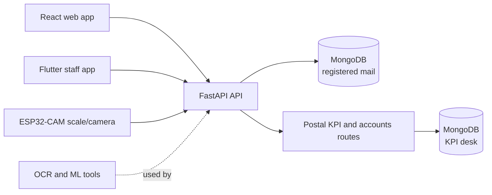

# PostAssist LK

**J26-IT-372 | Research prototype for local postal services**

PostAssist LK is a multi-part postal operations prototype. It brings registered-mail intake and tracking, staff
operations, daily accounts, and address-processing research together around a FastAPI and MongoDB backend. The
repository also contains a Flutter mobile app, ESP32-CAM scale firmware, machine-learning pipelines, datasets, and
project documentation.

The project is intended for demonstration and research. Use synthetic data unless operational and ethics approval
has been obtained. Recommendations and forecasts support staff decisions; they do not replace an authorised
officer's review.

## Project components

The primary research focus documented here is **Component 1: the Intelligent Ledger and KPI Prediction Module**,
also referred to as Daily Accounts Reconciliation, Ledger Prediction and the Postal KPI Desk.

Component 1 is led by Gunawardena N C A (IT23323216), under supervisors Dr. Junius Anjana and
Mrs. Poorna Panduwawala. The registered-mail component is led by Senarathna W.L.S.K (IT23324138).

| # | Component | Purpose | Current implementation | Key code or data locations |
|---|---|---|---|---|
| **1** | **Intelligent Ledger and KPI Prediction Module** (Daily Accounts Reconciliation, Ledger Prediction and Postal KPI Desk) | Manage staff, attendance, daily KPIs, entitlements, payroll, productivity, and office accounts | FastAPI routes and React desk pages, including daily-account imports, reconciliation, reporting, and GL-code suggestions | `backend/main.py`, `backend/routes.py`, `backend/attendance.py`, `backend/payroll.py`, `backend/productivity.py`, `frontend/src/admin/`, `frontend/src/attendance/`, `frontend/src/entitlements/` |
| 2 | Smart Registered Mail Intake and Tracking | Register, price, label, scan, review, and track registered mail | FastAPI API, React web app, Flutter staff app, and ESP32-CAM scale/camera integration | `backend/app/`, `frontend/src/pages/`, `frontend/src/components/`, `mobile_app/flutter_app/`, `iot/`, `ml/` |
| 3 | Postal Delivery Operations and Relief Assignment | Organise delivery areas and provide delivery-operation data | Kaduwela-area dataset and related documentation | `Datasets/kaduwela_postal_dataset_Final.xlsx` |
| 4 | Postal Address Beat/City Extraction | Identify a destination city from a mail-item image | Tesseract-based notebook and sample images | `firmware/address_extraction.ipynb` |

The multilingual machine-learning GL classifier and a separate secure ledger-prediction API are research extensions,
not completed product features. See [Limitations](#limitations) and the component documentation for scope details.

### Component responsibilities

| Component or role | Responsibility |
|---|---|
| Intelligent Ledger and KPI Prediction Module | The feature branch's daily-account import, reconciliation workflow, GL-code suggestions, staff/KPI desk, and reporting; the multilingual GL classifier and separate ledger API remain proposed research. |
| Smart Registered Mail Intake and Tracking | Counter intake, pricing, labels, tracking scans, review, notifications, and the supporting web, mobile, and IoT integrations. |
| Postal Delivery Operations and Relief Assignment | Delivery-area data and supporting research for delivery assignments and relief planning; this repository does not provide an integrated delivery-management application. |
| Postal Address Beat/City Extraction | Notebook-based OCR and city matching from mail images; it is a research utility, not a production address service. |
| Clerk | Enters and submits daily transactions; identity for any future secure ledger API must come from the authenticated session, not an editable request field. |
| Finance officer / postmaster | Reviews and corrects GL suggestions, approves transactions, resolves reconciliation exceptions, and authorises posting. |
| Manager | Reviews authorised, appropriately aggregated financial, reconciliation, and KPI reporting. |

### Proposed research responsibility allocation

| Workstream | Component lead focus | Shared or team contribution |
|---|---|---|
| Secure transaction API | Draft and test clerk-to-officer transaction processing and data classification. | Agree API contracts, data formats and integration requirements. |
| GL prediction and multilingual processing | Develop and evaluate the classifier and report Sinhala, Tamil and English results separately. | Define GL requirements and evaluation criteria; support data preparation. |
| Human approval and reconciliation | Design confidence-based review, officer correction, feedback capture and reconciliation tests. | Agree approval rules, exception handling and user workflow; support UI integration and testing. |
| KPI prediction and reporting | Evaluate KPI prediction and prepare authorised reporting for GL, reconciliation and KPI measures. | Agree dashboard requirements, data standards and system integration. |
| Dataset and final evaluation | Prepare approved, anonymised or synthetic research data; document methods, experiments and limitations. | Review results, provide approved datasets where available, and contribute to final system testing and documentation. |

## Daily accounts and ledger research status

**Implemented on this feature branch:** daily-account workbook import, validation and correction; category and summary
views; cash reconciliation; transaction workflows; reporting/export; and GL-code suggestions for officer review.
**Proposed research only:** a multilingual GL classifier with confidence-based routing and a separate secure ledger API.
The targets and designs below describe intended evaluation, not completed system behavior.

The implemented importer supports `.xlsx`, `.xls` and `.csv` files, multiple worksheets, header detection, column
mapping, summary-row exclusion and staged batches. Account categories include money orders, postal services, stamp
stock, utility collections, pension/welfare and expenses/imprest. Daily, weekly and monthly summaries include trends
and revenue breakdowns. Suggestions do not post ledger transactions automatically.

The proposed research extension is a multilingual GL classifier using transaction description, amount, service type,
branch, payment method, language and approved historical data. It would return a recommended account, confidence
score and model metadata. Even a high-confidence recommendation requires officer confirmation; low-confidence cases
must be routed for manual selection.

### Research workflow and safeguards

The planned transaction flow is:

```text
clerk submission → validation → GL suggestion and confidence → officer review or correction
                 → approval → posting → reconciliation → KPI analysis and reporting
```

The design keeps transaction state separate from prediction status. Proposed transaction states include
`created`, `submitted`, `validated`, `gl_predicted`, `pending_approval`, `approved`, `rejected`, `posted`,
`reconciled` and `exception`; prediction outcomes include high/low confidence, corrected and manually selected.
A rejection or missing approval is surfaced as an exception rather than silently treated as a completed posting.

| Role | Proposed responsibility |
|---|---|
| Clerk | Submit a transaction with its business details through an authenticated workflow. |
| Finance officer | Confirm, reject or correct a suggestion; resolve low-confidence cases and reconciliation discrepancies; authorise posting. |
| Manager / postmaster | Review authorised summaries of ledger activity, reconciliation, revenue, prediction quality and KPI results. |

These are research roles and do not imply that the proposed ledger API or every listed permission is currently
implemented. Posting must require an authorised person's approval; the prediction alone must never finalise a
transaction.

The research design calls for an authenticated clerk to submit a transaction and an authorised finance officer to
confirm, reject or correct its suggested account. Proposed API operations include transaction submission,
prediction, approval, posting, daily reconciliation and an authorised financial summary. These are design scope,
not claims that a separate ledger-prediction API is currently implemented.

| Proposed operation | Intended use |
|---|---|
| `POST /transactions` | Validate and submit a clerk transaction; return a reference ID |
| `POST /transactions/{id}/predictgl` | Return a suggested GL account and confidence |
| `POST /transactions/{id}/approve-gl` | Confirm, reject or correct the suggestion as an authorised officer |
| `POST /transactions/{id}/post` | Post an approved transaction with an audit trail |
| `POST /reconciliation/daily` | Compare transactions with ledger postings and report exceptions |
| `GET /dashboards/financialsummary` | Provide an authorised, aggregated financial summary |

The endpoints above are **proposed research interfaces**, not the implemented daily-account routes. The current
feature branch's daily-account transaction routes are under `/api/daily-accounts/transactions`; see
[`backend/routes.py`](backend/routes.py) and the OpenAPI page at <http://localhost:8000/docs> when running the API.

#### Proposed transaction API fields

The following is a draft contract for the planned ledger API, not a description of a currently implemented
request/response schema:

| Field | Direction | Proposed meaning |
|---|---|---|
| `transaction_id` | Request or server-assigned | Transaction identifier; uniqueness and assignment rules must be defined by the API contract. |
| `reference_id` | Request | Client or source reference used to detect duplicate submissions. |
| `transaction_description` | Request | Transaction description in Sinhala, Tamil or English. |
| `amount` | Request | Non-negative transaction amount, validated against the approved currency and accounting rules. |
| `service_type` | Request | Approved postal service or transaction category. |
| `branch_id` | Request | Identifier for the submitting branch. |
| `payment_method` | Request | Approved payment method. |
| `language` | Request | Declared or detected description language; validation behavior remains to be specified. |
| `clerk_id` | Server-derived | Authenticated clerk identity; must not be trusted from a caller-editable field. |
| `client_version`, `submitted_at` | Request metadata | Client version and client submission time; validation and clock-skew rules remain to be defined. |
| `received_at` | Server-generated | Server receipt time, kept distinct from client submission time. |
| `validation_status` | Server-generated | Result of schema and business-rule validation. |
| `gl_prediction`, `confidence_score` | Server-generated | Proposed GL account and model confidence, with model/version metadata retained for audit. |
| `approval_status` | Server-generated | Approval workflow state and recorded decision. |
| `policy_version`, `transaction_revision` | Server-generated | Applicable validation/prediction policy and transaction revision for traceability. |

Final field names, optionality, enumerations, error responses, versioning, and identity rules must be agreed and tested
before implementation. Do not send secrets or unnecessary personal or financial details in ordinary logs.

Key safeguards are human approval before posting, audit history for the prediction and any correction, idempotent
processing, role/object-level access checks, privacy-preserving logs and manual accounting procedures when services
are unavailable. Only approved corrections are candidates for model feedback; dashboards should expose only
authorised and appropriately aggregated information.

### Research evaluation plan

The classifier is to be compared with manual GL selection and a conventional ML baseline. A proposed
development/validation/held-out-test split is 60/20/20; this split must be confirmed after data-feasibility review.
Related or duplicate transactions must remain in one partition to limit leakage. Sinhala, Tamil and English results
should be reported separately. Choose the confidence threshold on validation data and freeze it before held-out
testing. Compare feature groups rather than assuming every additional field improves predictions. If translation
services are considered, evaluate their privacy, cost and language-specific effects separately.

The proposal includes targets such as at least 85% macro-F1 against a baseline and at least 90% correctness among
high-confidence suggestions. These are **proposed research targets, not achieved results**. A controlled
reconciliation dataset is also planned to test matched, unmatched and exception outcomes, including repeat processing
and restart behavior. Use approved, anonymised or synthetic financial and employee data; planned dataset sizes and
targets are not evidence of completed evaluation.

| Evaluation area | Proposed method and measures |
|---|---|
| GL classification | Compare manual selection (B0), a conventional classifier using description/basic attributes (B1), and the proposed feature set (P1). Report accuracy, precision, recall, macro-F1, top-k accuracy, and per-account results. |
| Language | Report Sinhala, Tamil and English separately; document class balance, preprocessing and any translation use. |
| Confidence and review | Select a threshold on validation data; report calibration/reliability, high-confidence correctness and officer correction rate. Low-confidence cases must offer manual selection. |
| Reconciliation | Use controlled matched, unmatched and exception examples; test repeat processing and restart behavior against known references and totals. |
| KPI prediction | Compare with an appropriate simple baseline using temporal validation (train on earlier periods and test on later periods) to reduce future-data leakage. |
| Secure API and integration | Exercise valid/invalid inputs, authentication, role/object access, duplicate references, idempotent replays, failure handling and dashboard consistency. |

Proposed acceptance targets include at least 95% of API tests passing with unauthorised-access cases rejected, at least
90% accuracy on controlled reconciliation cases, and a 95th-percentile API response below 2 seconds at 10 concurrent
pilot users. These are **targets only**; they require feasibility review and supervisor approval before held-out
evaluation. No test counts, model scores or security certification are claimed here as completed results.

Additional proposed non-functional criteria are no duplicate ledger records during idempotency tests, manual selection
for every low-confidence test case, and no private transaction or employee data in ordinary logs.

The proposal estimates 1,000–1,500 unique primary postal transactions for GL evaluation, a separate multilingual
secondary dataset, and 500–1,000 operational or synthetic KPI records. These are **planning estimates**, not
datasets confirmed as available or collected. Sample sizes, labels, data permissions and class coverage must be
validated before the study relies on them.

### Proposed work packages and milestones

The remote proposal describes a provisional 24-week plan (approximately 600 planned hours); schedule and workload
remain subject to supervisor approval.

| Work package | Intended deliverable |
|---|---|
| WP1: Research and evidence | Research protocol, evidence matrix, questions and a frozen test plan. |
| WP2: Data and transaction foundation | Validated dataset, GL mapping and data-classification rules. |
| WP3: Secure API pipeline | Draft API contract, tested client collection and transaction flow. |
| WP4: GL prediction | Baseline and proposed models with confidence and multilingual evaluation. |
| WP5: Approval and reconciliation | Officer approval/correction workflow and reconciliation/exception results. |
| WP6: KPI prediction and dashboard | KPI evaluation, recommendations and reporting/dashboard integration. |
| WP7: Integration and validation | Integrated prototype, baseline comparisons and test report. |
| WP8: Handover and demonstration | Setup/API documentation, final report and demonstration materials. |

Provisional checkpoints are M1 (week 4: scope, API design and data classification), M2 (week 8: dataset and baseline),
and M3–M5 (weeks 12–21: secure API, prediction, approval, reconciliation, KPI and dashboard integration). Do not
begin final held-out evaluation until the dataset split, confidence threshold, metrics and test procedures are fixed.

The desk's other feature-branch capabilities include postmaster/clerk sign-in, session and attendance security,
forecast monitoring, saved KPI simulations, coaching, leave workflows and work allocation. Forecasts, coaching and
review suggestions are decision support only; they do not change pay, warnings or promotions without an authorised
person's decision.

## Features

### Registered mail

- Counter intake with drafts, address assistance, tariff-based quotes, payment recording, and printable labels/receipts.
- IoT scale readings and envelope-camera capture, with manual weighing available where permitted.
- Barcode/QR label verification and item lookup.
- Location-aware delivery scans, offline mobile scan queues, and a postmaster review workflow for held events.
- Sender notifications through a configurable outbox and a public, redacted tracking page.
- Staff sign-in, role-specific operations, and audit history.

### Postal KPI desk and daily accounts

- Employee records, daily KPI logs, attendance, office settings, productivity, and KPI forecasts.
- Entitlement workflows and payroll calculations, including EPF and ETF.
- Postmaster sign-in, attendance QR workflows, work allocation, and productivity coaching.
- Daily-account import for `.xlsx`, `.xls`, and `.csv` files, including multiple worksheets, header detection,
  column mapping, summary-row exclusion, staged batches, validation, and correction workflows.
- Account categories include money orders, postal services, stamp stock, utility collections, pension/welfare, and
  expenses/imprest. Daily, weekly, and monthly summaries include trends and revenue breakdowns.
- Cash reconciliation, transaction status workflow, category and consolidated Excel reports, and audit history.
- Each transaction can receive a GL-code suggestion and confidence score for postmaster approval or correction; a
  suggestion is never an autonomous ledger posting.
- Optional Power BI reporting and embedding when configured with a suitable workspace and service principal.

The KPI desk also includes a postmaster/clerk role model, secure session-cookie sign-in, attendance-door codes,
duplicate-scan protection, leave and entitlement workflows, KPI forecast monitoring, and saved what-if simulations.
The branch's KPI forecast model uses work counts/rates, route length, leave, overtime, KPI history and employee/
office attributes; its feature documentation describes 26 inputs and provisional 0.40/0.30/0.30 completion,
accuracy and timeliness weights. Forecasts, coaching and work-allocation or performance-review suggestions are
decision-support only; they do not change pay, warnings or promotions without an authorised person's decision.

The KPI desk's existing records and attendance settings support staff, daily work, office location and attendance
windows, payroll, EPF/ETF contributions, leave and other entitlements. Forecast weights and example review thresholds
are prototype settings, not official employment or Sri Lanka Post policy.

#### Web routes and API surface

The React app exposes the following principal KPI desk routes:

| Area | Routes |
|---|---|
| Employees and daily KPI | `/employee`, `/employee/:id`, `/daily-kpi-log`, `/daily-kpi-log/:id` |
| Attendance | `/attendance-qr/token`, `/daily-attendance`, `/attendance-log`, `/attendance-log/:id` |
| Daily accounts | `/daily-accounts` |
| Productivity and forecast tools | `/productivity`, `/kpi-simulator`, `/kpi-forecasts`, `/forecast-monitoring` |
| Administration and reporting | `/settings`, `/postal-kpi-dashboard`, `/work-allocation` |
| Entitlements and payroll | `/entitlements`, `/entitlements/payroll`, `/entitlements/epf`, `/entitlements/etf`, `/entitlements/leave`, `/entitlements/holiday-pay`, `/entitlements/overtime`, `/entitlements/gratuity`, `/entitlements/promotions`, `/entitlements/transfers`, `/entitlements/family-benefits`, `/entitlements/retirement`, `/entitlements/loans` |

These are routes in the current frontend, not a claim that the separate research ledger screens are implemented. The
backend exposes KPI-desk route groups for authentication, daily accounts, attendance, payroll, entitlements,
productivity/coaching, forecasts, allocation, reporting and optional Power BI. Consult the running OpenAPI page at
<http://localhost:8000/docs> for exact methods and request schemas. The proposed ledger endpoints and fields above
remain separate from the implemented `/api/daily-accounts/` API.

### Research and hardware

- Address parsing, script identification, OCR/handwriting experiments, and model evaluation tools.
- ESP32-CAM and HX711 firmware for weighing and envelope photography.
- A Flutter app for staff workflows, scanning, location capture, and offline operation.
- Delivery-area data and a notebook for destination-city extraction.

## Architecture



The integrated API is served by `backend/app/main.py`. It registers the registered-mail routes and, when the KPI
desk dependencies are installed, the KPI desk routes in the same process. The two components use separate MongoDB
databases by default. Some research components remain separate datasets, notebooks, or firmware rather than
end-to-end application features.

## Technologies

| Area | Technologies |
|---|---|
| Backend | Python, FastAPI, Uvicorn, Pydantic, PyMongo |
| Data | MongoDB, CSV and Excel import/export |
| Web | React, Vite, React Router, Material UI, Tailwind CSS |
| Mobile | Flutter, Dart, SQLite-backed offline queue |
| Device | ESP32-CAM, Arduino, HX711 load-cell ADC |
| OCR and machine learning | Tesseract, OpenCV, ONNX Runtime, CRF, PyTorch/scikit-learn training tools |
| Tests | pytest, frontend ESLint/build checks, Flutter test and analysis tools |

## Repository layout

```text
backend/
  app/                 Registered-mail FastAPI application and services
  main.py, routes.py   Postal KPI and daily-account API
  tests and test_*.py  Backend test suites
  models/, ml_models/  Model artifacts and forecast data
frontend/
  src/                 Registered-mail and KPI/accounts React interfaces
mobile_app/
  flutter_app/         Flutter staff application
iot/
  postassist_scale_cam/ ESP32-CAM scale and camera firmware
ml/                    Dataset preparation, training, and evaluation
Datasets/              Research datasets and data documentation
firmware/              Address-extraction notebook and sample material
Documents/             Requirements, setup, hardware, and component guides
```

## Requirements

For the web application and integrated API:

- Windows, macOS, or Linux
- Python 3.11 or newer (the backend requirements include Python-version-specific ML dependencies)
- Node.js and pnpm (Corepack can provide pnpm)
- MongoDB Community Server or a MongoDB Atlas connection

Optional tools:

- Flutter SDK and Android Studio/Android SDK for the mobile app
- Arduino CLI or Arduino IDE for building firmware
- Tesseract OCR with the required language data for address OCR
- PyTorch and the ML dependencies for training or evaluating models
- Power BI workspace and service principal for optional embedding

## Installation and setup

### 1. Configure the backend

From the repository root, create a virtual environment and install backend dependencies:

```powershell
cd backend
python -m venv .venv
.\.venv\Scripts\python.exe -m pip install -r requirements.txt
Copy-Item .env.example .env
```

Edit `backend/.env` before using the application. At minimum, set a private `JWT_SECRET`, a suitable
`DEMO_PASSWORD`, and a strong `SEED_DEVICE_KEY`. For the KPI desk, set `POSTMASTER_PASSWORD` and a unique
`ATTENDANCE_DOOR_SECRET`. Keep real credentials out of source control.

The registered-mail API uses `MONGODB_URI` and `MONGODB_DB` (default database: `postassist_registered_mail`).
The KPI desk uses `KPI_MONGODB_URI` and `KPI_MONGODB_DB` (default database: `postassist`); if no KPI-specific URI
is supplied, it uses `MONGODB_URI`. The registered-mail application can start a local MongoDB instance when
`MONGODB_AUTOSTART=true`; alternatively, run MongoDB yourself or configure an Atlas URI.

### 2. Install the web application

In another terminal, from the repository root:

```powershell
cd frontend
corepack pnpm install
```

Vite proxies `/api` and `/health` to `http://127.0.0.1:8000` by default. Copy `frontend/.env.example` to
`frontend/.env.local` only if you need to change the proxy, HTTPS behavior, public app URL, or other documented
frontend settings.

### 3. Start the integrated API

From the `backend` directory:

```powershell
.\.venv\Scripts\python.exe -m uvicorn app.main:app --host 0.0.0.0 --port 8000 --reload
```

The API is available at <http://localhost:8000>. Interactive API documentation is at
<http://localhost:8000/docs>; registered-mail health is at <http://localhost:8000/api/health>.
The desk's `/health` endpoint may require a working MongoDB connection.

### 4. Start the web app

From the `frontend` directory, in a separate terminal:

```powershell
corepack pnpm dev
```

Open the URL Vite prints (typically <https://localhost:5173>). The development server may use a self-signed
certificate; accept it locally when prompted. Set `VITE_HTTPS=false` in `frontend/.env.local` to use plain HTTP.
Browser camera and location features generally require `localhost` or HTTPS.

### 5. Optional: run the mobile app

Install Flutter and the required platform tools, then from the repository root:

```powershell
cd mobile_app\flutter_app
flutter pub get
flutter run
```

Use the backend's reachable LAN address as the server URL on a physical phone, and ensure the phone and computer
can reach each other. See the [Flutter app guide](Documents/Flutter_Mobile_App_Guide.md) for platform-specific
instructions.

### 6. Optional: connect the scale and camera

Follow the [IoT hardware setup guide](Documents/IoT_Hardware_Setup_Guide.md). Copy
`iot/postassist_scale_cam/config.example.h` to `config.h` and configure Wi-Fi, backend URL, device ID, and device
key. The device ID and key must match `SEED_DEVICE_ID` and `SEED_DEVICE_KEY` in `backend/.env`.

## Running tests and checks

Backend tests (run from `backend`; MongoDB is required by integration tests):

```powershell
.\.venv\Scripts\python.exe -m pytest -q
```

Frontend build and lint (run from `frontend`):

```powershell
corepack pnpm build
corepack pnpm lint
```

Flutter checks (run from `mobile_app\flutter_app`):

```powershell
flutter analyze
flutter test
```

ML training and evaluation instructions are in [ml/README.md](ml/README.md). Hardware verification steps are in
the [IoT integration test flow](Documents/IoT_Integration_Test_Flow.md).

The repository includes the weekly KPI model at `backend/models/weekly_kpi_model.joblib`, a next-week evaluation
script at `backend/evaluation/evaluate_next_week_kpi.py`, and synthetic employee-week data at
`backend/data/synthetic/synthetic_employee_weeks.csv`. A planned multilingual GL model and ledger-prediction
evaluation are not represented as completed models or results here.

Ledger-research validation is planned to cover invalid and duplicate submissions, authentication and role checks,
Sinhala/Tamil/English inputs, confidence routing, officer approval and correction, reconciliation exceptions,
idempotent replay and service-failure handling. These proposed scenarios are not evidence that the planned ledger
API has been implemented or passed testing.

For the implemented modules, the backend suite includes daily-account import/classification and persistence tests,
productivity and forecast checks, plus API integration coverage; run the full backend command above from `backend`.
Use test data and a test database for integration tests. The React package exposes `build` and `lint` scripts, but no
test script. Flutter analysis and tests apply only to the mobile app. The planned ledger research should add explicit
contract, authorization, duplicate/idempotency, multilingual, confidence-routing, approval, reconciliation and
failure-injection tests before claiming those behaviors.

## Configuration and security notes

- Copy example environment files for local use; never commit populated `.env` files, API keys, or device secrets.
- Use HTTPS and set `AUTH_COOKIE_SECURE=true` when deploying the KPI desk outside local development.
- Do not expose a development API or Vite proxy publicly as a production deployment.
- Configure CORS, authentication, cookies, database access, and firewall rules for the target environment.
- Keep operational mail, location, attendance, payroll, and financial data private. Use approved or synthetic data
  for development and demonstrations.
- Power BI embedding is optional and requires server-side credentials; do not put client secrets in `VITE_` variables.

## Documentation

- [Setup and run guide](Documents/Setup_and_Run_Guide.md)
- [Requirements specification](Documents/Requirements_Specification.md)
- [Flutter mobile app guide](Documents/Flutter_Mobile_App_Guide.md)
- [IoT hardware setup guide](Documents/IoT_Hardware_Setup_Guide.md)
- [IoT integration test flow](Documents/IoT_Integration_Test_Flow.md)
- [Dataset documentation](Datasets/README.md)
- [Backend details](backend/README.md)
- [Web frontend details](frontend/README.md)
- [Mobile app details](mobile_app/flutter_app/README.md)
- [IoT firmware details](iot/README.md)
- [Machine-learning details](ml/README.md)

## Limitations

- The delivery-operations component currently includes its dataset and supporting documentation; this README does
  not claim that it is an integrated delivery-management application.
- City extraction is provided as a notebook and depends on image quality, OCR installation, and its limited city
  reference list.
- Address-recognition results depend on training data; much of the Sinhala and Tamil research material is
  synthetic. Validate on appropriately consented real-world samples before making performance claims.
- The GL-code functionality in daily accounts is a suggestion/workflow, not the planned multilingual GL
  classification model or an autonomous posting system.
- The proposed `/transactions`, `predictgl`, approval/posting and daily reconciliation API operations are not the
  same as the implemented `/api/daily-accounts/transactions` routes; the separate research API is not claimed as
  implemented.
- KPI forecasts, coaching, work allocation, and entitlement outputs are decision-support features. Confirm
  decisions with authorised staff and treat applicable rules as provisional unless formally approved.
- KPI weights, confidence thresholds, research sample sizes, acceptance thresholds, performance goals and milestones
  are provisional planning assumptions, not official Sri Lanka Post standards or completed evaluation results.
- Research data may be synthetic, limited or unrepresentative of other branches. Validate language coverage, labels,
  class balance, temporal/geographic generalisation, privacy and approval before making operational claims.
- The prototype is not a security certification or an integration with official financial systems. Production use
  would require a separately reviewed security design, approved accounting procedures, protected hosting/backups,
  staff training and operational support.
- Hardware behavior depends on correct assembly, calibration, network configuration, and device testing.

## Branch and integration status

This working tree is on `feature/daily-accounts-reconciliation-ledger-prediction`, intended for review against
`main`. The core KPI desk is in `main`; the feature branch adds daily accounts, postmaster sign-in, enhanced
attendance security, forecast monitoring, simulations, coaching, work allocation and reporting. The registered-mail
application, delivery-area research material and address-extraction notebook are also documented repository
components. The multilingual GL model and separate secure ledger-prediction API remain planned research work.
