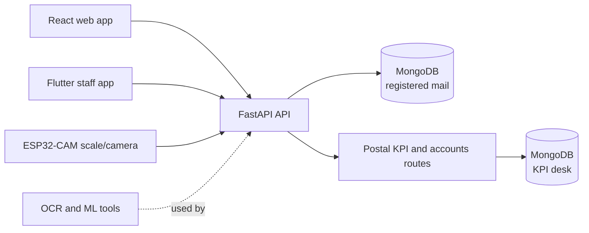

# PostAssist LK

**J26-IT-372 | Research prototype for local postal services**

PostAssist LK is a multi-part postal operations prototype. It brings registered-mail intake and tracking, staff
operations, daily accounts, and address-processing research together around a FastAPI and MongoDB backend. The
repository also contains a Flutter mobile app, ESP32-CAM scale firmware, machine-learning pipelines, datasets, and
project documentation.

The project is intended for demonstration and research. Use synthetic data unless operational and ethics approval
has been obtained. Recommendations and forecasts support staff decisions; they do not replace an authorised
officer's review.

## Project components

| Component | Purpose | Current implementation |
|---|---|---|
| Smart Registered Mail Intake and Tracking | Register, price, label, scan, review, and track registered mail | FastAPI API, React web app, Flutter staff app, and ESP32-CAM scale/camera integration |
| Postal Delivery Operations and Relief Assignment | Organise delivery areas and provide delivery-operation data | Kaduwela-area dataset and related documentation |
| Daily Accounts Reconciliation and Postal KPI Desk | Manage staff, attendance, daily KPIs, entitlements, payroll, productivity, and office accounts | FastAPI routes and React desk pages, including daily-account imports, reconciliation, reporting, and GL-code suggestions |
| Postal Address City Extraction | Identify a destination city from a mail-item image | Tesseract-based notebook and sample images |

The multilingual machine-learning GL classifier and a separate secure ledger-prediction API are research extensions,
not completed product features. See [Limitations](#limitations) and the component documentation for scope details.

## Features

### Registered mail

- Counter intake with drafts, address assistance, tariff-based quotes, payment recording, and printable labels/receipts.
- IoT scale readings and envelope-camera capture, with manual weighing available where permitted.
- Barcode/QR label verification and item lookup.
- Location-aware delivery scans, offline mobile scan queues, and a postmaster review workflow for held events.
- Sender notifications through a configurable outbox and a public, redacted tracking page.
- Staff sign-in, role-specific operations, and audit history.

### Postal KPI desk and daily accounts

- Employee records, daily KPI logs, attendance, office settings, productivity, and KPI forecasts.
- Entitlement workflows and payroll calculations, including EPF and ETF.
- Postmaster sign-in, attendance QR workflows, work allocation, and productivity coaching.
- Daily-account workbook import, validation, category views, summaries, cash reconciliation, and reporting/export.
- GL-code suggestions intended for officer review; a suggestion is not an autonomous ledger posting.
- Optional Power BI reporting and embedding when configured with a suitable workspace and service principal.

### Research and hardware

- Address parsing, script identification, OCR/handwriting experiments, and model evaluation tools.
- ESP32-CAM and HX711 firmware for weighing and envelope photography.
- A Flutter app for staff workflows, scanning, location capture, and offline operation.
- Delivery-area data and a notebook for destination-city extraction.

## Architecture



The integrated API is served by `backend/app/main.py`. It registers the registered-mail routes and, when the KPI
desk dependencies are installed, the KPI desk routes in the same process. The two components use separate MongoDB
databases by default. Some research components remain separate datasets, notebooks, or firmware rather than
end-to-end application features.

## Technologies

| Area | Technologies |
|---|---|
| Backend | Python, FastAPI, Uvicorn, Pydantic, PyMongo |
| Data | MongoDB, CSV and Excel import/export |
| Web | React, Vite, React Router, Material UI, Tailwind CSS |
| Mobile | Flutter, Dart, SQLite-backed offline queue |
| Device | ESP32-CAM, Arduino, HX711 load-cell ADC |
| OCR and machine learning | Tesseract, OpenCV, ONNX Runtime, CRF, PyTorch/scikit-learn training tools |
| Tests | pytest, frontend ESLint/build checks, Flutter test and analysis tools |

## Repository layout

```text
backend/
  app/                 Registered-mail FastAPI application and services
  main.py, routes.py   Postal KPI and daily-account API
  tests and test_*.py  Backend test suites
  models/, ml_models/  Model artifacts and forecast data
frontend/
  src/                 Registered-mail and KPI/accounts React interfaces
mobile_app/
  flutter_app/         Flutter staff application
iot/
  postassist_scale_cam/ ESP32-CAM scale and camera firmware
ml/                    Dataset preparation, training, and evaluation
Datasets/              Research datasets and data documentation
firmware/              Address-extraction notebook and sample material
Documents/             Requirements, setup, hardware, and component guides
```

## Requirements

For the web application and integrated API:

- Windows, macOS, or Linux
- Python 3.11 or newer (the backend requirements include Python-version-specific ML dependencies)
- Node.js and pnpm (Corepack can provide pnpm)
- MongoDB Community Server or a MongoDB Atlas connection

Optional tools:

- Flutter SDK and Android Studio/Android SDK for the mobile app
- Arduino CLI or Arduino IDE for building firmware
- Tesseract OCR with the required language data for address OCR
- PyTorch and the ML dependencies for training or evaluating models
- Power BI workspace and service principal for optional embedding

## Installation and setup

### 1. Configure the backend

From the repository root, create a virtual environment and install backend dependencies:

```powershell
cd backend
python -m venv .venv
.\.venv\Scripts\python.exe -m pip install -r requirements.txt
Copy-Item .env.example .env
```

Edit `backend/.env` before using the application. At minimum, set a private `JWT_SECRET`, a suitable
`DEMO_PASSWORD`, and a strong `SEED_DEVICE_KEY`. For the KPI desk, set `POSTMASTER_PASSWORD` and a unique
`ATTENDANCE_DOOR_SECRET`. Keep real credentials out of source control.

The registered-mail API uses `MONGODB_URI` and `MONGODB_DB` (default database: `postassist_registered_mail`).
The KPI desk uses `KPI_MONGODB_URI` and `KPI_MONGODB_DB` (default database: `postassist`); if no KPI-specific URI
is supplied, it uses `MONGODB_URI`. The registered-mail application can start a local MongoDB instance when
`MONGODB_AUTOSTART=true`; alternatively, run MongoDB yourself or configure an Atlas URI.

### 2. Install the web application

In another terminal, from the repository root:

```powershell
cd frontend
corepack pnpm install
```

Vite proxies `/api` and `/health` to `http://127.0.0.1:8000` by default. Copy `frontend/.env.example` to
`frontend/.env.local` only if you need to change the proxy, HTTPS behavior, public app URL, or other documented
frontend settings.

### 3. Start the integrated API

From the `backend` directory:

```powershell
.\.venv\Scripts\python.exe -m uvicorn app.main:app --host 0.0.0.0 --port 8000 --reload
```

The API is available at <http://localhost:8000>. Interactive API documentation is at
<http://localhost:8000/docs>; registered-mail health is at <http://localhost:8000/api/health>.
The desk's `/health` endpoint may require a working MongoDB connection.

### 4. Start the web app

From the `frontend` directory, in a separate terminal:

```powershell
corepack pnpm dev
```

Open the URL Vite prints (typically <https://localhost:5173>). The development server may use a self-signed
certificate; accept it locally when prompted. Set `VITE_HTTPS=false` in `frontend/.env.local` to use plain HTTP.
Browser camera and location features generally require `localhost` or HTTPS.

### 5. Optional: run the mobile app

Install Flutter and the required platform tools, then from the repository root:

```powershell
cd mobile_app\flutter_app
flutter pub get
flutter run
```

Use the backend's reachable LAN address as the server URL on a physical phone, and ensure the phone and computer
can reach each other. See the [Flutter app guide](Documents/Flutter_Mobile_App_Guide.md) for platform-specific
instructions.

### 6. Optional: connect the scale and camera

Follow the [IoT hardware setup guide](Documents/IoT_Hardware_Setup_Guide.md). Copy
`iot/postassist_scale_cam/config.example.h` to `config.h` and configure Wi-Fi, backend URL, device ID, and device
key. The device ID and key must match `SEED_DEVICE_ID` and `SEED_DEVICE_KEY` in `backend/.env`.

## Running tests and checks

Backend tests (run from `backend`; MongoDB is required by integration tests):

```powershell
.\.venv\Scripts\python.exe -m pytest -q
```

Frontend build and lint (run from `frontend`):

```powershell
corepack pnpm build
corepack pnpm lint
```

Flutter checks (run from `mobile_app\flutter_app`):

```powershell
flutter analyze
flutter test
```

ML training and evaluation instructions are in [ml/README.md](ml/README.md). Hardware verification steps are in
the [IoT integration test flow](Documents/IoT_Integration_Test_Flow.md).

## Configuration and security notes

- Copy example environment files for local use; never commit populated `.env` files, API keys, or device secrets.
- Use HTTPS and set `AUTH_COOKIE_SECURE=true` when deploying the KPI desk outside local development.
- Do not expose a development API or Vite proxy publicly as a production deployment.
- Configure CORS, authentication, cookies, database access, and firewall rules for the target environment.
- Keep operational mail, location, attendance, payroll, and financial data private. Use approved or synthetic data
  for development and demonstrations.
- Power BI embedding is optional and requires server-side credentials; do not put client secrets in `VITE_` variables.

## Documentation

- [Setup and run guide](Documents/Setup_and_Run_Guide.md)
- [Requirements specification](Documents/Requirements_Specification.md)
- [Flutter mobile app guide](Documents/Flutter_Mobile_App_Guide.md)
- [IoT hardware setup guide](Documents/IoT_Hardware_Setup_Guide.md)
- [IoT integration test flow](Documents/IoT_Integration_Test_Flow.md)
- [Dataset documentation](Datasets/README.md)
- [Backend details](backend/README.md)
- [Web frontend details](frontend/README.md)
- [Mobile app details](mobile_app/flutter_app/README.md)
- [IoT firmware details](iot/README.md)
- [Machine-learning details](ml/README.md)

## Limitations

- The delivery-operations component currently includes its dataset and supporting documentation; this README does
  not claim that it is an integrated delivery-management application.
- City extraction is provided as a notebook and depends on image quality, OCR installation, and its limited city
  reference list.
- Address-recognition results depend on training data; much of the Sinhala and Tamil research material is
  synthetic. Validate on appropriately consented real-world samples before making performance claims.
- The GL-code functionality in daily accounts is a suggestion/workflow, not the planned multilingual GL
  classification model or an autonomous posting system.
- KPI forecasts, coaching, work allocation, and entitlement outputs are decision-support features. Confirm
  decisions with authorised staff and treat applicable rules as provisional unless formally approved.
- Hardware behavior depends on correct assembly, calibration, network configuration, and device testing.
