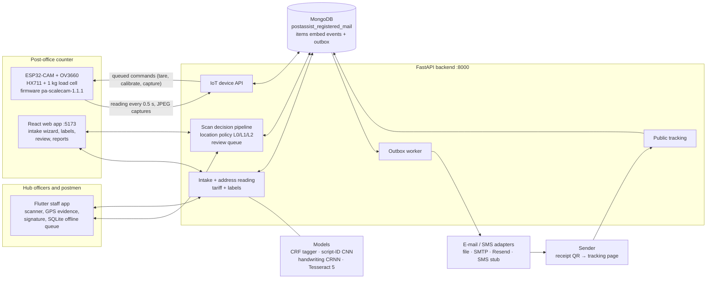
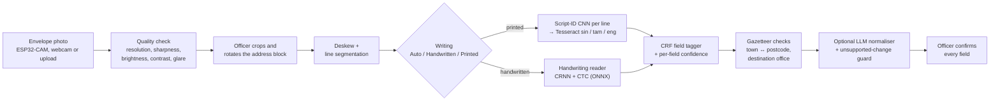
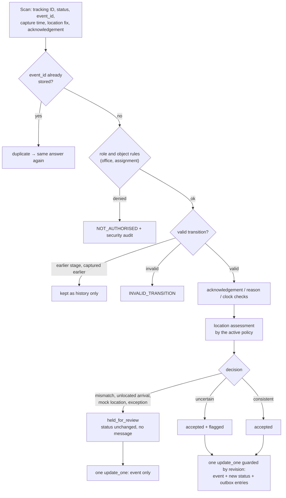
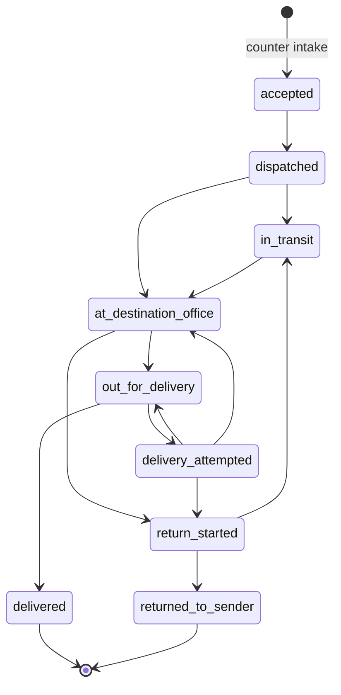

# Smart Registered Mail Intake and Tracking

**PostAssist LK – Intelligent Backbone for Local Postal Services · SLIIT final-year research project J26-IT-372**


A registered letter is accepted at a Sri Lankan post-office counter and followed to the recipient's door:

* the envelope address is **read for the officer** in Sinhala, Tamil or English, printed or handwritten;
* **one low-cost IoT device** weighs the letter and photographs the envelope;
* the charge is calculated from the **official tariff**, and an uncertain weight near a price boundary is never
  silently rounded;
* every handover scan is checked against **location evidence**;
* postmen's scans keep working **offline**;
* sender updates are **never lost and never duplicated**.

| | |
|---|---|
| **Student** | Senarathna W.L.S.K |
| **Student ID** | IT23324138 |
| **Programme** | B.Sc. (Hons) in Information Technology, Sri Lanka Institute of Information Technology (SLIIT) |
| **Group project** | PostAssist LK – Intelligent Backbone for Local Postal Services (J26-IT-372) |
| **Supervisors** | Dr. Junius Anjana · Mrs. Poorna Panduwawala |
| **Branch** | [`feature/smart_registered_mail_intake_&_tracking`](https://github.com/GUNAWARADANANCA/J26-IT-372/tree/feature/smart_registered_mail_intake_%26_tracking) |
| **Integration** | merged into `main` ([PR #5](https://github.com/GUNAWARADANANCA/J26-IT-372/pull/5), [PR #6](https://github.com/GUNAWARADANANCA/J26-IT-372/pull/6)) |
| **Status** | working research prototype; evaluated with public and synthetic data; field trials pending approval |

---

## Contents

1. [Overview](#1-overview)
2. [Research problem](#2-research-problem)
3. [Research objectives and how they are measured](#3-research-objectives-and-how-they-are-measured)
4. [Contributions of this component](#4-contributions-of-this-component)
5. [System architecture](#5-system-architecture)
6. [A letter's journey](#6-a-letters-journey)
7. [Functions](#7-functions)
8. [Mail states and role permissions](#8-mail-states-and-role-permissions)
9. [Business rules](#9-business-rules)
10. [IoT scale and envelope camera](#10-iot-scale-and-envelope-camera)
11. [Flutter staff mobile app](#11-flutter-staff-mobile-app)
12. [Web app (React)](#12-web-app-react)
13. [Backend API (FastAPI)](#13-backend-api-fastapi)
14. [Machine-learning models and results](#14-machine-learning-models-and-results)
15. [Datasets](#15-datasets)
16. [Repository layout](#16-repository-layout)
17. [Getting started](#17-getting-started)
18. [Configuration](#18-configuration)
19. [Demo accounts and a ten-minute demonstration](#19-demo-accounts-and-a-ten-minute-demonstration)
20. [Testing](#20-testing)
21. [Requirements traceability](#21-requirements-traceability)
22. [Security and privacy](#22-security-and-privacy)
23. [Troubleshooting](#23-troubleshooting)
24. [Documentation](#24-documentation)
25. [Limitations and honest notes](#25-limitations-and-honest-notes)
26. [Future work](#26-future-work)
27. [Data licences and acknowledgements](#27-data-licences-and-acknowledgements)

---

## 1. Overview

This component digitises **domestic registered letters (5–500 g)** from counter acceptance to delivery. It is one
of the four components of PostAssist LK and runs on its own: one FastAPI backend with its own MongoDB database
(`postassist_registered_mail`), a React web app, a Flutter staff app and one IoT device. No other component is
needed to demonstrate it. In the integrated system it shares the backend process (port 8000) and the web app
(port 5173) with the Postal KPI desk.

| Part | What it does | Code |
|---|---|---|
| **Backend API** | intake, address reading, weighing, tariff, labels, scans, location checks, review, notifications, public tracking, audit, reports | [`backend/app/`](backend/app) |
| **Web app** | counter intake wizard, label and receipt printing, scans, review queue, IoT scale page, offices, reports, public tracking | [`frontend/src/pages/`](frontend/src/pages), [`frontend/src/components/`](frontend/src/components) |
| **Flutter staff app** | all staff roles on Android/iOS, offline scan queue, GPS evidence, signatures, Sinhala/Tamil/English | [`mobile_app/flutter_app/`](mobile_app/flutter_app) |
| **IoT firmware** | ESP32-CAM that weighs the letter (HX711 + 1 kg load cell) and photographs the envelope | [`iot/postassist_scale_cam/`](iot/postassist_scale_cam) |
| **Machine learning** | address-field tagger (CRF), script identification (CNN), handwriting recogniser (CRNN-CTC), evaluation scripts | [`ml/`](ml), models in [`backend/models/`](backend/models) |
| **Datasets** | public sources, processed corpora, the curated 2026 tariff, field-data templates | [`Datasets/`](Datasets) |
| **Documentation** | requirements, setup, IoT, mobile and technical guides | [`Documents/`](Documents) |

**Out of scope:** international mail, parcels and volumetric charging, customs, cash on delivery, cash
reconciliation (another member's component), route optimisation, nationwide deployment, legal-for-trade
certification of the DIY scale and official Sri Lanka Post numbering ranges.

---

## 2. Research problem

Dependable information is lost between the **counter acceptance** of a domestic registered letter and a
**credible delivery update** to its sender. The component investigates four opportunities:

1. **Avoidable retyping** of envelope details. Addresses are written in Sinhala, Tamil, English or a mix,
   often by hand.
2. **Weight and tariff transcription errors.** The weight is read from one instrument and the charge is looked up
   by hand.
3. **Status updates without enough contextual evidence.** A scan says *arrived* or *delivered* but nothing shows
   where or when it was recorded.
4. **Inconsistent communication** when connectivity or a messaging service fails: updates are lost, delayed or
   sent twice.

---

## 3. Research objectives and how they are measured

| Objective | Target | Tool in this repository | Evidence so far |
|---|---|---|---|
| **SO1 – Assisted trilingual address capture** | ≥ 20 % lower median intake time than manual entry; ≥ 98 % confirmed required-field exact match; handwriting failures reported | intake configuration **B0** (manual) / **B1** (baseline OCR) / **P1** (proposed pipeline) per draft, `intake_tasks.csv`, [`ml/evaluation/ocr_benchmark.py`](ml/evaluation/ocr_benchmark.py), usability template | CRF tagger 99.4 % required-field exact match on unseen towns (rule baseline 57.5 %); handwriting CER 18.1 % Sinhala / 9.2 % English vs Tesseract 91 % / 55 %. The timed comparison with participants is still to be run. |
| **SO2 – IoT weighing and tariff** | MAE ≤ 1 g over 5–500 g; 100 % tariff agreement including band boundaries; boundary uncertainty never silently rounded | IoT page weighing trials → [`ml/evaluation/weighing_analysis.py`](ml/evaluation/weighing_analysis.py); tariff unit tests | tariff tests pass (official cross-check, band edges, boundary rule). The 10 × 10 weighing-trial analysis is still to be reported. |
| **SO3 – Location-aware scans** | compare L0 / L1 / L2; ≤ 5 % false acceptance of clearly-outside scans; report rejection and uncertainty rates | location-policy switch, `scan_events.csv`, [`ml/evaluation/location_policy_simulation.py`](ml/evaluation/location_policy_simulation.py), location-trials template | simulation (20,000 scans per scenario): false acceptance L0 100 %, L1 0 %, **L2 0 %**; stale fixes accepted L1 90 %, **L2 0 %**. Field trials still to be run. |
| **SO4 – Offline sync and reliable messaging** | zero duplicate events in 1,000 replays; zero messages from rolled-back or pending events; every durable local event recovered | [`backend/tests/test_workflow.py`](backend/tests/test_workflow.py), outbox fault injection, airplane-mode protocol | 1,000 replays → one event and one message (T12 **pass**); held events send nothing (T14 **pass**); provider timeouts handled (T15 **pass**). |

---

## 4. Contributions of this component

* **Uncertainty-aware location policy (L2).** A scan is compared with the approved zone of the office or delivery
  area using the phone's reported accuracy and the age of the fix. The policy computes the *probability* that the
  worker was inside the zone instead of a yes/no radius test. Noisy or stale evidence becomes *uncertain* (flagged)
  instead of a false accusation or a false confirmation. It is evaluated against a status-only baseline (L0) and a
  fixed radius (L1).
* **Boundary-uncertainty tariff rule.** The charge engine uses the measured expanded uncertainty *U* of the
  scale. If *weight ± U* crosses a band boundary, it asks for a reweigh instead of silently choosing a band.
* **One device that weighs and photographs.** A single ESP32-CAM takes the weight and the envelope photo of the
  same letter at the same moment. Placement numbering ties one stable weight to one letter, so the previous
  letter's weight can never be reused.
* **Trilingual assisted capture that never decides alone.**
  * A trained script-ID CNN sends each text line to the matching Tesseract language pack.
  * A trained handwriting recogniser reads handwritten blocks.
  * A CRF tagger with calibrated confidence splits the text into address fields.
  * A guard rejects any normalisation that invents digits, names or script changes.
  * The officer confirms every field.
* **Offline scans and messages without duplicates.** Phones queue scans with client-generated event IDs and the
  server accepts each ID once. Sender messages are written into an outbox inside the item document, in the same
  atomic update as the event that caused them. No multi-document transactions are needed.

---

## 5. System architecture



### 5.1 Address-reading pipeline (configuration P1)



Typing or pasting the address is always possible. When Tesseract is unavailable, the officer types the address and
the CRF tagger still splits it into fields.

### 5.2 Scan decision pipeline



### 5.3 Technology stack

| Layer | Technology |
|---|---|
| Backend | Python 3.11+ (tested 3.14), FastAPI 0.142, Uvicorn, Pydantic, PyMongo 4.18, PyJWT |
| Database | MongoDB 8.2 (local service, portable `mongod` started by the API, or Atlas) |
| Web app | React 19, Vite 8, Tailwind CSS 4, React Router 7 |
| Mobile app | Flutter (Dart 3.13): provider, http, sqflite, mobile_scanner, geolocator, connectivity_plus, barcode_widget, image_picker, shared_preferences, intl |
| IoT | AI-Thinker ESP32-CAM (OV3660), HX711, Arduino (ESP32 core 3.x), ArduinoJson 7 |
| Machine learning | PyTorch → ONNX Runtime 1.30, python-crfsuite, OpenCV, Tesseract OCR 5 (`sin`, `tam`, `eng`) |
| Labels | python-barcode (Code 128), qrcode |
| Messaging | e-mail to file (default), SMTP, Resend, SMS stub |
| Optional | Ollama + Gemma 3 4B for the LLM-normalisation experiment |

---

## 6. A letter's journey

1. **Counter intake.**
   * The counter officer starts a draft.
   * The envelope is photographed by the scale's camera, a webcam or a file upload.
   * The officer crops the address block, and the system suggests the address fields in Sinhala, Tamil or
     English. The officer confirms every field.
   * The officer places the letter on the IoT scale and presses *Use this weight*. The charge is calculated from
     the tariff in force.
   * The payment is recorded, and a label and a receipt are printed. The printed label is scanned back to
     verify it.
2. **Dispatch and transit.** Hub officers scan the label (web or phone) to record *dispatched*, *in transit* and
   *at destination office*. Every scan carries the phone's location evidence.
3. **Location check.** Each scan is compared with the approved reference zone of the office or delivery area.
   * These scans are **held for review**: clear mismatches, missing locations on arrival, mock locations and
     delivery exceptions.
   * A held scan does not change the status and does not message the sender.
4. **Review.** A postmaster reads the reasons and approves or rejects the held scan. The postmaster gives a reason,
   and the decision is audited.
5. **Delivery.** The postman scans *out for delivery* and then *delivered*, with a signature, the recipient's name
   or a delivery-sheet reference. This works offline: the scan is queued on the phone and uploaded later with the
   same event ID, so it is never duplicated.
6. **Sender updates.**
   * Each accepted event creates the sender's message (e-mail or SMS, in English, Sinhala or Tamil) in the same
     atomic update as the event.
   * The sender follows the letter on a public tracking page. The page shows office names and times only, with no
     coordinates and no staff names.

---

## 7. Functions

| Area | Functions |
|---|---|
| **Sign-in and roles** | username + password (salted PBKDF2-SHA256), signed expiring JWTs, user re-read on every request; roles *admin, postmaster, counter officer, hub officer, postman*; object-level rules (office, assignment); worker identity always taken from the token; append-only audit log |
| **Intake drafts** | auto-saved drafts that can be resumed after a restart, progress per step, cancel or delete (releases the scale reading), configuration B0 / B1 / P1 per draft for the comparison experiment |
| **Envelope image** | capture from the ESP32-CAM on the scale, webcam or upload; crop and rotate; image-quality check (resolution, sharpness, brightness, contrast, glare) with recapture advice |
| **Address reading** | P1 pipeline: deskew → line segmentation → trained **script-ID CNN** → matching Tesseract language pack; **handwriting reader** (CRNN-CTC) for handwritten blocks with *Auto / Handwritten / Printed*; B1 baseline for comparison; typed or pasted text always possible |
| **Address fields** | trained **CRF tagger** splits text into name, house number, street, locality, town, district, postcode, country with per-field confidence; low-confidence fields highlighted; suggestions shown beside the officer's values and never merged silently |
| **Address checks** | town ↔ postcode check against the gazetteer (consistent / mismatch / unknown); Colombo zone postcodes suggested, never inserted; destination office suggestion; optional LLM normalisation (Gemma 3 4B via Ollama) behind an *unsupported-change guard* that rejects invented digits, names or script changes |
| **Confirmation** | sender, recipient and notification blocks must be confirmed before acceptance; editing after confirmation needs reconfirmation; corrections (suggested vs final) recorded for evaluation |
| **Weighing (IoT)** | live reading on the counter screen (≤ 1 s); pairing only if the reading is fresh (≤ 3 s), stable (spread ≤ 1 g over 1 s), 5–500 g, from a calibrated healthy scale of the officer's office; one placement → one letter (`PLACEMENT_ALREADY_USED`); audited manual weight from an approved instrument |
| **Tariff and charge** | versioned tariff transcribed from the Department of Posts notice of 9 Feb 2026; optional advice of delivery and insurance; **reweigh required** when *weight ± U* crosses a band boundary; itemised quotes expire after 10 min; missing or overlapping tariffs block quoting |
| **Acceptance and labels** | exactly one item per draft (an idempotent retry returns the same item); payment must equal the quote; opaque tracking IDs `PA-DEMO-` + 10 Crockford base-32 characters + a check character; label with Code 128 + QR + readable ID; receipt with itemised charge and tracking QR; audited reprints with a reason; label verification by scanning (`LABEL_MISMATCH`) |
| **Tracking scans** | valid transitions only (`INVALID_TRANSITION`); each role sees only the statuses it may record; late offline scans of an earlier stage kept in history without moving the status back; explicit return workflow; *delivered* needs an acknowledgement, *attempted* and *return started* need a reason |
| **Location policies** | L0 status-only (baseline), L1 fixed radius, **L2 uncertainty-aware** (probability of being inside the zone from the reported accuracy, fix age and a Gaussian error model); every event stores its policy version; admin can switch policies |
| **Review queue** | held and flagged scans with reasons; approve or reject with an audited reason |
| **Offline sync** | phone queue in SQLite written *before* upload with a client-generated `event_id`; idempotent server (1,000 replays → one event, one message); automatic upload in capture order when the network returns |
| **Sender notifications** | transactional outbox inside the item document; de-duplication key (event + recipient + channel + template version); bounded exponential back-off; *ambiguous* and permanent failures shown for retry or manual resolution; templates in EN/SI/TA; fault injection for experiments |
| **Public tracking** | `/track/<ID>#t=<token>` from the receipt; redacted timeline; postmaster can rotate the tracking link |
| **Recipient location** | a postmaster can set a confirmed recipient location (with mandatory provenance) as the delivery reference point; town or postcode centres are never used |
| **Offices and zones** | reference points with provenance (OpenStreetMap or measured on site), facility and delivery-area radii, "use my location" |
| **Reports and experiments** | CSV exports `intake_tasks.csv`, `scan_events.csv`, `notifications.csv`, dashboard summary, weighing-trials CSV |
| **Dashboard** | items needing attention: held scans, failed messages, offline or uncalibrated scale, unfinished drafts |

---

## 8. Mail states and role permissions



`in_transit → in_transit` is allowed (several hubs). On the return journey `in_transit` leads to
`returned_to_sender`. Rules: [`backend/app/services/state_machine.py`](backend/app/services/state_machine.py).

| Role | Statuses it may record | Object rule |
|---|---|---|
| Counter officer | `dispatched` (plus *accepted* through intake) | item accepted at own office |
| Hub officer | `dispatched`, `in_transit`, `at_destination_office` | dispatch only at origin; arrival only at destination office |
| Postman | `out_for_delivery`, `delivery_attempted`, `delivered` | destination office = own office; postcode in beat or assigned; attempt and delivery only if assigned to self |
| Postmaster | every scan status including returns; review | own office is origin or destination |
| Admin | everything | – |

Scan decisions: `accepted`, `held_for_review`, `rejected`, `duplicate` (and accepted / rejected after review).

---

## 9. Business rules

### 9.1 Tariff (version `SLP-DOM-2026-02-09`, transcribed, pending approval)

`charge = letter postage(band) + registration fee Rs 60 + advice of delivery Rs 100 (optional) + insurance Rs 100 per Rs 1,000 or part (optional, max Rs 25,000)`

| Weight band (g) | ≤ 30 | ≤ 40 | ≤ 50 | ≤ 60 | ≤ 70 | ≤ 80 | ≤ 90 | ≤ 100 | ≤ 200 | ≤ 300 | ≤ 400 | ≤ 500 |
|---|---|---|---|---|---|---|---|---|---|---|---|---|
| Postage (Rs) | 70 | 80 | 90 | 100 | 110 | 120 | 130 | 140 | 160 | 180 | 200 | 220 |
| **Registered total (Rs)** | **130** | 140 | 150 | 160 | 170 | 180 | 190 | 200 | 220 | 240 | 260 | 280 |

* Bands are `lower < W ≤ upper`.
* **Boundary rule:** if `[W − U, W + U]` crosses a band limit, the quote is *reweigh required*. Example: 29 g ± 2 g
  → reweigh.
* Prototype range 5–500 g. Above it only an audited manual weight from an approved scale is accepted, up to the
  tariff maximum of 2 kg.
* Errors: `TARIFF_AMBIGUOUS`, `TARIFF_NONE_IN_FORCE` and `TARIFF_BANDS_NOT_CONTIGUOUS` block quoting.
* Source: [`Datasets/curated/tariff_slpost_domestic_2026-02-09.json`](Datasets/curated/tariff_slpost_domestic_2026-02-09.json)
  and the original notice in `Datasets/raw/slpost/`.

### 9.2 Location policy L2 (default `LOC-2026.10-L2`)

| Condition | Result |
|---|---|
| no fix / permission denied / timeout | unlocated |
| no approved reference area | uncertain |
| fix older than 120 s, or reported accuracy > 250 m | uncertain |
| P(inside zone) ≥ 0.80 (σ from the reported accuracy as a 68 % radius) | consistent |
| P(inside zone) ≤ 0.05 | mismatch |
| otherwise | uncertain |

What each result does to the scan:

| Result | Action |
|---|---|
| mismatch | **hold** |
| unlocated, on arrival | **hold** |
| mock location | **hold** |
| uncertain | **accept and flag** |

A town or postcode centre is never used as a house location.

### 9.3 Sender notifications

* **Key updates** (default): accepted, out for delivery, attempted, delivered, return started, returned.
* **All updates** adds dispatched, in transit and arrival.
* Delivery tries at most 6 times, with back-off 10 s × 2ⁿ (≤ 1 h).
* Messages contain no precise addresses or worker coordinates.
* The *delivered* wording does not claim GPS proof, and a delayed sync is disclosed.

---

## 10. IoT scale and envelope camera

One **ESP32-CAM** both **weighs** the letter and **photographs** the envelope lying on the platform. The weight
and the photo of the same letter come from the same device at the same moment, and the hardware stays cheap.


### 10.1 Hardware (bought for Rs 4,800)

| Part | Role | Price (Rs) |
|---|---|---|
| AI-Thinker **ESP32-CAM** with **OV3660** 3 MP camera | Wi-Fi microcontroller: reads the HX711, takes the photo, talks to the backend | 2,750 |
| **1 kg bar load cell** | measures the letter's weight | 450 |
| **HX711** 24-bit ADC (powered at 5 V) | amplifies and digitises the load-cell signal (channel A, gain 128, 10 samples/s) | 160 |
| Wooden load-cell bracket | fixed end / loaded end mounting | 600 |
| 4-channel bi-directional **level shifter** (3.3 V ↔ 5 V) | connects the 5 V HX711 safely to the 3.3 V ESP32 pins | 100 |
| F–F jumper wires | wiring | 160 |
| Shipping | – | 580 |

Also needed: an ESP32-CAM-MB USB programmer, a breadboard, M–F jumpers, a 1000 µF capacitor, a 5 V / 2 A supply,
reference masses and a camera stand 28–32 cm above the platform. Full list:
[IoT hardware setup guide](Documents/IoT_Hardware_Setup_Guide.md#1-what-you-bought-and-what-each-part-does).

### 10.2 Wiring (HX711 at 5 V through the level shifter)

| From | To |
|---|---|
| 5 V supply VCC / GND | breadboard (+) / (−) rails |
| ESP32-CAM **5V** / **GND** | (+) / (−) rails |
| ESP32-CAM **3V3** | level shifter **LV** |
| level shifter **HV** / **GND** | (+) / (−) rails |
| HX711 **VCC** / **GND** | (+) / (−) rails |
| HX711 **DT** → shifter **HV1**, shifter **LV1** → | ESP32-CAM **IO13** |
| HX711 **SCK** → shifter **HV2**, shifter **LV2** → | ESP32-CAM **IO14** |
| load cell red / black / white / green | HX711 **E+ / E− / A− / A+** |
| 1000 µF capacitor (+ to 5 V) | across the rails next to the ESP32-CAM |

IO13 and IO14 are free because the SD-card slot is not used. Do not use these pins:

* **IO12** (boot strapping)
* **IO16** (PSRAM)
* **IO0** and **IO4** (flash LED)

Never feed power into the ESP32-CAM **VCC** pin. Without a level shifter the HX711 can run at 3.3 V directly,
with slightly more noise.

### 10.3 Firmware [`iot/postassist_scale_cam/`](iot/postassist_scale_cam) (version `pa-scalecam-1.1.1`)

| Feature | Details |
|---|---|
| **Weighing** | reads the HX711 itself (no library) at 10 samples/s with slow clock pulses, so slow edges through the level shifter cannot flip bits; 1-second window → net grams, spread, *stable* (spread ≤ 1 g) and *loaded* flags; isolated spikes > 25 g ignored unless confirmed; slow zero tracking while empty |
| **Placement numbering** | the platform must return to empty before the next stable load gets a new number, so the server can refuse to reuse the previous letter's weight |
| **Push protocol** | `POST /api/iot/readings` every 500 ms with `X-Device-Id` / `X-Device-Key`; the reply carries queued commands (tare, calibrate, capture, identify, reboot); results go to `POST /api/iot/commands/<id>/result` |
| **Envelope photo** | on *capture* the camera warms up (exposure and white balance settle), takes a short burst and uploads the frame with the most detail (largest JPEG) to `POST /api/iot/captures/<id>`; QXGA 2048×1536, lens and pixel correction, edge enhancement, vertical flip for the usual mounting |
| **Calibration** | offset, factor and calibration ID stored in flash (NVS); every paired weight records the calibration ID; a stored factor below 100 counts/g is discarded at start-up and refused by calibrate, so a bad calibration cannot lock the scale |
| **Device web page** `http://<device-IP>/` | live weight, tare, calibrate, test photo, **focus helper** (turn the lens until the detail score peaks), Wi-Fi and backend address settings without re-flashing |
| **Set-up network** | if the configured Wi-Fi cannot be joined within 20 s the board opens `PostAssist-Scale` on `http://192.168.4.1/` |
| **HTTPS** | optional root CA in `config.h` for an `https://` backend |

**Local endpoints of the board**

| Endpoint | Purpose |
|---|---|
| `GET /` | device page |
| `GET /status` | firmware version, Wi-Fi, backend address, backend reachability, calibration, spike count |
| `GET /weight` | current reading |
| `POST /tare` (`?force=1` while not stable) | zero the platform |
| `POST /calibrate` | calibrate with a known reference mass |
| `POST /calibrate/reset` | back to the default factor without a stable reading |
| `GET /capture`, `GET /capture.jpg` | take a photo |
| `GET /focus` | one fast frame with its detail score |
| `POST /settings` | change Wi-Fi and backend address |

**Serial console (115200 baud):**

| Command | Action |
|---|---|
| `t` | tare |
| `tf` | tare now, even if not stable |
| `r` | reset calibration |
| `c <grams>` | calibrate with a known mass |
| `i` | info |

### 10.4 Build and flash

1. Copy `iot/postassist_scale_cam/config.example.h` to `config.h` (git-ignored).
2. In `config.h`, set:
   * the Wi-Fi (2.4 GHz);
   * `API_BASE_URL` (`http://<laptop-LAN-IP>:8000`);
   * `DEVICE_ID` and `DEVICE_KEY`, the same values as `SEED_DEVICE_ID` / `SEED_DEVICE_KEY` in `backend/.env`.
3. Choose these build settings:
   * board **AI Thinker ESP32-CAM** (ESP32 core 3.x);
   * PSRAM enabled;
   * partition **Huge APP (3 MB No OTA)**;
   * library **ArduinoJson 7**.
4. Compile, then upload with the ESP32-CAM-MB:
   ```bash
   arduino-cli compile -b "esp32:esp32:esp32cam:PartitionScheme=huge_app" iot/postassist_scale_cam
   ```
   The 1.1.0 build with ESP32 core 3.3.12 and ArduinoJson 7.4.3 is 1.20 MB (38 % of the partition).
5. Wire the circuit and power on. Open the device page and focus the lens for the 30 cm working distance.
6. In the web app, sign in as `counter2` and open **IoT scale**. The card shows *online*, IP, firmware, RSSI,
   `HX711 ok` and `camera ok`.

### 10.5 Calibration and measurement uncertainty

1. Empty the platform, wait for *stable* and press **Tare**.
2. Place a reference mass (100–200 g) in the centre and press **Calibrate**.
3. Run the weighing trials: 10 reference masses from 5 to 500 g, 10 repeats each, under different conditions.
   Record them on the IoT page and export them as CSV.
4. Analyse the CSV:
   ```bash
   ml/.venv/Scripts/python ml/evaluation/weighing_analysis.py SCALECAM-01_trials.csv
   ```
   The report gives MAE, bias, repeatability, a linear fit and the expanded uncertainty **U (k = 2)**.
5. A postmaster enters U on the IoT page. From then on the tariff engine asks for a reweigh whenever
   *weight ± U* crosses a band boundary.

Target (SO2): MAE ≤ 1 g over 5–500 g.

### 10.6 Working without the board

* **Simulator:** [`backend/tools/device_simulator.py`](backend/tools/device_simulator.py) speaks the same
  protocol. Type `w 23.5` to place a 23.5 g letter and `r` to remove it. It can also upload an envelope image.
  ```bash
  backend/.venv/Scripts/python backend/tools/device_simulator.py --key "<SEED_DEVICE_KEY>"
  ```
* **Bridge for older boards:** [`backend/tools/device_bridge.py`](backend/tools/device_bridge.py) connects a
  board that runs a pull-only sketch (`/weight`, `/tare`, `/calibrate`, `/capture`) through `BRIDGE_DEVICE_URL`.
  * Do not run it while firmware 1.1 reports to the backend itself.
  * `device_bridge.py --check` is still useful as a diagnostic.

More help: the [IoT hardware setup guide](Documents/IoT_Hardware_Setup_Guide.md#troubleshooting) and the
[IoT integration test flow](Documents/IoT_Integration_Test_Flow.md).

---

## 11. Flutter staff mobile app

[`mobile_app/flutter_app/`](mobile_app/flutter_app) (package `postassist_mobile`) is an Android and iOS app. It
talks to the same backend and covers every registered-mail staff role.

| Role | What the app does |
|---|---|
| Counter officer | registers a letter in 5 steps (envelope photo → address reading → confirm → IoT scale weight → charge and accept), shows the label and receipt with Code 128 + QR, verifies the printed label by scanning it, saved drafts, sender messages, scale and camera |
| Hub officer | scans labels to record *dispatched / in transit / at destination office* |
| Postman | scans labels to record *out for delivery / delivery attempted / delivered* with signature, name or delivery-sheet acknowledgement – works **offline** |
| Postmaster | everything above plus the review queue, summary, audit log, offices and reference zones (set from the phone's GPS) |
| Sender (no sign-in) | tracks a letter by scanning the receipt QR or typing the tracking ID and access code |

* **Offline first:**
  * Each scan is written to SQLite with a once-generated `event_id` before any upload.
  * It is re-sent with the same ID until the server gives a durable answer (accepted, duplicate, held or
    rejected).
  * Each queued scan remembers who captured it and is uploaded only with that person's sign-in.
* **Location evidence:** read once when *Save* is pressed, with accuracy, fix age, permission state and Android's
  mock-location flag.
* **Tracking-ID check:** the check character is validated on the phone, so a mistyped ID is caught before upload.
* **Languages:** Sinhala, Tamil and English (ARB files in `lib/l10n/`).
* **UI:**
  * follows the principles of the Sri Lanka Digital Design System draft and WCAG 2.2 AA: 48 dp targets, labels
    above fields, status shown with words and icons, text scaling;
  * is not formally approved by any government body;
  * uses no national emblem or Sri Lanka Post logo.

```bash
cd mobile_app/flutter_app
flutter pub get
flutter run                      # phone over USB or a running emulator
flutter build apk --release      # build/app/outputs/flutter-apk/app-release.apk
```

Server address at sign-in:

| Where the app runs | Server address |
|---|---|
| phone on the same Wi-Fi as the laptop | `http://<laptop-IP>:8000` |
| Android emulator | `http://10.0.2.2:8000` |
| USB-connected phone, after `adb reverse tcp:8000 tcp:8000` | `http://127.0.0.1:8000` |

Full guide: [Documents/Flutter_Mobile_App_Guide.md](Documents/Flutter_Mobile_App_Guide.md).

---

## 12. Web app (React)

The web app lives in [`frontend/`](frontend) and is built with Vite and React 19. It is served on
`https://localhost:5173`, and on `https://<laptop-IP>:5173` on the LAN. Vite forwards `/api` to the backend. The
registered-mail pages use Tailwind CSS 4.

| Page | Route | Used by |
|---|---|---|
| Sign in | `/login` | all staff |
| Dashboard – what needs attention | `/` | all staff |
| Counter intake – drafts | `/counter` | counter officer, postmaster |
| Intake wizard (image, recipient, sender, destination, weight, charge) | `/counter/:draftId` | counter officer |
| Label and receipt print + verify | `/items/:id/print` | counter officer |
| Registered items and item detail (timeline, journey progress) | `/items`, `/items/:id` | all staff |
| Record a scan | `/scan` | counter, hub, postmaster |
| Review queue | `/review` | postmaster |
| Sender messages (outbox) | `/notifications` | postmaster, counter officer |
| IoT scale (live status, tare, calibrate, test photo, trials, uncertainty) | `/devices` | counter officer, postmaster |
| Offices and reference zones | `/offices` | postmaster |
| Reports (CSV exports, location policy, tariff versions) | `/reports` | postmaster, admin |
| Audit log | `/audit` | postmaster |
| Public tracking | `/track/:id` | senders (no sign-in) |

Main components:

| Component | Role |
|---|---|
| `ImagePanel` | capture, crop, rotate, quality advice, *Writing* selector |
| `AddressBlock` | suggestions beside confirmed values, confidence highlighting |
| `WeightPanel` | live scale reading |
| `IntakeProgress` | 5-step stepper |
| `Timeline`, `StatusBadge` | item history and status |

Webcam capture needs `localhost` or HTTPS. Set `VITE_HTTPS=false` in `frontend/.env` for plain HTTP.

---

## 13. Backend API (FastAPI)

`uvicorn app.main:app` in `backend/` serves the API. Interactive OpenAPI documentation is at
<http://localhost:8000/docs> and the health check at `/api/health`.

### 13.1 Routers

| Router | Prefix | Main endpoints |
|---|---|---|
| auth | `/api/auth` | `login`, `me` |
| intake | `/api/intake` | drafts (create, list, get, patch, cancel), image upload, scale-camera capture, OCR, parse, normalise, address check, confirm fields, weight pair / manual / live, quote, accept, office suggestions, capabilities |
| items | `/api/items` | search, detail, label, label printed (reprint), label verify, assign postman, recipient location, rotate tracking link |
| scans | `/api/scans` | record one scan, batch upload (offline), lookup with allowed statuses, status list |
| review | `/api/review` | held, flagged, decide, audit |
| notifications | `/api/notifications` | outbox list, preview, retry, resolve |
| devices | `/api/devices` | list, register, rotate key, live reading, readings, commands, weighing trials (+ CSV), uncertainty |
| iot (device auth) | `/api/iot` | readings, captures, command results |
| public | `/api/public` | redacted tracking (`X-Tracking-Token` header) |
| admin | `/api/admin` | offices, tariffs + approval, location policy mode, users |
| reports | `/api/reports` | `intake.csv`, `events.csv`, `notifications.csv`, summary |

### 13.2 Services ([`backend/app/services/`](backend/app/services))

| Service | Responsibility |
|---|---|
| `address/` | tokenizer, trilingual lexicon, CRF features and parser, normaliser + unsupported-change guard |
| `ocr/` | image-quality gate, script ID (ONNX), B1/P1 Tesseract pipelines, handwriting reader `htr.py` (ONNX) |
| `notifications/` | EN/SI/TA templates, adapters (file, SMTP, Resend, SMS stub), outbox worker |
| `tariff.py` | versioned tariff engine with the boundary-uncertainty rule |
| `weighing.py` | pairing rules for IoT readings |
| `state_machine.py` | mail states, transitions, role permissions, notification rules |
| `location.py` | L0/L1/L2 location policies |
| `scan_events.py` | scan decision pipeline and review |
| `labels.py`, `tracking_id.py` | Code 128 / QR SVG, opaque IDs with check character |
| `item_views.py` | staff view vs redacted public timeline |

On start-up the API does four things:

1. starts a local MongoDB if none is running (`MONGODB_AUTOSTART`);
2. creates the indexes that enforce the integrity rules;
3. seeds the demo data (`DEMO_SEED`);
4. starts the outbox worker.

### 13.3 Error codes the client can rely on

| Code | Meaning |
|---|---|
| `PLACEMENT_ALREADY_USED` | this scale placement is already paired with another letter |
| `TARIFF_AMBIGUOUS`, `TARIFF_NONE_IN_FORCE`, `TARIFF_BANDS_NOT_CONTIGUOUS` | the tariff cannot be applied safely |
| `LABEL_MISMATCH` | the scanned label does not belong to this item |
| `UNKNOWN_ITEM`, `UNKNOWN_STATUS` | no such tracking ID / not a scan status |
| `NOT_AUTHORISED` | role or object rule refused the scan (security-audited) |
| `INVALID_TRANSITION` | the status cannot follow the current one |
| `ACK_REQUIRED`, `REASON_REQUIRED` | *delivered* needs an acknowledgement; *attempted* / *return started* need a reason |
| `EVENT_ID_CONFLICT` | an event ID was reused by another worker or for another item |
| `CONFLICT` | concurrent update; retry |

### 13.4 Data model (MongoDB)

| Collection | Content | Personal data |
|---|---|---|
| `users` | username, role, office, beat, PBKDF2 hash | staff names |
| `offices` | reference point, zone radii, provenance | none |
| `drafts` | intake fields, suggestions, corrections, timings, weight, quote | sender / recipient |
| `items` | confirmed fields, weight, quote, payment, **embedded events and outbox**, label, public token | sender / recipient, contact, signature |
| `images` (+ files in `backend/storage/images`) | envelope photos | yes (git-ignored) |
| `devices`, `device_readings` (TTL 3 days), `device_commands`, `captures`, `weighing_trials` | IoT data | none |
| `tariffs`, `location_policies` | versioned rules, never edited in place | none |
| `audit_log` | actor, action, target ID, reason | staff usernames |

---

## 14. Machine-learning models and results

| Model | Task | Result on held-out data | Artefact |
|---|---|---|---|
| **Address-field tagger** (linear-chain CRF) | label tokens as name, house, street, locality, city, region, postcode, country | towns never seen in training: token accuracy **99.7 %**, required-field exact match **99.4 %** (rule baseline 57.5 %); real-address subset (Deepparse LK) **97.6 %**; with OCR noise 98.7 %; calibration ECE 0.002 | `backend/models/address_crf.crfsuite` |
| **Script identification** (CNN, 0.46 M parameters) | Sinhala / Tamil / Latin per text line → chooses the Tesseract language pack | fonts never seen in training **98.6 %** (3 seeds: 97.5 ± 1.4 %); printed 99.5 %; handwriting-style lines 94.1 % (3 seeds: 87.5 ± 7.9 %); 6.8 ms per line on CPU; ECE 0.067 → 0.012 after temperature scaling | `backend/models/script_id.onnx` |
| **Handwriting recogniser** (CRNN + CTC, 4.5 M parameters) | reads handwritten Sinhala, English and Tamil lines | real Sinhala (SinOCR test, 227 lines) CER **18.1 %** vs Tesseract 91 %; real English (IAM test, 400 lines) CER **9.2 %** vs Tesseract 55 %; 13.1 ms per line on CPU | `backend/models/htr.onnx` |
| **Location-policy simulation** | false acceptance vs unnecessary review for L0 / L1 / L2 | clearly-outside scans accepted: L0 100 %, L1 0 %, **L2 0 %**; stale fixes reported consistent: L1 90 %, **L2 0 %**; valid scans held as mismatch: L1 6.9 %, L2 1.7 % (L2 flags or holds 18.7 % of valid scans in total) | `ml/reports/location_policy/` |

Every model has a fallback. If a model file is missing, the rules engine or manual entry takes over, so the
counter is never blocked.

### 14.1 How each model was built

* **CRF tagger.**
  * Features: token text and affixes, Unicode script, shape, digits, gazetteer membership, trilingual vocabulary,
    line position and ±2 context.
  * Training: grid search on validation, final model on the training set, review threshold chosen on validation
    and then frozen.
  * Test set: grouped by postal town, so no test town was seen in training.
* **Script-ID CNN.**
  * Five convolution blocks and global average pooling, trained on HarfBuzz-shaped renders.
  * Fonts: 18 for training, 4 for validation and **6 held-out test fonts**.
  * Three seeds were trained, and the shipped model was chosen on validation only.
  * Temperature scaling (Guo et al., 2017) is applied.
* **Handwriting CRNN.**
  * Seven convolution layers, then 2 × BiLSTM(256), then CTC.
  * One network for all three scripts, with 48 px line height.
  * Before the network, the photo is flat-fielded into an ink image, straightened and split into lines.
  * Trained on real SinOCR Sinhala lines and real IAM English lines, plus synthetic lines.
  * **Tamil is learnt from fonts only.**

### 14.2 Honest reading of the numbers

* Most Sinhala and Tamil address text used for the CRF and script-ID models is **synthetic**, built from public
  reference data. Quote the *real-address* row and confirm on the consented envelope set before making claims.
* A handwriting word error rate of 55 % (Sinhala) means about every second handwritten word still contains a
  mistake. The model saves typing; it does not replace reading the envelope.
* The end-to-end OCR benchmark on the uncropped synthetic envelopes is at floor for every configuration (CER ≈ 1.0,
  [report](ml/reports/ocr_benchmark/synthetic_envelopes_test_REPORT.md)). That benchmark validates the pipeline,
  not accuracy. Real performance must be measured on cropped, consented envelope photos.

### 14.3 Train and evaluate

```bash
python -m venv ml/.venv
ml/.venv/Scripts/python -m pip install torch --index-url https://download.pytorch.org/whl/cu128   # or .../whl/cpu
ml/.venv/Scripts/python -m pip install -r ml/requirements.txt
bash ml/run_all.sh                                 # datasets → CRF → script-ID → synthetic envelopes → simulation
ml/.venv/Scripts/python ml/htr/build_cache.py      # handwriting model (datasets outside the repository)
ml/.venv/Scripts/python ml/htr/train.py
ml/.venv/Scripts/python ml/htr/evaluate.py
```

Tested with Python 3.14 and PyTorch 2.11 + CUDA 12.8 on an RTX 2050 (4 GB). The handwriting model trains in about
70 minutes (40 epochs).

Full reports:

* [CRF](ml/reports/address_parser/REPORT.md)
* [script ID](ml/reports/script_id/REPORT.md)
* [handwriting](ml/reports/htr/REPORT.md)
* [location policy](ml/reports/location_policy/REPORT.md)
* the ML guide: [ml/README.md](ml/README.md)

---

## 15. Datasets

| Dataset | Licence | Used for |
|---|---|---|
| Sri Lanka provinces–districts–cities gazetteer (2,155 towns in EN/SI/TA) | MIT | gazetteer features, town ↔ postcode check, synthetic addresses, office suggestions |
| Deepparse worldwide addresses – `lk` split | CC BY 4.0 | real-address part of the CRF corpus |
| OpenStreetMap | ODbL | post-office reference points with provenance, street vocabulary |
| Wikidata | CC0 | recipient-name vocabulary |
| Google Fonts | SIL OFL | rendered training lines and synthetic envelopes |
| Department of Posts tariff notice, 9 Feb 2026 | official notice | versioned tariff |
| SinOCR handwritten, IAM lines, 454-class Sinhala characters | per source; **kept outside the repository** | handwriting recogniser |

Templates for your own field data are in [`Datasets/templates/`](Datasets/templates):

| Template | Collects |
|---|---|
| `envelope_annotation_template.csv` | consented envelope photos with their correct fields |
| `weighing_trials_template.csv` | 10 × 10 weighing trials |
| `location_trials_template.csv` | location scans at approved areas |
| `usability_task_log_template.csv` | usability session tasks |

Planned research data:

* 360 consented or synthetic envelope images (120 per script, half printed and half handwritten);
* 10 × 10 weighing trials;
* about 120 location scans at 6 areas;
* 1,000 replay requests;
* 12–16 usability participants.

Sources, licences, folder map and rebuild steps: [Datasets/README.md](Datasets/README.md).

---

## 16. Repository layout

Only the files of this component are shown. The repository also holds the other PostAssist LK components.

```
J26-IT-372/
├── backend/
│   ├── app/
│   │   ├── main.py            app, CORS, start-up (indexes, demo seed, outbox worker)
│   │   ├── config.py          settings from environment / .env
│   │   ├── db.py              MongoDB client, indexes (integrity rules), local mongod autostart
│   │   ├── security.py        PBKDF2 passwords, JWT, role guards, device-key auth
│   │   ├── audit.py           append-only audit log
│   │   ├── schemas.py         request models (Pydantic)
│   │   ├── seed.py            demo offices, users, tariff, policy, device
│   │   ├── reference/         gazetteer, post offices, vocabulary, 2026 tariff
│   │   ├── routers/           auth, intake, items, scans, review, notifications, devices, iot, public, admin, reports
│   │   └── services/          address/, ocr/, notifications/, tariff, weighing, state machine, location, scan events, labels
│   ├── models/                address_crf.crfsuite, script_id.onnx, htr.onnx (+ .meta.json)
│   ├── tests/                 unit tests and end-to-end acceptance tests (T03–T17)
│   ├── tools/                 device_simulator.py, device_bridge.py, start_all.ps1, rename_demo_office.py
│   ├── requirements.txt
│   └── .env.example
├── frontend/src/
│   ├── pages/                 Login, Dashboard, CounterHome, IntakeWizard, LabelPrint, Items, ItemDetail,
│   │                          ScanEvent, ReviewQueue, Notifications, Devices, Offices, Reports, Audit, Track
│   └── components/            ImagePanel, AddressBlock, WeightPanel, IntakeProgress, Timeline, StatusBadge, Layout
├── mobile_app/flutter_app/    Flutter staff app (lib/, test/, android/, ios/)
├── iot/postassist_scale_cam/  ESP32-CAM firmware: .ino, device_page.h, camera_pins.h, config.example.h
├── ml/
│   ├── common/                paths, Unicode-correct text renderer, font registry
│   ├── datasets/              fetch_public_datasets.py, build_reference_data.py
│   ├── address_parser/        build_corpus.py, train_crf.py
│   ├── script_id/             render_dataset.py, train.py
│   ├── htr/                   build_cache.py, data.py, sinhala_glyphs.py, train.py, evaluate.py
│   ├── synthetic_envelopes/   generate.py
│   ├── evaluation/            ocr_benchmark.py, weighing_analysis.py, location_policy_simulation.py
│   ├── reports/               generated metrics and reports
│   └── run_all.sh
├── Datasets/                  raw/, processed/, curated/, templates/, README.md
└── Documents/                 requirements, setup, IoT, mobile guides (MD) and component guides (PDF)
```

---

## 17. Getting started

### 17.1 Prerequisites

| Tool | Version tested | Needed for |
|---|---|---|
| Python | 3.14 (3.11+ works) | backend, ML |
| Node.js | 22 LTS | web app |
| MongoDB Community Server | 8.2 | database: local service, portable `mongod` or Atlas via `MONGODB_URI` |
| Tesseract OCR 5 + Sinhala and Tamil data | 5.5 | printed address reading. Windows: the [UB Mannheim build](https://github.com/UB-Mannheim/tesseract/wiki) with **Sinhala** and **Tamil** ticked under *Additional language data*. Optional: without it, officers type the address and the CRF still splits it. |
| Flutter SDK | Dart 3.13 | mobile app. Install it in a path **without spaces**, e.g. `C:\src\flutter`. |
| Android phone (Android 7.0 / API 24+) or emulator | – | mobile app |
| Arduino IDE 2 or arduino-cli + ESP32 core 3.x | 3.3.12 | firmware |
| Ollama + `gemma3:4b` | – | optional LLM-normalisation experiment |

### 17.2 Get the code

```bash
git clone https://github.com/GUNAWARADANANCA/J26-IT-372.git
cd J26-IT-372
git checkout "feature/smart_registered_mail_intake_&_tracking"
```

### 17.3 Backend

```bash
cd backend
python -m venv .venv
.venv/Scripts/python -m pip install -r requirements.txt
cp .env.example .env            # set JWT_SECRET, SEED_DEVICE_KEY, DEMO_PASSWORD, PUBLIC_BASE_URL
.venv/Scripts/python -m uvicorn app.main:app --host 0.0.0.0 --port 8000 --reload
```

* Use `--host 0.0.0.0` so that phones and the ESP32 can reach the API.
* Allow port 8000 through the Windows firewall on private networks.
* Linux and macOS use `.venv/bin/python` instead of `.venv/Scripts/python`.

### 17.4 Web app

```bash
cd frontend
npm install
npm run dev                     # https://localhost:5173
```

### 17.5 Everything at once (Windows)

```powershell
powershell -ExecutionPolicy Bypass -File backend\tools\start_all.ps1
```

It opens a separate window for each of these:

* MongoDB
* the API
* the device bridge (only when `BRIDGE_DEVICE_URL` is set)
* the web app

### 17.6 Mobile app, IoT device and models

| Part | Steps |
|---|---|
| Flutter app | [§11](#11-flutter-staff-mobile-app) and the [Flutter mobile app guide](Documents/Flutter_Mobile_App_Guide.md) |
| IoT device | [§10.4](#104-build-and-flash); without hardware use the simulator ([§10.6](#106-working-without-the-board)) |
| Retrain models | [§14.3](#143-train-and-evaluate) – only needed to rebuild; trained models are already in `backend/models/` |

Find the laptop's LAN IP with `ipconfig` (*IPv4 Address* of the Wi-Fi adapter). Phones and the ESP32 need it.

---

## 18. Configuration

`backend/.env` (copy of [`backend/.env.example`](backend/.env.example)):

| Variable | Default | Meaning |
|---|---|---|
| `MONGODB_URI`, `MONGODB_DB` | `mongodb://127.0.0.1:27017`, `postassist_registered_mail` | database |
| `MONGODB_AUTOSTART` (`MONGOD_PATH`, `MONGOD_DBPATH`) | `true` | start a local `mongod` when none is running |
| `JWT_SECRET`, `JWT_EXPIRE_MINUTES` | – , `720` | sign-in tokens (set a fixed, long random secret) |
| `CORS_ORIGINS`, `PUBLIC_BASE_URL` | localhost:5173 | web origins, base of tracking links on receipts |
| `TRACKING_PREFIX` | `PA-DEMO` | tracking-ID prefix until an official range exists |
| `DEMO_SEED`, `DEMO_PASSWORD` | `true`, – | demo data and the password of every demo account |
| `SEED_DEVICE_ID`, `SEED_DEVICE_KEY` | `SCALECAM-01`, – | the IoT scale; same values in the firmware's `config.h` |
| `BRIDGE_DEVICE_URL` | empty | only for a board running a pull sketch |
| `WEIGHT_MIN_G`, `WEIGHT_MAX_G`, `READING_MAX_AGE_S`, `DEFAULT_WEIGHT_UNCERTAINTY_G`, `DEVICE_OFFLINE_AFTER_S` | 5, 500, 3, 2.0, 10 | weighing rules |
| `TESSERACT_CMD` | auto | path to `tesseract.exe` |
| `LLM_PROVIDER`, `OLLAMA_URL`, `OLLAMA_MODEL` | `none`, local, `gemma3:4b` | optional LLM normalisation |
| `NOTIFY_EMAIL_ADAPTER` | `file` | `file`, `smtp` or `resend` (+ `SMTP_*`, `RESEND_*`) |
| `OUTBOX_WORKER_ENABLED`, `OUTBOX_POLL_SECONDS`, `OUTBOX_MAX_ATTEMPTS` | `true`, 2, 6 | message delivery worker |
| `OUTBOX_FAULT_MODE` | `none` | `fail_first`, `timeout_once`, `permanent`, `always_timeout` for failure-injection experiments |

Other settings:

| File | Settings |
|---|---|
| `frontend/.env` | `VITE_API_PROXY` (default `http://127.0.0.1:8000`), `VITE_HTTPS` |
| `iot/postassist_scale_cam/config.h` | Wi-Fi, `API_BASE_URL`, device ID and key, pins, weighing and camera settings |

Never commit the real `.env` or `config.h`. Both are git-ignored.

---

## 19. Demo accounts and a ten-minute demonstration

The demo accounts are created on the first start when `DEMO_SEED=true`. Every account's password is
`DEMO_PASSWORD` from `backend/.env`, as it was when the database was first seeded.

| Username | Role | Office |
|---|---|---|
| `counter2` | counter officer | Malabe Post Office `MLB-PO` (owns the scale `SCALECAM-01`) |
| `hub2` | hub officer | Malabe Post Office |
| `postman2` | postman | Malabe Post Office |
| `pm2` | postmaster | Malabe Post Office |
| `counter1`, `hub1`, `hubjaf`, `postman1`, `pm1` | – | Kaduwela, Central Mail Exchange and Jaffna (a Kaduwela → Colombo → Jaffna journey) |
| `admin` | administrator | devices, users, tariff approval, location-policy switch |

**Demonstration**

1. As `counter2` on the web, register a letter:
   1. Open *Counter intake* and choose *Register a new letter*.
   2. Capture or upload the envelope and crop the recipient block.
   3. Press *Read address* and check the fields.
   4. Set the destination to *Malabe Post Office*, choose e-mail updates and confirm.
   5. Place the letter on the scale (simulator: `w 20`) and press *Use this weight*.
   6. Press *Calculate charge* (Rs 130.00), then accept and print.
   7. Verify the label.
2. As `hub2`, open *Record a scan* and record *Dispatched*. Then record *At destination office* from far away: the
   scan is **held for review**.
3. As `pm2`, open the *Review queue* and approve the held scan with a reason.
4. As `postman2` in the Flutter app:
   1. Scan the label and record *Out for delivery*.
   2. Record *Delivered* with a signature.
   3. Try it in airplane mode and watch the scan upload later.
5. Open the tracking link from the receipt. It shows office names and times only.
6. As `pm2`, open *Messages* and *Reports* and download the CSV files for the evaluation.

E-mails from the default file adapter are written to `backend/storage/outbox_mail/` as `.eml` files.

---

## 20. Testing

| Part | Command | What is tested |
|---|---|---|
| Backend | `cd backend && .venv/Scripts/python -m pytest -q tests` | **71 tests**: tariff (including the official cross-check), location probability, state machine, tracking-ID check characters, address guard, end-to-end acceptance scenarios T03–T17 (including 1,000 replays of one scan), scale bridge, handwriting pipeline, combined-API route order |
| Mobile app | `cd mobile_app/flutter_app && flutter analyze && flutter test` | tracking IDs, intake logic, API client, widgets, backend contract tests against an isolated API on port 8001 |
| Firmware | `arduino-cli compile …` ([§10.4](#104-build-and-flash)) and the [IoT integration test flow](Documents/IoT_Integration_Test_Flow.md) | build; device ↔ backend ↔ web chain on the bench |
| Models | `ml/htr/evaluate.py`, `ml/evaluation/*.py` | held-out test sets, SO1–SO3 experiments |

The end-to-end tests need MongoDB and use a temporary database. Test files: `test_units.py`,
`test_workflow.py`, `test_handwriting.py`, `test_device_bridge.py` and `test_combined_api.py`.

### Acceptance tests

| Test | Scenario | Expected outcome | Status |
|---|---|---|---|
| T01 | Clear printed envelope, correct OCR suggestion | officer confirms; original and reviewed fields distinguishable | implemented – run with Tesseract |
| T02 | Blurred handwritten Sinhala/Tamil address | recapture or manual entry; no invented completion | implemented |
| T03 | Previous item's reading offered to a new draft | rejected; fresh reading required | **pass** |
| T04 | Weight uncertainty overlaps a boundary | reweigh / approved exception | **pass** |
| T05 | Acceptance repeated after a timeout | same item and receipt | **pass** |
| T06 | Printer fails after acceptance | reprint with the same ID, audited | **pass** |
| T07 | Unassigned worker scans a valid code | denied, security audit | **pass** |
| T08 | Fix clearly outside the facility zone | held; no misleading arrival | **pass** |
| T09 | Location denied or fix stale | unlocated / uncertain per policy | **pass** |
| T10 | Delivered without acknowledgement | rejected / held; no delivered message | **pass** |
| T11 | Offline save, then app restart | pending scan survives with the same ID | manual check on the phone |
| T12 | Same scan uploaded 1,000 times | one event, one message | **pass** |
| T13 | Late transit scan after delivered | history only | **pass** |
| T14 | Rolled-back / held event | no message | **pass** |
| T15 | Provider timeout after possible acceptance | ambiguous outcome handled, no false exactly-once claim | **pass** |
| T16 | Sender changes the URL to another ID | no disclosure | **pass** |
| T17 | Approved return after failed attempts | explicit return states, attempts kept | **pass** |
| T18 | Map / geocoder unavailable | counter and timeline continue | **pass by design** |

---

## 21. Requirements traceability

| Objective | Requirements | Main modules | Tests / evidence |
|---|---|---|---|
| SO1 | FR02–FR05, NFR02, NFR07, NFR12, ML-01–ML-06 | `routers/intake.py`, `services/ocr/*`, `services/address/*`, `ImagePanel`, `AddressBlock` | address unit tests, ML reports, `ocr_benchmark.py`, T01, T02, T18 |
| SO2 | FR06–FR09, HW-01–HW-10 | `services/weighing.py`, `services/tariff.py`, `routers/devices.py`, `routers/iot.py`, firmware | tariff unit tests, T03–T06, weighing analysis |
| SO3 | FR01, FR10–FR12, FR16, NFR06, NFR11 | `services/scan_events.py`, `services/location.py`, `state_machine.py`, Flutter app | journey test (T07, T08, T10, T13), L2 policy test, simulation, T09, T17 |
| SO4 | FR13–FR15, NFR03–NFR05 | `services/notifications/*`, Flutter offline queue, `routers/public.py` | T11, T12, T14, T15, T16 |
| Cross-cutting | FR18, NFR08–NFR10 | `seed.py`, `main.py`, documentation | clean-environment demo |

Every functional requirement (FR01–FR18) has its acceptance criteria, verification and implementation file in the
[requirements specification](Documents/Requirements_Specification.md). The non-functional requirements
(NFR01–NFR12), hardware requirements (HW-01–HW-14) and business rules are there too.

---

## 22. Security and privacy

| Area | Measures |
|---|---|
| **Authentication** | passwords stored as salted PBKDF2-SHA256; signed, expiring JWTs; the user is re-read on every request, so deactivation is immediate |
| **Authorisation** | role checks on every endpoint, plus object-level rules on every item (office, assignment), following OWASP API1 |
| **Worker identity** | taken from the token, never from the request body |
| **IoT devices** | each device has its own key; only the key's SHA-256 is stored; failed attempts are audited |
| **Personal data** | tracking IDs are random and hold no personal data; barcodes and QR codes encode only the ID or link; the tracking token is in the URL **fragment**; a wrong token and an unknown ID both return 404 |
| **Sender's view** | the public timeline has no coordinates, worker names or recipient name; messages contain no precise addresses |
| **Audit and exports** | the audit log stores identifiers and reasons, not personal data; CSV exports for evaluation carry no names or addresses and are limited to postmasters |
| **Stored files** | envelope images, generated mail and `.env` are git-ignored |
| **Data protection** | data are handled according to Sri Lanka's Personal Data Protection Act No. 9 of 2022. The prototype uses synthetic mail until ethics and Department of Posts approval is obtained. |

---

## 23. Troubleshooting

| Problem | Fix |
|---|---|
| Backend: `ServerSelectionTimeoutError` | MongoDB is not running: start the service, keep `MONGODB_AUTOSTART=true`, or fix `MONGODB_URI` |
| Web: "wrong username or password" | the password is `DEMO_PASSWORD` *as it was when the database was first seeded*; to reset demo data drop `postassist_registered_mail` and restart the backend |
| Every session logs out after restarting the backend | set a fixed `JWT_SECRET` in `.env` |
| *Read address* → "OCR unavailable" | install Tesseract with the Sinhala and Tamil packs or set `TESSERACT_CMD`, then restart the backend; typing and pasting still work |
| Handwriting is read badly | set **Writing** to *Handwritten*, crop to the address block only, retake the photo without shadows; Sinhala and English are trained on real handwriting, Tamil only on fonts |
| Every photo gets a "blurry" warning | the sharpness check is a warning, not a block; it is strict for 720p webcams, so continue if the address reads correctly |
| Browser refuses the dev server's certificate | accept the self-signed certificate, or set `VITE_HTTPS=false` in `frontend/.env` and use `http://localhost:5173` |
| Phone: "Server did not answer" | use the laptop's LAN IP (not localhost) on the same Wi-Fi, start the backend with `--host 0.0.0.0` and allow port 8000 through the firewall; over USB use `adb reverse tcp:8000 tcp:8000` (lost when the cable is unplugged) |
| Flutter build: "Unable to establish loopback connection" | set `GRADLE_OPTS=-Djdk.net.unixdomain.tmpdir=C:\src\tmp -Djava.io.tmpdir=C:\src\tmp` (a folder without spaces) |
| Flutter: "isn't defined" for every package import although `flutter analyze` is clean | run `flutter clean`, then `flutter pub get` |
| IoT card stays offline | open the board's `http://<device-IP>/status` and check `fw`, `ssid`, `api` and `backend_ok`; laptop and board must be on the same 2.4 GHz network (a hotspot change moves the board's IP) |
| IoT `401` | `DEVICE_ID` / `DEVICE_KEY` in `config.h` differ from `SEED_DEVICE_ID` / `SEED_DEVICE_KEY` in `backend/.env` |
| Scale never becomes *stable* or reads far off zero | tare with `POST /tare?force=1` or serial `tf`; if the factor is wrong use *Reset calibration* (`POST /calibrate/reset`, serial `r`) and calibrate again |
| Brown-outs or camera init errors | use a 5 V / 2 A supply and the 1000 µF capacitor; see the [IoT guide](Documents/IoT_Hardware_Setup_Guide.md#troubleshooting) |

---

## 24. Documentation

| Document | Contents |
|---|---|
| [Requirements specification](Documents/Requirements_Specification.md) | functional (FR01–FR18), non-functional, hardware, business rules, data and ML requirements, traceability, acceptance tests |
| [Setup and run guide](Documents/Setup_and_Run_Guide.md) | installation, demo script, experiments, troubleshooting |
| [IoT hardware setup guide](Documents/IoT_Hardware_Setup_Guide.md) | parts, wiring, flashing, calibration, camera mounting, protocol, troubleshooting |
| [IoT integration test flow](Documents/IoT_Integration_Test_Flow.md) | checking the whole device → backend → web chain |
| [Flutter mobile app guide](Documents/Flutter_Mobile_App_Guide.md) | installing Flutter, running on a phone or emulator, APK, troubleshooting |
| [Backend README](backend/README.md) · [IoT README](iot/README.md) · [ML README](ml/README.md) · [Datasets README](Datasets/README.md) · [Flutter app README](mobile_app/flutter_app/README.md) | per-folder details |
| [Component guide (English)](Documents/PostAssist_Component_Guide_EN.pdf) · [Component guide (Sinhala)](Documents/PostAssist_Component_Guide_SI.pdf) | the component explained for readers |
| [IoT scale guide](Documents/PostAssist_IoT_Scale_Guide_EN.pdf) · [Models and datasets](Documents/PostAssist_Models_and_Datasets.pdf) · [Technical reference](Documents/PostAssist_Technical_Reference.pdf) · [Research work record](Documents/PostAssist_Research_Work_Record.pdf) · [Folder structure](Documents/PostAssist_Folder_Structure_EN_SI.pdf) | PDF references |

---

## 25. Limitations and honest notes

* **Synthetic training data.** Most Sinhala and Tamil address text used for the CRF and script-ID models is
  synthetic. The real-address figures are the ones to quote, and claims must be confirmed on a consented envelope
  set.
* **Handwriting.**
  * Tamil handwriting is **untested**: no real Tamil handwriting was used for training or testing.
  * Handwritten digits come mainly from fonts, so house numbers and postcodes must always be checked by the
    officer.
  * The labels of the 454-class Sinhala character set were assigned by reading sample sheets, because the archive
    has no label file.
* **Weighing.**
  * The DIY scale is a research demonstrator, not a legal-for-trade instrument. Official charging uses an approved
    scale.
  * The weighing accuracy target (SO2) still needs the full trial analysis.
* **Tariff.** It was transcribed from the official notice and must be approved by an authorised postal officer.
* **Location.** GPS is uncertain supporting evidence, never proof of delivery or of the recipient's presence.
  * The L2 thresholds come from simulation and must be confirmed with field trials.
  * Office reference points are trial points; the Malabe point is on the SLIIT campus.
* **Capture quality check.** The whole-image sharpness threshold warns on most 720p webcam photos even when the
  handwriting reader reads them well.
* **Field and user evidence.** The usability study (NFR07) and the load test (NFR01) are still to be run.
* **Translations.** The app's Sinhala and Tamil text was written for the prototype and needs review by native
  speakers.
* **Identifiers.** Tracking IDs use the `PA-DEMO` prefix until an official numbering range is allocated.
* **Approvals.** No real customer mail, staff evaluation or electronic delivery acknowledgement is used before
  institutional ethics and Department of Posts approval. Until then, results are labelled as simulation or
  synthetic.

---

## 26. Future work

* Recipient OTP acknowledgement (FR17.1). The schema supports `type=otp`, but sending the OTP is not implemented.
* Push notifications for app users (FR17.2).
* A map view of scans (FR17.3).
* Field trials with consented data:
  * the 360-image envelope set;
  * 10 × 10 weighing trials;
  * location trials at 6 areas;
  * a usability study with 12–16 participants (SUS ≥ 70 target).
* Real Tamil handwriting data and more handwritten digits for the recogniser.
* Native-speaker review of the Sinhala and Tamil text.
* Official tariff approval and an official tracking-number range.
* HTTPS for every client outside a closed lab network.
* Integration with the delivery-area assignment component, so that postman assignment comes from the delivery-area
  model.

---

## 27. Data licences and acknowledgements

| Source | Licence |
|---|---|
| Sri Lanka provinces–districts–cities gazetteer | MIT |
| Deepparse worldwide addresses (`lk` split) | CC BY 4.0 |
| OpenStreetMap contributors | ODbL |
| Wikidata | CC0 |
| Google Fonts | SIL OFL |
| SinOCR handwritten and IAM lines | used under their own terms; not redistributed here |

The tariff is from the Department of Posts Sri Lanka notice *Domestic postage revision effective 9 February 2026*.
Temperature scaling follows Guo et al., *On Calibration of Modern Neural Networks* (ICML 2017).

The repository has no software licence file. Third-party data keep their own licences.

---

*Smart Registered Mail Intake and Tracking · Senarathna W.L.S.K (IT23324138) · PostAssist LK, J26-IT-372, SLIIT ·
2026*
