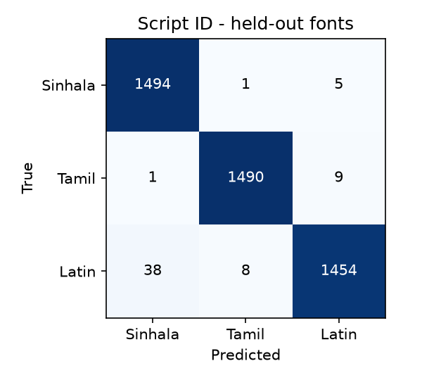

# Script identification (Sinhala / Tamil / Latin) - evaluation report

Trained 2026-10-02T02:32:29+00:00 on cuda (32404.7 s wall-clock for the shipped seed, includes the machine sleeping overnight; ~10 min of actual GPU time per seed); 462,755 parameters.

Test lines use **fonts never seen in training** and **address text from the held-out corpus split**.

* Test accuracy of the shipped model: **0.9862** (best validation accuracy 0.9553, validation uses its own held-out fonts)
* Across 3 training seeds: test accuracy 0.9753 ± 0.0136 (SD); handwriting-style lines 0.8751 ± 0.0792. The shipped model is seed 6, chosen on validation only.
* Temperature (fitted on validation): 0.5468
* Expected calibration error on test: 0.0667 raw -> 0.0115 after temperature scaling
* ONNX export: max |logit difference| vs PyTorch = 3.34e-06; 6.84 ms per line on CPU

| Class | Precision | Recall | F1 | Support |
|---|---|---|---|---|
| si | 0.9746 | 0.9960 | 0.9852 | 1500 |
| ta | 0.9940 | 0.9933 | 0.9937 | 1500 |
| en | 0.9905 | 0.9693 | 0.9798 | 1500 |

Confusion matrix (rows = true, columns = predicted; order si, ta, en):

    [1494, 1, 5]
    [1, 1490, 9]
    [38, 8, 1454]

| Held-out font | n | Accuracy |
|---|---|---|
| IndieFlower-Regular | 734 | 0.9414 |
| Merriweather | 766 | 0.9961 |
| Nirmala | 1228 | 0.9976 |
| Pavanam-Regular | 509 | 0.9902 |
| TiroTamil-Regular | 493 | 0.9919 |
| Yaldevi | 770 | 0.9948 |

| Style | n | Accuracy |
|---|---|---|
| printed | 3766 | 0.9950 |
| handwriting | 734 | 0.9414 |

## Limitations

* Rendered lines, not photographs: real envelopes add camera blur, perspective and real handwriting.
  No public Sinhala handwriting font was available, so Sinhala handwriting is not represented; measure it
  on the consented envelope set (proposal section 3.3) before claiming handwriting performance.
* The classifier only chooses the Tesseract language pack; the officer still reviews every field.
